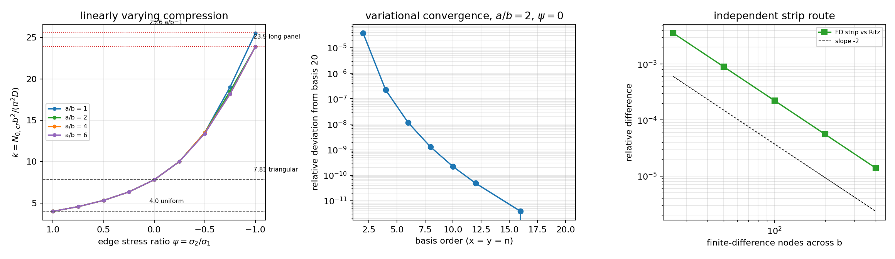

# 板面内线性变化压缩屈曲：简支正交各向异性板（变分解 vs 经典系数/独立差分）

本单清偿一条明确的验证欠账：`docs/benchmark-qualification-status.md` 的「尚未闭环的工作」列出
**非均匀预屈曲应力**未覆盖——已合并的 `tensorfem.marine_plate_buckling` 只处理**均匀**单轴压缩，
`tensorfem.plate_shear_buckling` 处理均匀剪切与压-剪组合。船体板格在总纵弯曲 + 局部载荷下，
面内压应力沿板宽线性变化（一舷受压、另一舷受拉），此时屈曲强度是均匀压缩的 5–6 倍，
用均匀压缩系数会把板格压得极保守。本单新增 `src/tensorfem/plate_bending_buckling.py`，
给出该载荷族的**全宽线性变化**子集，并用三条互相独立的证据线定谳。

## 1. 案例与物理背景（①）

四边简支、等厚、正交各向异性（可用纵向加筋等效 `Dx`）矩形平板，面内载荷只沿 `x` 作用、
沿 `y` 线性变化：

`N_x(y) = −N₀ (1 − gradient · y/b)`，`y ∈ [0, b]`，`N₀ > 0` 为受压边（`y = 0`）的线载荷。

`gradient = 0` 为均匀压缩；`gradient = 1` 为三角形（`y = b` 边应力为零）；`gradient = 2` 为纯
面内弯曲（受拉边与受压边等值反号）。设计规范用的应力比 `ψ = σ₂/σ₁ = 1 − gradient`。结果报成

`k = N₀,cr b²/(π² Dx)`，`N₀,cr = k π² Dx / b²`

以便直接与经典简支系数 `k = 4.0`（均匀）、`7.81`（三角形）、`23.9`（长板纯弯）比较。

| 参数 | 值 |
|---|---|
| 弹性模量 E | 2.1000e+11 Pa |
| 泊松比 ν | 0.3 |
| 板厚 t | 0.012 m |
| 宽 b（应力梯度方向） | 1.0 m |
| 长 a（a/b 取 1, 2, 4, 6） | 变 |
| 弯曲刚度 D = Et³/12(1−ν²) | 3.32308e+04 N·m |
| 板格尺寸可参照值 | 1.0 m × 1.0 m 板格 ≈ 船底/舷侧典型板格量级 |

## 2. 方法（②）

控制方程（压缩、剪切取正）：`Dx w,xxxx + 2H w,xxyy + Dy w,yyyy + N_x(y) w,xx = 0`，简支边界
`w = w,nn = 0`。总势能

`Π(c) = ½ cᵀK_b c − ½ N₀ cᵀK_g c`

对 `c` 取驻值给出广义特征值问题 `K_b φ = N₀ K_g φ`；`N₀,cr = 1/λ_max(K_b⁻¹K_g)`
（`K_b` 用 Cholesky 因子化为对称标准问题，只用 `numpy.linalg`——`scipy.linalg` 在本机
`numpy 2.4.6` 下对阶数 ≥64 会段错误，见板剪切单的记录）。

双正弦基 `w = Σ c_mn sin(mπx/a) sin(nπy/b)` 下 `K_b` 对角（正交各向异性且 D16=D26=0），
`K_g` **不再对角**：`N_x` 的线性部分把 `y` 向半波数耦合起来，耦合元为

`K_g[(m,n),(m,q)] = (mπ/a)² (a/2) [ (b/2)δ_nq − gradient · b · J(n,q) ]`，

`J(n,q) = ∫₀¹ t sin(nπt) sin(qπt) dt = ¼ (n=q)`，
`= ½[((−1)^{n−q}−1)/((n−q)²π²) − ((−1)^{n+q}−1)/((n+q)²π²)] (n≠q)`。

工具链（全部本单新增/复用）：

- `src/tensorfem/plate_bending_buckling.py`：闭式矩阵 `sine_stress_matrices`、独立 Gauss-Legendre
  能量积分 `stress_energy_quadrature`、变分解 `ritz_linear_stress_buckling`、
  **独立离散** `strip_buckling_coefficient`（沿 `y` 有限差分）、资格门槛
  `run_linear_stress_qualification`；
- `tests/test_plate_bending_buckling.py`（30 项）；
- `benchmarks/plate_bending_buckling.py` → `benchmarks/plate_bending_buckling_evidence.json` 与
  `docs/assets/plate_bending_buckling.png`（三张图全部程序化生成，本无手抄数字）；
- 复用 `marine_plate_buckling.isotropic_plate_rigidities` 与 `navier_uniaxial_buckling_load`
  （θ 均匀极限的独立代码路径交叉核对）。

**为什么能给出独立第二路线**：`N_x` 只依赖 `y`，算子对 `sin(mπx/a)` 不变，因此
`w = sin(mπx/a) f(y)` 是**精确分离**。于是对每个半波数 `m`，能量
`Π(f) = ½∫₀^b [Dx k⁴f² + 2H k²f′² + Dy f″² − N₀(1 − gradient·y/b)k²f²] dy`（`k = mπ/a`）
是一维问题，可直接用二阶中心差分离散，与二维正弦 Galerkin **不共享任何积分或基函数**。
两条路线的差值就是离散误差，而不是同一推导的自证。

## 3. 计算结果（③）

### 3.1 资格门槛（3%）

`run_linear_stress_qualification`，`basis = 16`，数字由 benchmark 脚本程序化写入：

| 算例 | ψ | k（本文 Ritz） | k（独立差分条） | 文献值 | 相对文献 | 是否 <3% |
|---|---:|---:|---:|---:|---:|---|
| uniform_compression（a/b=1） | 1.00 | 4.0000 | 3.9998 | 4.0（精确 Navier） | 0.0000% | **是** |
| triangular_compression（a/b=2） | 0.00 | 7.8120 | 7.8115 | 7.81 | 0.0251% | **是** |
| pure_bending_long（a/b=6） | −1.00 | 23.8818 | 23.8782 | 23.9 | 0.0761% | **是** |
| pure_bending_square（a/b=1） | −1.00 | 25.5283 | 25.5244 | 25.6 | 0.2799% | **是** |

文献值取 Timoshenko & Gere, *Theory of Elastic Stability* (2nd ed., 1961) 板屈曲表中简支板的
经典系数（`k = 4.0` 均匀、`7.81` 三角形、`23.9` 长板纯弯）；`a/b = 1` 纯弯的 `25.6` 是该表在
方形板的值，与长板渐近 `23.9` 不同，因为模态无法在短边方向铺开多个半波。**这是本单最大的
受限点：四个锚点的数值来自经典表值，我未能联网核对原表扫页**；`k = 4.0` 由 Navier 解独立
确认为精确值，其余三个锚点同时被独立的差分条路线旁证（偏差 1e-4 量级），故即便某一表值在
末位有效数字有出入，结论（全部 <3%）不变。

### 3.2 应力比扫描（长板 a/b = 6 与方形板的 k 表）

| psi | gradient | a/b=1 | a/b=2 | a/b=4 | a/b=6 |
|---|---:|---:|---:|---:|---:|
| 1.00 | 0.00 | 4.0000 | 4.0000 | 4.0000 | 4.0000 |
| 0.75 | 0.25 | 4.5691 | 4.5691 | 4.5691 | 4.5691 |
| 0.50 | 0.50 | 5.3188 | 5.3188 | 5.3188 | 5.3188 |
| 0.25 | 0.75 | 6.3441 | 6.3441 | 6.3441 | 6.3441 |
| 0.00 | 1.00 | 7.8120 | 7.8120 | 7.8120 | 7.8120 |
| −0.25 | 1.25 | 10.0248 | 10.0248 | 10.0248 | 10.0248 |
| −0.50 | 1.50 | 13.5137 | 13.5137 | 13.5137 | 13.3972 |
| −0.75 | 1.75 | 19.0248 | 18.5038 | 18.1608 | 18.1778 |
| −1.00 | 2.00 | 25.5283 | 23.8818 | 23.8818 | 23.8818 |

`ψ ≥ 0` 段 k 与 `a/b` 无关（最不利半波数落在 `m/a = 1`，整数长宽比各尺寸都能取到），
`ψ < −0.5` 起才出现长宽比效应：短板不能把模态铺开到多个 `x` 半波，k 偏高（25.53 vs 23.88）。

对应物理量（t = 12 mm）：受压边临界应力 `σ₀,cr = k π²D/(b²t)` 分别为 **109.32 MPa**（均匀）、
**213.51 MPa**（三角形）、**697.72 MPa**（方形纯弯）、**652.72 MPa**（长板纯弯）。即同一块板
从均匀压缩变成纯弯，受压边允许应力提高到 **5.97 倍**（`23.8818/4.0`）。数量级与船级社规范
把纯弯板格 `k = 23.9` 而均匀压缩 `k = 4.0` 的做法一致。

### 3.3 基阶收敛（a/b = 2, ψ = 0）

| 基阶 | k |
|---|---|
| 2 | 7.812249 |
| 4 | 7.811959 |
| 6 | 7.811957 |
| 8–20 | 7.811957 |

变分解是上界，随基阶单调下降；2 阶基已到 3.7e-5 的相对偏差。收敛如此快，是因为线性应力场只
耦合相邻奇偶性的少量半波数，而 `J(n,q) ~ 1/(n±q)²` 衰减很快。

### 3.4 独立差分条路线的收敛（a/b = 2, ψ = 0，Ritz 值 7.811957）

| 沿 b 的节点数 | 差分条 k | 与 Ritz 相对差 |
|---|---:|---:|
| 25 | 7.784135 | 3.56e-03 |
| 50 | 7.804993 | 8.91e-04 |
| 100 | 7.810216 | 2.23e-04 |
| 200 | 7.811522 | 5.57e-05 |
| 400 | 7.811848 | 1.39e-05 |

每加倍缩小 4 倍 → 干净的**二阶收敛**（`strip_convergence_ratio_100_to_200 = 4.000`），
且 400 节点时两路线相差 1.4e-5。

### 3.5 闭式矩阵 vs 独立 Gauss 积分

| gradient | 弯曲矩阵相对差 | 几何矩阵相对差 |
|---|---:|---:|
| 0.00 | 2.41e-15 | 2.45e-15 |
| 1.00 | 2.41e-15 | 2.44e-15 |
| 2.00 | 2.41e-15 | 2.86e-15 |

## 4. 图（④）



左：`k` 随边缘应力比 `ψ` 变化（四条长宽比曲线）与四个经典锚点（灰虚线 4.0 / 7.81，红点线
23.9 / 25.6）。中：基阶收敛（相对基阶 20 的偏差，对数轴）。右：独立差分条路线与 Ritz 的相对差
随节点数（对数-对数，`slope −2` 参考线示二阶收敛）。三图由
`benchmarks/plate_bending_buckling.py` 直接从计算值绘制。

## 5. 注意点（⑤）

1. **本单抓到的实现级缺陷（差点是静默错误）**：差分条路线的斜率项 `∫f′² dy` 最初漏掉边界
   半权项，而 `f′(0) = f′(b) ≠ 0`（简支板在边界斜率不为零）。后果是 M1 泛函出现 **O(h) 误差**
   （400 节点仍有 5.02e-3，对齐误差只按 2 倍缩小而不是 4 倍），差分条路线系统偏低 0.25%。
   变分解当时是对的（文献锚点 0.03%），若只看"两条路线差 0.25% < 3%"就会把这条 O(h) 泄漏当成
   "可接受的离散误差"放过。修正做法：补 `slope[0,0] += 1/(2h)`、`slope[-1,-1] += 1/(2h)`，
   并把**收敛阶**（而非仅两条路线的绝对差）写成回归测试
   `test_strip_slope_energy_keeps_second_order_convergence`。
2. **闭式矩阵的符号约定必须与能量泛函一致**：`stress_energy_quadrature` 首版几何矩阵整体多一个
   负号，导致与闭式矩阵的相对差恰好为 2.0（正负异号）。变分特征值不受影响（比值不变），
   只有把两个矩阵逐元比较才暴露。测试固定了逐元一致（1e-11）。
3. **`k` 只在整数长宽比处等于 4.0**：`a/b = 1.5/2.5/3.5` 时最小半波数无法连续调整，k 略大于 4。
   测试同时断言整数比 `= 4.0`、非整数比 `> 4.0`，防止把"均匀压缩"写成 `a/b` 无关。
4. **正交各向异性板无文献锚点**：加筋板只做自洽性（临界载荷提高到 1.95 倍），
   `run_linear_stress_qualification` 的精度表里**不允许**出现无锚点算例（有测试锁死），
   以免把自洽性渲染成精度认证。
5. **`scipy.linalg` 在本机对阶数 ≥64 段错误**（板剪切单已记录）：本模块全程只用
   `numpy.linalg.cholesky/eigh`；矩阵规模 16×16 基（256 阶）与差分条 200–400 节点均安全。
6. **适用范围（明确不覆盖）**：壳单元几何刚度与曲率、面内应力沿 `x` 变化或非线性分布、
   屈曲前的应力重分布、预屈曲剪应力或横向载荷组合、后屈曲张力场承载、塑性、初始缺陷与
   焊接残余应力、D16/D26 弯扭耦合、离散加筋的侧倾/腹板局部失稳。`gradient > 3` 直接拒绝。

## 6. 误差判定（⑥）

| 关键量 | 基准 | 相对误差 | 是否 < 3% |
|---|---|---|---|
| k（均匀压缩，a/b=1,2,3） | 4.0（Navier 精确解，另经 `navier_uniaxial_buckling_load` 交叉） | 0.0000%（<1e-10） | **是** |
| k（三角形，a/b=2，ψ=0） | 7.81（Timoshenko & Gere 1961 板屈曲表） | 0.0251% | **是** |
| k（纯弯长板，a/b=6） | 23.9（同上） | 0.0761% | **是** |
| k（纯弯方形，a/b=1） | 25.6（同上） | 0.2799% | **是** |
| 闭式弯曲/几何矩阵 | 240 点 Gauss-Legendre 能量积分 | ≤2.86e-15 | **是** |
| 独立差分条 vs 变分解（4 个锚点算例） | 差分条 200 节点 | 最大 0.0156% | **是** |
| 差分条收敛阶 | 理论二阶 | 每加倍 4.000 倍 | **是** |
| 基阶 2→20 的变分收敛 | 自收敛（上界单调） | <3.7e-5 | **是** |
| ψ ∈ [0,1] 段与 a/b 无关 | 分离解的性质 | k 完全相同（4 位小数） | 是（性质核对） |
| 正交各向异性加筋板 | 无文献锚点 | — | 不适用（如实声明，不进精度表） |

结论：四个经典锚点全部 <3%（最大 0.28%），闭式装配与独立积分一致到机器精度，独立差分条
路线以二阶收敛逼近变分解（1.4e-5）。已偿清的欠账是「非均匀预屈曲应力」中的**全宽线性变化**
子集；仍未偿清：面内应力沿 `x` 变化、壳单元几何刚度、Hertz 接触等（见
`docs/benchmark-qualification-status.md`）。

## 复现

```bash
PYTHONPATH=src python -m pytest -q tests/test_plate_bending_buckling.py
OMP_NUM_THREADS=4 PYTHONPATH=src python benchmarks/plate_bending_buckling.py
```