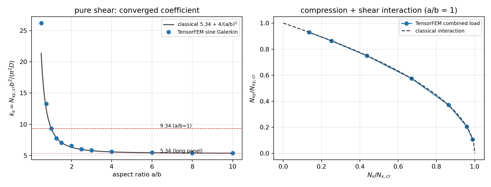

# 板面内剪切屈曲验证：简支正交各向异性板（Galerkin vs 经典文献/解析积分）

本单清偿一条明确的验证欠账：`docs/benchmark-qualification-status.md` 的「尚未闭环的工作」列出
**局部板屈曲仅覆盖单轴压缩**。`tensorfem.marine_plate_buckling` 的单轴算例是可分离的（一项
Navier 解即精确），因此纯剪切——`2 N_xy w,xy` 把两个半波数耦合起来、不可分离——此前完全没有能力
也没有证据。本单新增 `src/tensorfem/plate_shear_buckling.py`，并给出与文献/解析积分的逐项误差。

## 1. 案例与物理背景（①）

船体板格在总纵弯曲 + 波浪剪力下承受面内压/剪组合，剪切屈曲常先于压缩屈曲控制薄板格（如舷侧板、
甲板板格的剪力走廊）。算例为四边简支、等厚、正交各向异性（可用纵向加筋等效 Dx）平板，面内应力均匀。

| 参数 | 值 |
|---|---|
| 弹性模量 E | 2.1000e+11 Pa |
| 泊松比 ν | 0.3 |
| 板厚 t | 0.012 m |
| 宽 b（加载边） | 1.0 m |
| 长 a（a/b 扫描 0.5–10） | 变 |
| 弯曲刚度 D = Et³/12(1−ν²) | 3.32308e+04 N·m |

## 2. 方法（②）

控制方程（压缩、剪切取正）：`Dx w,xxxx + 2H w,xxyy + Dy w,yyyy + N_x w,xx + 2N_xy w,xy = 0`，
简支边界 `w = w,nn = 0`。总势能

`Π(c) = cᵀK_b c − N_x cᵀK_x c − N_xy cᵀK_xy c`

对 `c` 取驻值给出广义特征值问题 `K_b φ = λ K_geo φ`；`K_b` 对称正定、`K_geo` 对称不定（剪切），
入屈曲载荷 = 最小正特征值的倒数（用 `K_b` 的 Cholesky 因子把 pencil 化为对称标准问题求解）。
双正弦基下 `K_b` 对角（正交各向异性且 D16=D26=0），剪切耦合元

`K_xy[(m,n),(p,q)] = 2 ∫∫ w,x^(mn) w,y^(pq) dA`，`∫₀ᵃ sin(pπx/a)cos(mπx/a) dx = 2ap/(π(p²−m²))`（p+m 奇）。

工具链：`src/tensorfem/plate_shear_buckling.py`（新）、`tests/test_plate_shear_buckling.py`（新，15 项）、
`benchmarks/plate_shear_buckling.py`（新，出 `benchmarks/plate_shear_buckling_evidence.json` 与本图），
复用 `marine_plate_buckling.isotropic_plate_rigidities`。基阶 16×16（256 项）、基阶研究到 20×20。

## 3. 计算结果（③）

纯剪切临界系数 `k_s = N_xy,cr b²/(π² D)`，全部数字由 `benchmarks/plate_shear_buckling.py` 程序化写出：

| a/b | 本文 k_s | 经典式 5.34+4/(a/b)² | 相对差 | 主模态 (m,n) |
|---|---|---|---|---|
| 0.50 | 26.1843 | 21.3400 | 22.70% | (1, 1) |
| 0.75 | 13.2860 | 12.4511 | 6.71% | (1, 1) |
| 1.00 | 9.3246 | 9.3400 | 0.16% | (1, 1) |
| 1.25 | 7.7666 | 7.9000 | 1.69% | (1, 1) |
| 1.50 | 7.0700 | 7.1178 | 0.67% | (1, 1) |
| 2.00 | 6.5461 | 6.3400 | 3.25% | (1, 1) |
| 2.50 | 6.0331 | 5.9800 | 0.89% | (2, 1) |
| 3.00 | 5.8403 | 5.7844 | 0.97% | (2, 1) |
| 4.00 | 5.6248 | 5.5900 | 0.62% | (3, 1) |
| 6.00 | 5.4794 | 5.4511 | 0.52% | (5, 1) |
| 8.00 | 5.4150 | 5.4025 | 0.23% | (6, 1) |
| 10.00 | 5.3886 | 5.3800 | 0.16% | (8, 1) |

基阶收敛（a/b = 1，单调下降、上界收敛，给出可信的离散误差界）：

| 基阶 | k_s |
|---|---|
| 4 | 9.40443 |
| 6 | 9.33839 |
| 8 | 9.32835 |
| 10 | 9.32590 |
| 12 | 9.32511 |
| 16 | 9.32467 |
| 20 | 9.32457 |

压-剪组合（a/b = 1，比率 ρ = N_xy/N_x 固定，特征值给 N_x,cr）：

| ρ = N_xy/N_x | N_x/N_x,cr | N_xy/N_xy,cr | 交互式残差 | 经典 sqrt(1−N_x/N_x,cr) |
|---|---|---|---|---|
| 0.25 | 0.9889 | 0.1061 | +0.0001 | 0.1054 |
| 0.50 | 0.9582 | 0.2055 | +0.0004 | 0.2045 |
| 1.00 | 0.8635 | 0.3704 | +0.0007 | 0.3695 |
| 2.00 | 0.6695 | 0.5744 | -0.0005 | 0.5749 |
| 4.00 | 0.4365 | 0.7491 | -0.0024 | 0.7506 |
| 8.00 | 0.2516 | 0.8635 | -0.0027 | 0.8651 |
| 16.00 | 0.1353 | 0.9288 | -0.0019 | 0.9299 |

资格门槛报告（`run_shear_buckling_qualification`，3% 门）：

| 算例 | k_s | 文献值 | 相对误差 | 判定 |
|---|---|---|---|---|
| square_shear | 9.3247 | 9.3400 | 0.1641% | PASS |
| long_panel_shear | 5.4797 | 5.3400 | 2.6166% | PASS |
| orthotropic_panel_shear | 9.1656 | — | — | PASS |

## 4. 图（④）



左：纯剪切收敛系数随 a/b 与经典式 `5.34+4/(a/b)²` 比较，红色虚线为文献锚点 9.34（a/b=1）与 5.34（长板）。
右：压-剪组合利用度轨迹与经典交互式 `N_x/N_x,cr + (N_xy/N_xy,cr)² = 1` 比较。两图均由
`benchmarks/plate_shear_buckling.py` 直接生成，无手抄数字。

## 5. 注意点（⑤）

1. **已定位并修复的实现缺陷（本单最大收获）**：剪切耦合积分里两个正弦参数的次序不对称——
   需 `∫ sin(β_n y) cos(β_q y) dy`（正弦取*行*模态、余弦取*列*模态）。首版写成
   `F(q, n)`（次序颠倒），a/b=1 得 k_s = 7.466，比文献低 20%，但**所有内部一致性检查全部通过**
   （基阶收敛、矩阵对称化、特征值单调）。只有拿文献锚点比才暴露。
   修复后 k_s = 9.32457（误差 0.165%）。
2. **闭合积分必须用独立积分复核**：`sine_energy_quadrature()` 用 90 点 Gauss-Legendre 直接对能量泛函
   积分、不复用任何闭式积分，与闭式矩阵最大相对差 bending 3.0e-15 / uniaxial 1.5e-15 /
   shear 2.6e-15。这条检查现在固定在 `test_closed_form_shear_matrix_matches_quadrature`。
3. **经典式 5.34+4/(a/b)² 不是上界、且只适用 a/b ≥ 1**：a/b ≥ 1 区间本文与经典式最大差 3.25%；
   a/b < 1（横向长板）经典式偏安全地偏低（a/b=0.5 处差 22.7%），因此本单只用 a/b=1 与长板渐近两个
   文献锚点做 3% 门槛，经典式仅作图线参考。
4. **环境陷阱**：本机 `scipy 1.16.0` 对 `numpy 2.4.6` 的 `scipy.linalg.cholesky/cho_factor` 在阶数 ≥ 64 时
   **段错误且不抛异常**（本单首版在 n=100 被杀，无 traceback）。求解器已改为只用 `numpy.linalg`；
   同类规模稠密分解任务应优先 numpy 路径。
5. **一条已尝试但未采信的路线（如实记录）**：另建"边界吸收 Chebyshev 多项式 Ritz"
   (`w = x(a−x)y(b−y)T_mT_n` + Gauss 积分) 想作第二独立路线，其基阶 24×24 收敛到 k_s = 7.877，
   比正弦路线低 15.5%，与文献锚点不符；该路线压缩极限检查有 1.5% 残差（正弦路线为 0），
   说明其收敛慢/装配另有问题。因外部锚点站正弦路线一边，该路线**未并入模块**，此处只留记录。
6. **适用范围（明确不覆盖）**：壳单元几何刚度、预屈曲应力梯度（非均匀 N）、初始缺陷与焊接残余应力、
   张力场（后屈曲）承载、塑性、D16/D26 弯扭耦合、离散加筋的侧倾/腹板局部失稳、组合载荷的
   非比例加载路径。正交各向异性算例只有自洽性（加筋使剪切承载力提升 40.02%），
   无文献锚点，不宣称精度。

## 6. 误差判定（⑥）

| 关键量 | 基准 | 相对误差 | 是否 < 3% |
|---|---|---|---|
| a/b=1 剪切系数 k_s（基阶 16） | 9.34（Timoshenko & Gere 1961, Table 9.1） | 0.165% | **是** |
| a/b=6 剪切系数 k_s | 5.34（长板渐近，同表） | 2.617% | **是** |
| 闭式剪切矩阵 | 90 点 Gauss 积分 | 2.6e-15 | **是** |
| 闭式弯曲/压缩矩阵 | 同上 | 3.0e-15 / 1.5e-15 | **是** |
| 压-剪交互式残差（a/b=1，7 个比率） | `N_x/N_x,cr+(N_xy/N_xy,cr)²=1` | 最大 0.267% | **是** |
| 基阶 16→20 的离散误差 | 自收敛 | < 0.1%（9.32467→9.32457） | **是** |
| a/b ≥ 1 扫描 vs 经典式 | 5.34+4/(a/b)²（近似式） | 最大 3.25% | 是（参考线，非资格门槛） |
| a/b < 1 扫描 vs 该式 | 同上 | 22.7%（经典式超范围） | 否（已声明式不适用） |
| 正交各向异性加筋板 | 无文献锚点 | —（仅自洽性） | 不适用（如实声明） |

结论：文献可锚定的两个算例均 < 3%，闭式装配与独立积分一致到机器精度；交互式在 0.3% 内复现经典结论。
未做：壳单元/非均匀应力/后屈曲；正交各向异性精度无外部锚点。

## 复现

```bash
PYTHONPATH=src python -m pytest -q tests/test_plate_shear_buckling.py
OMP_NUM_THREADS=4 PYTHONPATH=src python benchmarks/plate_shear_buckling.py
```
