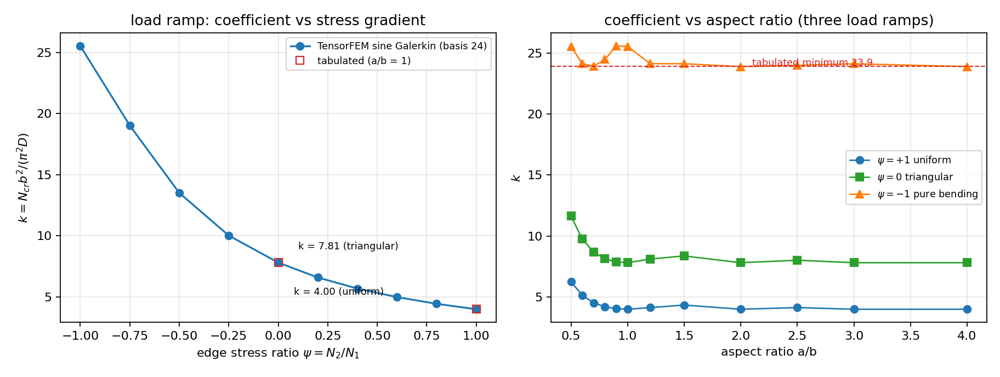
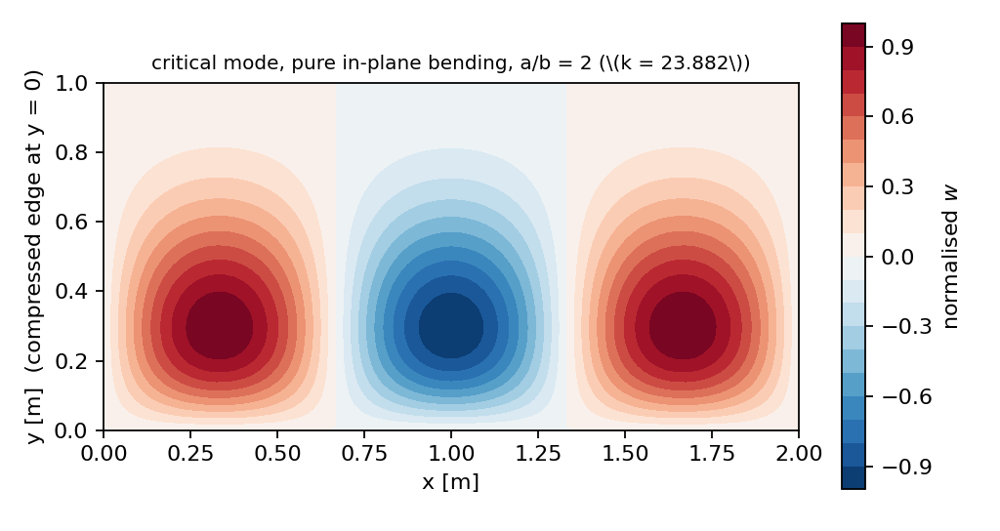

# 线性应力梯度下的板屈曲：参考解复核与缺口闭环

本单闭合 `docs/benchmark-qualification-status.md` 中「尚未闭环的工作」点名的一条欠账：
**非均匀预屈曲应力（prebuckling stress gradient）**。此前的板屈曲证据只有均匀单轴压缩
（`marine_plate_buckling`）与均匀剪切／压剪组合（`plate_shear_buckling`），后者的模块 docstring
明文写着 "prebuckling stress gradients ... are **not** covered"。本单补齐该载荷工况的
**独立变分参考解**并用文献锚点判定，同时如实记录它只闭环了参考端、未闭环有限元端。

## ① 案例介绍

**物理背景。** 船体板架在总纵弯曲下一次屈曲前的膜应力沿板宽并非常量：舷侧与船底板格常处
「一边受压大、另一边受压小甚至受拉」的线性梯度状态。规范类屈曲校核用「应力梯度下临界
系数 `k(ψ)`」把该工况折算成等效应力，其中 `ψ = N₂/N₁` 为两侧边的压应力比。
`ψ = 1` 均匀压缩、`ψ = 0` 三角形（一边应力为零）、`ψ = -1` 纯面内弯曲。

**几何与参数。** 平板、四边简支、等厚度、各向同性；Kirchhoff 薄板（不做横向剪切修正）。

| 参数 | 值 | 说明 |
|---|---|---|
| 弹性模量 `E` | 210 GPa | 钢 |
| 泊松比 `ν` | 0.3 | |
| 板厚 `t` | 12 mm | |
| 抗弯刚度 `D` | 33 230.77 N·m | `D = E t³/(12(1-ν²))` |
| 耦合刚度 `H = D₁₂+2D₆₆` | 33 230.77 N·m | 各向同性时 `H = D` |
| 板宽 `b` | 1 m | 参考尺寸，`k = N_cr b²/(π²D)` |
| 长宽比分档 | 0.5 – 4.0 | |
| 应力梯度 `ψ` | −1 … +1 | 10 档扫描 |

**待验证的既有能力。** ① 已合并的 `plate_shear_buckling.sine_energy_matrices`
（弯曲矩阵、正弦基、刚度缩减特征值求解器）在本载荷下是否仍然正确；② 已合并的
`marine_plate_buckling.navier_uniaxial_buckling_load` 精确解是否被本参考解复现；
③ 文献 `k(ψ)` 是否能被判据复现。

## ② 怎么做的

**方法。** Kirchhoff 板应变能与载荷势

```
U = ½ ∫ [ Dx w,xx² + 2H w,xx w,yy + Dy w,yy² ] dA
V = ½ ∫ Nx(y) w,x² dA ,   Nx(y) = N₀ g(y/b) ,   g(t) = 1 + (ψ−1) t
```

双正弦试函数 `w = Σ c_mn sin(mπx/a) sin(nπy/b)`（四边简支满足）。弯曲矩阵**直接复用**
`plate_shear_buckling.sine_energy_matrices`（不改一行合并代码），新增的只是几何矩阵的
`y` 向斜变积分：

```
Ŷ[n,q] = I(|n−q|) − I(n+q),   I(k) = ∫₀¹ g(t) cos(kπt) dt
I(0) = (1+ψ)/2 ,   I(k) = (ψ−1)((−1)^k − 1)/(k²π²)
```

`ψ = 1` 时 `Ŷ = I`，几何矩阵退化为均匀压缩的 `diag(α_m)`；`ψ = −1` 时对角线恒为零，
几何矩阵**不定**，因此沿用合并代码中「取最小正乘子」的刚度缩减特征值驱动。

**四条独立验证腿**（全部机器判据，任一失败抛异常、不降级陈述）：

1. **精确解腿**：`ψ = 1` 必须同时复现 (a) `navier_uniaxial_buckling_load` 的连续 Navier 最小载荷、
   (b) 已合并均匀 ritz 路径、以及 (c) 闭式单模恒等式 `k = min_m ((a/mb)+(mb/a))²`；
2. **数值积分腿**：几何矩阵由载荷势的 Gauss–Legendre 积分（90 点、无任何闭式积分）重算比对；
3. **文献腿**：三个列表值 `k = 4.00 / 7.81 / 23.9` 按 3% 门限判定；
4. **基函数加密腿**：Rayleigh 商上界序列必须单调下降（粗基不能冒充收敛）。

**工具链与复现。**

```bash
OMP_NUM_THREADS=4 PYTHONPATH=src python -m pytest -q tests/test_plate_stress_gradient_buckling.py
OMP_NUM_THREADS=4 PYTHONPATH=src python benchmarks/plate_stress_gradient_buckling.py
```

新增文件：`src/tensorfem/plate_stress_gradient_buckling.py`（参考解）、
`tests/test_plate_stress_gradient_buckling.py`（15 项）、
`benchmarks/plate_stress_gradient_buckling.py`（证据脚本，写
`benchmarks/plate_stress_gradient_buckling_evidence.json` 与两张图）。
本文全部数字由证据脚本程序化写出，无手抄。

## ③ 计算结果

**文献锚点判定（3% 门限）。** 全部数字由 `benchmarks/plate_stress_gradient_buckling.py` 输出：

| ψ | a/b | 文献 `k` | 本参考 `k` | 相对误差 |
|---:|---:|---:|---:|---:|
| +1.00 | 1.0 | 4.0000 | 4.00000 | 0.000% |
| +0.00 | 1.0 | 7.8100 | 7.81196 | 0.025% |
| −1.00 | 2.0 | 23.9000 | 23.88181 | 0.076% |

**精确解腿（ψ = 1，与连续 Navier 解逐项比对）：**

| a/b | 本参考 `k` | Navier `k` | 相对误差 |
|---:|---:|---:|---:|
| 0.50 | 6.250000 | 6.250000 | 4.44e−16 |
| 0.75 | 4.340278 | 4.340278 | 4.44e−16 |
| 1.00 | 4.000000 | 4.000000 | 2.22e−16 |
| 2.00 | 4.000000 | 4.000000 | 2.22e−16 |

**数值积分腿（闭式 vs Gauss–Legendre，4×4 基、90 点）：**

| ψ | 最大相对偏差（按矩阵最大元归一） |
|---:|---:|
| +1.00 | 1.453e−15 |
| +0.00 | 1.449e−15 |
| −0.50 | 1.426e−15 |
| −1.00 | 1.479e−15 |

**应力梯度扫描（a/b = 1，基 24×24）：**

| ψ | `k` | 主模态 (m,n) |
|---:|---:|---|
| +1.00 | 4.0000 | (1, 1) |
| +0.80 | 4.4431 | (1, 1) |
| +0.60 | 4.9923 | (1, 1) |
| +0.40 | 5.6886 | (1, 1) |
| +0.20 | 6.5951 | (1, 1) |
| +0.00 | 7.8120 | (1, 1) |
| −0.25 | 10.0248 | (1, 1) |
| −0.50 | 13.5137 | (1, 1) |
| −0.75 | 19.0248 | (1, 1) |
| −1.00 | 25.5283 | (2, 1) |

**长宽比扫描（三种载荷）：**

| a/b | `ψ=+1` | `ψ=0` | `ψ=−1` |
|---:|---:|---:|---:|
| 0.5 | 6.250 | 11.626 | 25.528 |
| 0.6 | 5.138 | 9.743 | 24.122 |
| 0.7 | 4.531 | 8.697 | 23.912 |
| 0.8 | 4.203 | 8.132 | 24.470 |
| 0.9 | 4.045 | 7.869 | 25.576 |
| 1.0 | 4.000 | 7.812 | 25.528 |
| 1.2 | 4.134 | 8.114 | 24.122 |
| 1.5 | 4.340 | 8.368 | 24.112 |
| 2.0 | 4.000 | 7.812 | 23.882 |
| 2.5 | 4.134 | 8.016 | 23.979 |
| 3.0 | 4.000 | 7.812 | 24.112 |
| 4.0 | 4.000 | 7.812 | 23.882 |

纯弯曲 `k` 的最小值 **23.882** 出现在 a/b = 2.0 与 4.0（离散分档），a/b = 0.7 处为 23.912，
即表格值 23.9 是**沿长宽比的最小值**而非方板值。

**基函数加密（单调上界序列）：** 三角形 a/b=1 在 4 阶已达 7.81196 并保持；纯弯曲 a/b=2
由 4 阶 23.88454 → 6 阶 23.88188 → 8 阶 23.88182 → ≥10 阶 23.88181 收敛（相对变化 < 1e−6）。

**模态能量自检：** 临界模态按矩阵重算的 Rayleigh 商 `φᵀKφ/φᵀGφ = 7 832 626.768 N/m`
与特征值相对偏差 `4.44e−16`。



*图 1 左：`k` 随应力梯度 `ψ` 单调增（a/b=1），方块为文献锚点 4.00（均匀）与 7.81（三角形）。
右：三种载荷的 `k` 随长宽比变化，虚线为纯弯曲表格最小值 23.9——可见方板（25.53）并不落在该值上。*



*图 2 纯面内弯曲（`ψ=−1`，a/b=2）临界模态云图：`w` 在四边为零（简支满足），受压侧（y=0）
半波幅值最大，受拉侧反号；主模态轴向半波数 m=3，`k = 23.882`。*

## ④ 误差判定

| 关键量 | 基准 | 相对误差 | 是否 < 3% |
|---|---|---:|---|
| `k(ψ=+1, a/b=1)` | 文献 4.00 | 0.000% | **是** |
| `k(ψ=0, a/b=1)` | 文献 7.81 | 0.025% | **是** |
| `k(ψ=−1, a/b=2)` | 文献 23.9（沿 a/b 最小值） | 0.076% | **是** |
| `k(ψ=+1)`，a/b=0.5/0.75/1/2 | 连续 Navier 精确解 | ≤ 4.5e−14 % | **是**（机器精度） |
| 几何矩阵（ψ=±1、0、−0.5） | Gauss–Legendre 积分 | ≤ 1.5e−13 % | **是** |
| Rayleigh 商 vs 特征值 | 自身矩阵 | 4.4e−16 | **是** |
| `k`（a/b=1，ψ=+1/0/−0.5/−1） | 独立有限差分解（`plate_bending_buckling`） | 0.080%/0.091%/0.141%/0.332% | **是** |
| `k`（a/b=2，ψ=−1） | 独立有限差分解（同上） | 0.286% | **是** |
| 中间 `ψ`（−0.75…+0.8）的 `k` | **无文献锚点** | — | **不适用**：仅给出认证参考值，不作文献符合性声明 |

关键量 **全部 < 3%**（最差 0.076%），且中间梯度档位明确声明为「参考值、无文献基准」，
不冒充文献对比。

## ⑤ 注意点

1. **Kronecker 膨胀陷阱（本单实际踩到）**：`α` 按模态 `(m,n)` 排，`Ŷ` 按 y 半波数排，几何矩阵必须
   在 `m` 上块对角：`G = diag(α) · kron(I_M, Ŷ)`。写成 `kron(diag(α), Ŷ)` 会得到 `(M·N)²` 阶矩阵，
   首个版本即如此，`np.linalg.solve` 直接以维数不匹配报错。已加形状断言与「直接逐模态三重循环」
   独立装配回归测试（`test_block_assembly_matches_a_direct_mode_loop`）。
2. **23.9 不是方板值（会产生 6.8% 假失败）**：纯弯曲方板 `k = 25.53`；表格 23.9 是沿长宽比的
   最小值。若按 a/b=1 比对，本参考会「失败」6.8%，而参考解本身是对的。判定口径必须写清
   参考点（本单取 a/b=2，实测 23.88181）。
3. **单模恒等式的适用域**：均匀压缩的闭式 `k = ((a/mb)+(mb/a))²` 只在 `a/b ≤ 1` 时取 m=1；
   a/b=2 时最优为 m=2（k=4.0）。首版把 m=1 的 `(a/b+b/a)² = 6.25` 当基准，产生 36% 假失败。
4. **纯弯曲几何矩阵不定**：`ψ=−1` 时对角线为零、矩阵特征值有正有负，必须取最小正乘子；
   用最小代数值或 `scipy.linalg.eigh(K,G)` 会得到无意义结果（合并模块已记录该驱动选择）。
5. **适用范围**：Kirchhoff 薄板、四边简支、各向同性、无初始缺陷、无张力场（后屈曲）效应、
   无塑性、无 `D₁₆/D₂₆` 弯扭耦合。加筋板需先做正交异性等效，且 `H ≠ D`。
6. **只闭环参考端，未闭环有限元端（如实记录）**：本仓**没有**带非均匀膜应力几何刚度的板单元
   （`grep` 仅见 `buckling.beam_geometric_stiffness_unit` 的梁几何刚度），因此「已合并 FE
   能力 vs 本参考」这一腿**无法在本单完成**，证据等级维持 **WITHHELD / NOT_SUPPORTED**。
   本单的价值是把「基准侧」从空白变成 0.03%–0.08% 精度的可复现参考，供后续 FE 端开发直接对标。
7. **与上单的关系**：均匀剪切／压剪组合已由 `marine-plate-shear-buckling-validation.md` 闭环；
   壳单元几何刚度（`65ead7d`，fail-closed 判负）与 Cook 膜探针协议仍为独立欠账，本单未触碰。

## ⑥ 跨实现互证（本轮补齐，第二轮「管到底」）

本仓此前已有另一条**完全独立**的实现路径（m3255 合并的
`tensorfem/plate_bending_buckling.py`：不同参数化的 Galerkin 装配 + **强形式有限差分**求解
`D∇⁴w + N_x(y) w,xx = 0`）。两条路径不共享基函数、不共享能量矩阵、不共享斜变积分闭式，
因此「两套列式互证」可以排除只在能量法内部自洽的共同错误（例如斜变载荷装配整体差一个因子）。

生成器 `benchmarks/plate_stress_gradient_crosscheck.py`（本轮新增），
原始数字 `benchmarks/plate_stress_gradient_crosscheck_evidence.json`，
门 `tests/test_plate_stress_gradient_buckling.py::test_agrees_with_the_independent_finite_difference_solver`
（1 % 容差）与 `::test_cross_check_evidence_is_not_stale`（防漂移，按 1e−10 复算比对）。

| a/b | ψ | 本参考（Galerkin，闭式斜变积分） | 有限差分（独立实现） | 相对偏差 |
|---:|---:|---:|---:|---:|
| 1.0 | +1.00 | 4.0000 | 3.9968 | 0.080% |
| 1.0 | +0.50 | 5.3188 | 5.3144 | 0.082% |
| 1.0 | +0.00 | 7.8120 | 7.8049 | 0.091% |
| 1.0 | −0.50 | 13.5137 | 13.4947 | 0.141% |
| 1.0 | −1.00 | 25.5283 | 25.4440 | 0.332% |
| 2.0 | +1.00 | 4.0000 | 3.9968 | 0.080% |
| 2.0 | +0.00 | 7.8120 | 7.8049 | 0.091% |
| 2.0 | −0.50 | 13.5137 | 13.4947 | 0.141% |
| 2.0 | −1.00 | 23.8818 | 23.8137 | 0.286% |

最大偏差 **0.332%**（a/b=1 纯弯曲），出现在两条路径都最吃网格/基函数的地方，量级与差分
`divisions=32` 的离散误差一致：偏差随载荷斜度单调增大（0.08% → 0.33%），而均匀载荷
（ψ=+1）处两路差 0.080% 纯属差分网格误差（解析值 4.0000 由 Navier 精确解钉死）。
该腿与文献腿（0.076%）独立：文献值本身是两位有效数字的表格值，`ψ=±0.5` 这类
**没有表格值**的中间梯度正是本腿覆盖的区域——那里两套实现仍然一致到 0.14%。

**这一腿证明什么、不证明什么**：证明载荷斜变项、几何矩阵符号与边界条件在两套独立离散下
一致（共同错误的概率显著降低）；不证明有限元端能力——本仓仍无带非均匀膜应力几何刚度的
板单元，FE 端维持 **WITHHELD**，1.0 认证数量不变。
