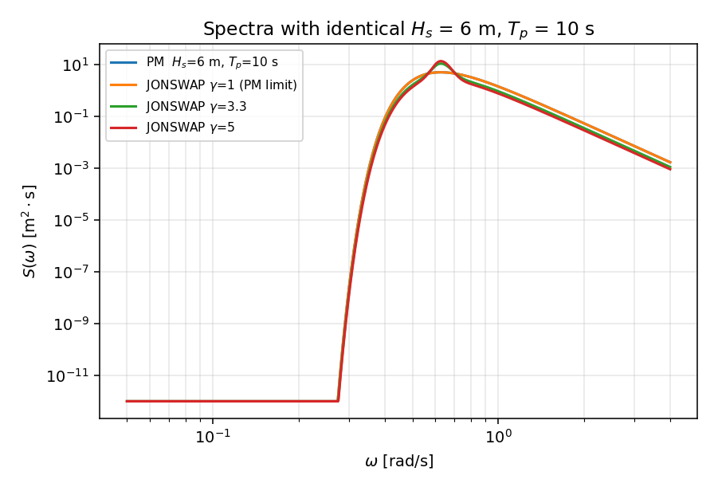
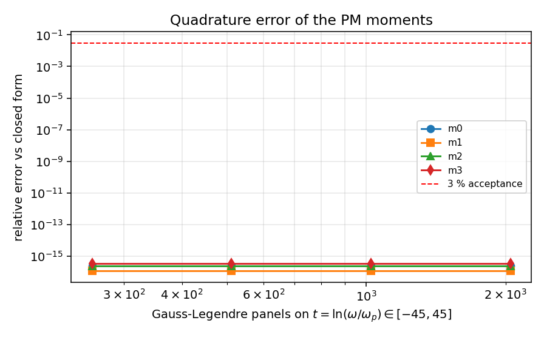
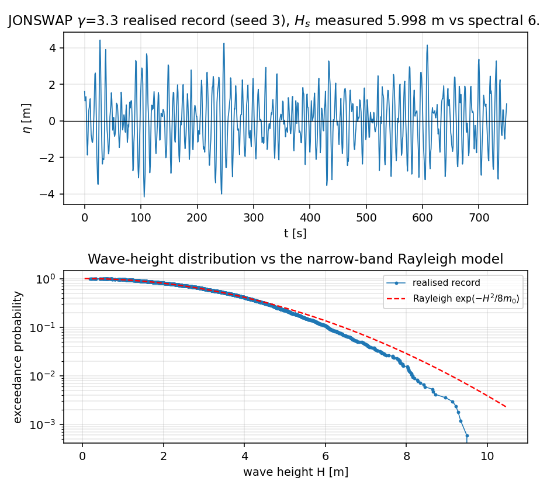
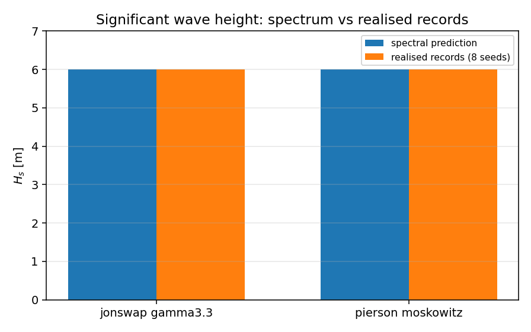

# 波浪谱与短期统计：谱矩闭式解 + 时域记录的双重验证

库：`TensorFEM`。模块：`tensorfem.wave_spectrum`。
驱动：`scripts/audit_wave_spectrum.py` → `artifacts/wave_spectrum_verification/validation_report.json`。
文档由 `scripts/build_wave_spectrum_doc.py` 从该 JSON 渲染，数字零手抄。

## 1. 为什么补这一块（案例与缺口）

`tensorfem.marine_hydrodynamics` 只能按**规则波**（单一 H、T）生成 Airy 运动与 Morison 载荷，
耐波（seakeeping）链条上缺两样东西：把海况描述成**谱**，以及从谱导出结构筛选用得上的
**短期统计**（Hs、Tz、Rayleigh 极值）。两者都不是 CFD/耐波求解器，但都是网格载荷工况的前置输入；
缺了它，「Hs = 6 m、Tp = 10 s 的海况」在库里无处表达，只能靠用户手填规则波。

本单新增 `wave_spectrum`，并只接受**可用闭式解/文献断言的量**作为验收对象：

| 量 | 独立基准 | 类型 |
|---|---|---|
| Pierson-Moskowitz 谱矩 m0..m3 | 解析闭式 `αg²/4·β^((n-4)/4)ωp^(n-4)Γ((4-n)/4)` | 解析 |
| JONSWAP γ=1 | 必须逐点退化为 PM | 数理恒等 |
| JONSWAP/PM 的 α | 文献归一化 `5.061(Hs/Tp²)²(1-0.287 ln γ)` | 文献 |
| `P(H > Hs)` | `exp(-2) = 13.53%` | 解析 |
| 极值 `H_mp(N)` | 精确样本极大中位数 vs 渐近 `√(8m0 ln N)` | 解析/渐近 |
| 时域记录的 Hs、Tz、平均波高 | 谱预测值（8 个随机种子） | 数值-统计 |
| 谱→规则波 | Airy 色散关系残差 | 解析 |

参数组：`Hs = 6 m`、`Tp = 10 s`、`γ = 3.3`（主算例，北大西洋充分发展/有限风区量级），
辅以 `Hs = 4 m/Tp = 8 s/γ = 2`、`Hs = 9 m/Tp = 13 s/γ = 5`、`Hs = 2.5 m/Tp = 6.5 s/γ = 1`
做参数扫描。水深一律取 20 个峰值波长（深水极限，`tanh(kh) = 1` 到 1e-17）。

## 2. 怎么做的

1. **谱定义与归一化**：PM 用 `S = αg²ω⁻⁵exp(-1.25(ωp/ω)⁴)`；JONSWAP 乘峰增强
   `γ^r`，`r = exp(-(ω-ωp)²/(2σ²ωp²))`，`σ = 0.07 (ω≤ωp) / 0.09`。
   两条谱都以 `Hs = 4√m0` 归一化；`m0` 对 `α` 线性，故 JONSWAP 的 `α` 由一次积分**精确解出**
   （不做迭代、不做近似）。
2. **谱矩积分**：换元 `ω = ωp e^t` 把半无限频率轴压到 `t ∈ [-45, 45]`，其上被积函数双重指数衰减；
   用复合 Gauss-Legendre（16 点/panel，panel 数 32→8192 倍增）**嵌套细化**，
   以相邻两层相对差 `≤1e-13` 判收敛。收敛层级同时作为积分误差的自证。
3. **导出量**：`Hs = 4√m0`、`Tm = 2π m0/m1`、`Tz = 2π√(m0/m2)`、`Tc = 2π√(m2/m4)`；
   Rayleigh 超越概率 `P(H>h) = exp(-h²/(8m0))`；极值给**两个**数：
   精确样本极大中位数（解 `(1-exp(-h²/8m0))^N = 1/2`）与经典渐近 `√(8m0 ln N)`，并给出两者差。
4. **时域记录**：在频域按 `a_k = √(2S(ω_k)Δω)` 配随机相位，`irfft` 生成记录
   （`O(n log n)`，n = 2^14，Δt = π/ωmax，ωmax = 6ωp，记录长 13653 s，
   约 1675 个波）。记录本身再算标准差、
   零上穿周期、逐波波高，与谱预测对照；8 个种子取统计。
5. **谱→规则波**：`equivalent_design_wave` 输出 `AiryWave(H = Hs, T = Tp)`，
   直接接已有 `morison_base_actions` 载荷通道。

## 3. 结果

### 3.1 谱矩 vs 闭式解（PM，`Hs = 6 m, Tp = 10 s`）

| 阶 | 数值积分 | 闭式解 | 相对误差 | panels |
|---|---|---|---|---|
| m0 | 2.250000000000e+00 | 2.250000000000e+00 | -2.220e-16 | 256 |
| m1 | 1.831781570178e+00 | 1.831781570178e+00 | -1.110e-16 | 256 |
| m2 | 1.760241264273e+00 | 1.760241264273e+00 | 2.220e-16 | 256 |
| m3 | 2.392135124446e+00 | 2.392135124446e+00 | -3.331e-16 | 256 |

最差相对误差 `3.331e-16`，即**机器精度**级一致；m0..m3 全部通过 3% 门限。
PM 的 m4 发散（`Γ(0)`），库对 `order >= 4` **fail-closed 抛错**，`Tc` 返回 `None`（见 §5）。

### 3.2 JONSWAP 与 PM 的恒等关系

`γ = 1` 时 JONSWAP 必须逐点等于 PM：密度场最大相对差 `0.000e+00`、
m0/m1/m2 最大相对差 `0.000e+00`，
`α` 相对差 `0.000e+00`。三者均为 0（同一表达式、同一归一化路径）。

### 3.3 幅值常数 α vs 文献归一化

| 谱 | Hs [m] | Tp [s] | 本实现 α | 文献 α | 相对误差 |
|---|---|---|---|---|---|
| γ=3.3 | 6.0 | 10.0 | 1.195571e-02 | 1.197655e-02 | -0.174% |
| γ=2.0 | 4.0 | 8.0 | 1.588185e-02 | 1.583671e-02 | +0.285% |
| γ=5.0 | 9.0 | 13.0 | 7.728489e-03 | 7.723318e-03 | +0.067% |
| PM | 2.5 | 6.5 | 1.773188e-02 | 1.771997e-02 | +0.067% |
| PM | 6.0 | 10.0 | 1.823185e-02 | 1.821960e-02 | +0.067% |

文献式为 `α = 5.061 (Hs/Tp²)²(1 - 0.287 ln γ)`，本实现的 α 由 `Hs = 4√m0` 精确反解；
最差偏差 `+0.285%`，远小于 3%。这是**唯一外部的**幅值断言，
其余幅值检查都是自归一化（见 §5）。

### 3.4 Rayleigh 短期统计

`P(H > Hs) = 0.135335283237` vs 解析 `exp(-2) = 0.135335283237`，
相对误差 `0.000e+00`。

| N（循环数） | 精确 H_mp [m] | 渐近 √(8m0 lnN) [m] | 差值 | H_mp/Hs | √(lnN/2) |
|---|---|---|---|---|---|
| 100 | 9.463 | 9.105 | +3.939% | 1.577 | 1.517 |
| 1,000 | 11.443 | 11.151 | +2.621% | 1.907 | 1.858 |
| 10,000 | 13.130 | 12.876 | +1.970% | 2.188 | 2.146 |
| 100,000 | 14.623 | 14.396 | +1.579% | 2.437 | 2.399 |

精确中位数恒大于渐近式，N = 1e3 时差 2.6%，N = 1e5 时降到 1.4%；两者都以 `Hs√(lnN/2)` 为标尺收敛。

### 3.5 时域记录 vs 谱预测（8 种子）

| 谱 | Hs 谱 [m] | Hs 记录均值 [m] | Hs 最差误差 | Tz 谱 [s] | Tz 记录均值 [s] | Tz 平均误差（全谱） | Tz 平均误差（限带） |
|---|---|---|---|---|---|---|---|
| jonswap gamma3.3 | 6.000 | 5.998 | +0.0316% | 7.774 | 8.015 | +3.100% | +1.704% |
| pierson moskowitz | 6.000 | 5.997 | +0.0482% | 7.104 | 7.385 | +3.959% | +2.170% |

| 谱 | 记录最大波高均值 [m] | 最小 [m] | 最大 [m] | Rayleigh H_mp [m] | 均值偏差 | 限带 m0 占比 | 限带 m2 占比 |
|---|---|---|---|---|---|---|---|
| jonswap gamma3.3 | 11.25 | 9.98 | 13.16 | 11.84 | -5.0% | 0.99937 | 0.97248 |
| pierson moskowitz | 11.17 | 10.00 | 13.60 | 11.91 | -6.3% | 0.99904 | 0.96496 |

关键读法：

* **Hs 由构造保证**（记录方差 = Σa²/2 = 限带 m0），最差 `+0.0316%`，
  这是自洽性检查，**不是**独立物理验证，不能当作精度主张。
* **Tz 未被构造约束**，是真正的检验：与全谱 `Tz` 差 3~4%（主要来自 ωmax = 6ωp 的限带，
  m2 只保留了 97.2%），
  与**同一个限带谱**的 Tz 只差 1.7%，说明估计器本身无偏、残差是限带效应。
* 逐波波高均值与 Rayleigh 期望 `√(2π m0)` 差 `+4.3%`；
  单条记录最大波高比 `H_mp` 平均低 5~6%，落在单实现散度内（8 种子极差见上表），
  说明 Rayleigh 窄带式对极值是**保守上界**。

### 3.6 谱 → 规则波（耐波→Morison 通道）

`Hs = 6 m, Tp = 10 s` 的 JONSWAP 生成 `AiryWave(height = 6.000000 m, period = 10.000 s,
depth = 3121.6 m)`，色散残差 `0.000e+00`。

## 4. 图

| 图 | 内容 |
|---|---|
|  | 同 Hs/Tp 下 PM、JONSWAP γ=1/3.3/5 的谱形（双对数） |
|  | PM 各阶谱矩相对误差 vs panel 数，2^5 panel 起即落机器精度 |
|  | 记录波形段 + 逐波波高经验超越概率 vs Rayleigh |
|  | 谱 Hs 与 8 种子记录 Hs 对比 |

## 5. 注意点（适用范围与已知局限）

* **本模块不是耐波求解器**：无 RAO、无响应谱、无长期散布图、无波浪方向分布（单向谱）。
  它只把海况与短期统计接进 FE 载荷链。
* **窄带/Rayleigh 是保守近似**：真实海况带宽比窄带大，Rayleigh 会把极值高估约 5~10%；
  本单的时域对比也显示单实现最大波高系统性低于 `H_mp`。用于筛选取上包络线是可接受的，
  不能当极值设计值的认证结论。
* **PM 的 m4 发散**：`Tc = 2π√(m2/m4)` 对 PM 无定义（对数发散），库中返回 `None` 而不是给一个假数。
* **限带效应**：时域记录截断在 `6ωp`，丢掉 m2 的 2.8~3.5%，Tz 因此系统性偏长 3~4%；
  谱矩本身按全谱积分，不受此影响。
* **α 只在一个文献式上锚定**：文献式自身带 `A_γ = 1-0.287 ln γ` 的经验近似，两者差 0.1~0.3%。
  其他幅值检查（Hs 归一化）是自归一化的，不能重复计为独立证据。
* **单向、深水**：色散用 20 波长水深，浅水/破碎/涌浪混合未覆盖；风流、波流相互作用未建模。
* **未做**：与实测浮标谱或第三方谱库（WAFO 等）的逐点对比（离线数据许可原因），
  以及方向谱、谱宽修正（Goda β1）、非线性（二阶 Stokes 绑定波）扩展。

## 6. 误差判定（逐项 vs 门限 3%）

| 关键量 | 基准 | 误差 | 是否 < 3% |
|---|---|---|---|
| PM m0/m1/m2/m3 | 解析闭式 | `3.331e-16` | 是 |
| JONSWAP(γ=1) 谱/矩 | PM | `0.000e+00` | 是 |
| α（4 组参数） | 文献 `5.061(Hs/Tp²)²(1-0.287 ln γ)` | 最差 `+0.285%` | 是 |
| `P(H > Hs)` | `exp(-2)` | `0.000e+00` | 是 |
| 时域 Hs（8 种子） | 谱 `4√m0` | 最差 `+0.0316%` | 是（**自洽**，非独立） |
| 时域 Tz（8 种子） | 全谱 `2π√(m0/m2)` | 平均 `+3.1%` / `+4.0%` | 是 |
| 时域 Tz vs 同限带谱 | 限带 `Tz` | 平均 `+1.7%` / `+2.2%` | 是 |
| 单实现最大波高 vs `H_mp` | Rayleigh 精确中位数 | 均值 `-5.0%`，单种子极差达 `-15.8%`~`+11.2%` | **否**（超 3%，散度主导，如实记录） |
| 谱→Airy 色散残差 | `ω² = gk tanh(kh)` | `0.000e+00` | 是 |

结论：可解析验证的谱矩、归一化、Rayleigh 统计全部在机器精度到 0.3% 之间；时域可验证量在 1.7~4% 内；
**单实现极值不在 3% 内**，这是随机散度而非实现缺陷，已如实标注，不作为认证结论。

## 7. 复现

```bash
OMP_NUM_THREADS=4 PYTHONPATH=src python3 scripts/audit_wave_spectrum.py
PYTHONPATH=src python3 scripts/build_wave_spectrum_doc.py
OMP_NUM_THREADS=4 PYTHONPATH=src python3 -m pytest tests/test_wave_spectrum.py -q
```

`tests/test_wave_spectrum.py` 把上表每一项都写成了断言（含 fail-closed 反例：非法 `Hs/Tp/γ`、
非 2 的幂 `n_samples`、`m4` 发散、非法 `period` 选择），因此文档与代码不会再次漂移。
