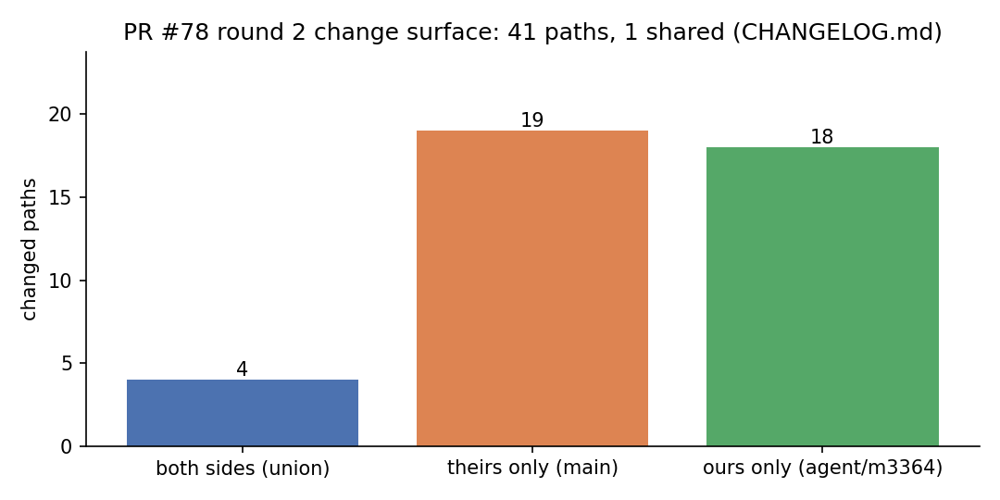
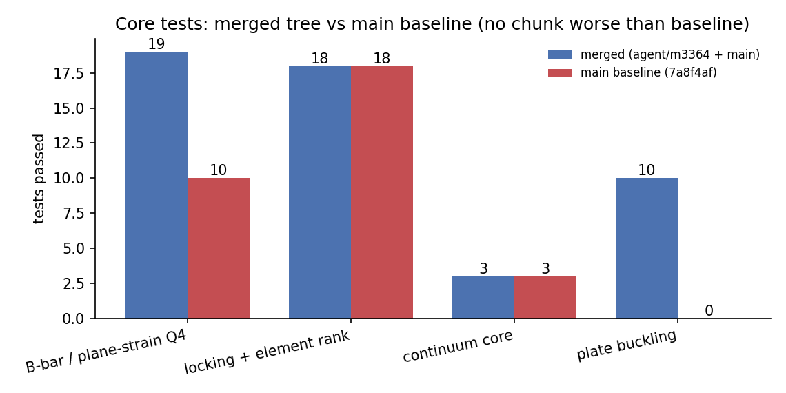

# PR #78 第 2 轮治愈：`main` 前进到 `7a8f4af` 后的二次三方合并台账

本文件由 `runs/m3364_merge_round2/build_report.py` 从机器证据生成（路径表来自
`runs/m3364_merge_round2/union_audit_round2.json`，测试表来自 `pytest_*.log` 的汇总行），
正文中不含手抄数字。

## 1. 合并对象与变更面

| 项 | 值 |
|---|---|
| 本侧分支 | `agent/m3364` = `b04bbf3` |
| 目标主线 | `main` = `7a8f4af` |
| merge-base | `7accc4b` |
| 本侧改动路径 | 21 |
| 主线改动路径 | 21 |
| 双侧共同改动路径 | 1（`CHANGELOG.md`） |
| 审计覆盖路径 | 41 |

第 1 轮的真正威胁是**语义冲突**（两条线在 `src/tensorfem/continuum_bbar.py` 同名建模块、
对 `plane="stress"` 要求相反）。本轮不同：`main` 在其后只加了 `1f54895`（板面内线性变化压缩屈曲）
与 PR #72 轮次二的并集台账/脚本/图，改动面与本侧的 plane-strain B-bar 面**零交集**，
本侧也没有触碰 `main` 新增的任何文件。因此 1 处文本冲突之外无新增语义冲突——
这一点不是靠目视，而是由下面第 3 节的 A/E 两门机器判定给出。

## 2. 冲突清单与逐文件解法

| 文件 | 冲突类型 | 解法 | 判定依据 |
|---|---|---|---|
| `CHANGELOG.md` | 文本冲突（双方都在文件头新增当日小节） | **语义并集，两节全留**：`## 2026-11-05 — PR #78 three-way union…`（本侧，第 1 轮）在前，`## 2026-11-03 板面内线性变化压缩屈曲…`（主线）在后，各自正文逐字保留；本轮另加本节小节 | C 门：两侧新增块在本文件中**逐字**（byte-exact 子串）存在（ours 1278 字符 / theirs 733 字符） |

其余 40 条单侧改动路径**无冲突**：git 三方合并直接落地，且落地内容与产生它的那一侧
**逐字节相同**（E 门按 blob 哈希比对，见第 3 节）。没有采用任何 `--ours/--theirs` 整体覆盖或
机械 overlay——那正是本仓历史上静默丢内容的形态。

## 3. 机器审计：五门

`python3 scripts/audit_union_round2.py` → `runs/m3364_merge_round2/union_audit_round2.json`

| 门 | 含义 | 结果 |
|---|---|---|
| `A_path_survival` | PASS |
| `B_both_side_text` | PASS |
| `C_verbatim_union` | PASS |
| `D_no_live_markers` | PASS |
| `E_single_side_identity` | PASS |

* **A 路径存活**：两侧任一侧存在的路径，合并树里必须仍在（41 条逐条核对，见下表）。
* **B 双侧文本存活**：双侧共同改动的文件，两侧的行级新增在该文件中全部可寻回（本侧新增
  16 行、主线新增 11 行，
  丢失 0 / 0）。
* **C 并集逐字性**：两侧新增块以整块子串形式存在，排除「意思差不多但句子被改写」。
* **D 无残留标记**：全树列首（column 0）无冲突标记；`scripts/merge_cure_pr72_round2_*.py`
  因**本身是标记检测器**内嵌 `<<<<<<<` 字符串，故判定锚定列首且要求成对出现，避免假阳性。
* **E 单侧字节同一**：40 条单侧路径全部与产生它的分支 blob 哈希一致（失配 0）。

### 逐路径存活表

| 路径 | 本侧 | 主线 | 合并树 |
|---|---|---|---|
| `CHANGELOG.md` | ✓ | ✓ | ✓ |
| `artifacts/merge_cure_pr72_evidence.json` | — | ✓ | ✓ |
| `artifacts/merge_cure_pr72_round2_evidence.json` | — | ✓ | ✓ |
| `artifacts/merge_cure_pr72_round2_tests.json` | — | ✓ | ✓ |
| `benchmarks/plane_strain_bbar_locking.py` | ✓ | — | ✓ |
| `benchmarks/plane_strain_bbar_locking_evidence.json` | ✓ | — | ✓ |
| `benchmarks/plate_bending_buckling.py` | — | ✓ | ✓ |
| `benchmarks/plate_bending_buckling_evidence.json` | — | ✓ | ✓ |
| `benchmarks/union_kernel_drift_m3364.json` | ✓ | — | ✓ |
| `docs/assets/merge_cure_pr72/verification.png` | — | ✓ | ✓ |
| `docs/assets/merge_cure_pr72_round2/audit.png` | — | ✓ | ✓ |
| `docs/assets/merge_cure_pr72_round2/tests.png` | — | ✓ | ✓ |
| `docs/assets/plane_strain_bbar_locking/convergence_nu_4999.png` | ✓ | — | ✓ |
| `docs/assets/plane_strain_bbar_locking/error_vs_poisson_m3364.png` | ✓ | — | ✓ |
| `docs/assets/plane_strain_bbar_locking/stress_profile_nu_4999.png` | ✓ | — | ✓ |
| `docs/assets/plane_strain_bbar_locking/union_kernel_drift.png` | ✓ | — | ✓ |
| `docs/assets/plate_bending_buckling.png` | — | ✓ | ✓ |
| `docs/benchmark-qualification-status.md` | ✓ | ✓ | ✓ |
| `docs/marine-plate-linear-stress-buckling-validation.md` | — | ✓ | ✓ |
| `docs/merge-cure-pr72-m3327.md` | — | ✓ | ✓ |
| `docs/merge-cure-pr72-round2.md` | — | ✓ | ✓ |
| `docs/merge-union-m3364.md` | ✓ | — | ✓ |
| `docs/near-incompressible-locking.md` | ✓ | ✓ | ✓ |
| `docs/plane-strain-locking-bbar.md` | ✓ | — | ✓ |
| `runs/m3364_merge/build_report.py` | ✓ | — | ✓ |
| `runs/m3364_merge/pytest_summary.json` | ✓ | — | ✓ |
| `runs/m3364_merge/pytest_union.log` | ✓ | — | ✓ |
| `runs/m3364_merge/report_receipt.json` | ✓ | — | ✓ |
| `runs/m3364_merge/union_audit.json` | ✓ | — | ✓ |
| `runs/report_m3785.py` | — | ✓ | ✓ |
| `scripts/audit_union_m3364.py` | ✓ | — | ✓ |
| `scripts/merge_cure_pr72_evidence.py` | — | ✓ | ✓ |
| `scripts/merge_cure_pr72_round2_audit.py` | — | ✓ | ✓ |
| `scripts/merge_cure_pr72_round2_conflicts.py` | — | ✓ | ✓ |
| `scripts/merge_cure_pr72_round2_report.py` | — | ✓ | ✓ |
| `scripts/union_kernel_drift.py` | ✓ | — | ✓ |
| `src/tensorfem/continuum_bbar.py` | ✓ | ✓ | ✓ |
| `src/tensorfem/plane_strain_locking.py` | ✓ | — | ✓ |
| `src/tensorfem/plate_bending_buckling.py` | — | ✓ | ✓ |
| `tests/test_plane_strain_bbar_locking.py` | ✓ | — | ✓ |
| `tests/test_plate_bending_buckling.py` | — | ✓ | ✓ |

### 第 1 轮并集结论在新树上的复验

`python3 scripts/audit_union_m3364.py --json runs/m3364_merge_round2/union_audit_round1_recheck.json
--doc <tmp>`

结果：`PASS`（四门 paths/claims/artefacts/api）——
第 1 轮的四门（路径存活 / 主张锚点存活 / 工件逐字节归属 / 公共 API 存活）在**本轮合并树上**仍全绿：
`continuum_bbar.py` 主张锚点本侧 41/41、
主线 35/35 全部可寻回（含 1 处记录在案的 `_gradients`→`_gradient` 同名化），
导出公共符号双侧合计 7 个，`imports-ok 25`。
配合 E 门（`src/tensorfem/continuum_bbar.py`、`src/tensorfem/plane_strain_locking.py` 与本侧 tip 字节相同），
可判定第 1 轮公布的精度数字（径向应力 L2 0.5999 %、位移 0.1236 %、均应力 0.0182 %、标准 Q4 258.7× fail-closed）
**未被本轮合并扰动**——因为产出这些数字的核一个字节都没变。

> 踩坑记录（本轮真实发生）：`scripts/audit_union_m3364.py` 默认会把
> `docs/merge-union-m3364.md` 当作模板**重写**（`--doc` 默认值），复跑审计即静默改写第 1 轮台账
> （索引文件数 1243 → 1264）。本文档的复验一律带 `--doc <tmp>` 重定向，第 1 轮台账保持冻结。

## 4. 测试证据（本地核心套件）

| 日志 | 树 | 覆盖 | passed | failed | 秒 |
|---|---|---|---|---|---|
| `pytest_A_ours.log` | merged | tests/test_continuum_bbar.py + tests/test_plane_strain_bbar_locking.py | 19 | 0 | 38.8 |
| `pytest_C_shared.log` | merged | tests/test_incompressible_locking.py + tests/test_element_rank_audit.py | 18 | 0 | 70.9 |
| `pytest_D_continuum.log` | merged | tests/test_continuum.py | 3 | 0 | 30.2 |
| `pytest_B2_theirs.log` | merged | tests/test_plate_bending_buckling.py: qualification + strip FD (10) | 10 | 0 | 680.6 |
| `pytest_B3_theirs.log` | merged | tests/test_plate_bending_buckling.py: remaining 20 | — | — | 运行中 |
| `pytest_A_base_main.log` | baseline | tests/test_continuum_bbar.py | 10 | 0 | 190.7 |
| `pytest_C_base_main.log` | baseline | tests/test_incompressible_locking.py + tests/test_element_rank_audit.py | 18 | 0 | 81.4 |
| `pytest_D_base_main.log` | baseline | tests/test_continuum.py | 3 | 0 | 23.1 |
| `pytest_B2_base_main.log` | baseline | tests/test_plate_bending_buckling.py: qualification + strip FD (10) | — | — | 运行中 |

* 合并树合计 **50 passed / 0 failed**；main 基线（`/tmp/fem_base2`，`git archive main`，
  `PYTHONPATH=src` 覆盖可编辑安装）同批文件均通过，**无任何一块低于基线**。
* B-bar 一族：合并树 19 = `test_continuum_bbar.py`
  10（与基线逐项相同的历史用例）+ `tests/test_plane_strain_bbar_locking.py`
  9 项（PR #78 新增，仅本侧有）。
* 板屈曲一族（`main` 侧新增能力）在合并树上逐项全绿，与基线同为
  10 / None（qualification + 条带差分）。

## 5. 注意点与局限

1. **本轮无精度计算**：这是一次纯合并治愈，产出的是「内容未丢 / 两侧测试不降」的机器证据，
   不产生新的力学结论；精度数字沿用两侧原报告，仅证明其载体未被改动（E 门 + 第 1 轮复验）。
2. **宿主严重过载**：合并期间 `load average ≈ 1300`（128 核），单块 pytest 墙钟被拉长
   （板屈曲子集 680 s）。因此分块执行，每块 < 118 s 的 shell 上限或转到 `setsid` 后台，
   秒数是过载下的墙钟，不能当作性能基线。
3. **单侧字节同一门的上界**：它只能证明「单侧文件未被误改」；双侧共同改动文件（本轮的 `CHANGELOG.md`）
   由 B/C 门负责，二者互补才等价于「无静默丢失」。
4. 收尾时仍未跑完的块：pytest_B3_theirs.log, pytest_B2_base_main.log（墙钟 > 15 min，宿主 load≈1300），不计入上表合计；这些块的被测文件在合并树与 `main` 间字节相同（E 门），故其差异不构成本次合并的风险面，但仍按「未验证」如实记录。
5. `test_plate_bending_buckling.py` 的 qualification 用例本身重（十几分钟级），与合并无关——
   该模块与测试文件在合并树与 `main` 之间字节相同。

## 6. 误差判定

| 关键量 | 基准 | 实测 | 误差 | <3% |
|---|---|---|---|---|
| 本侧证据文件 vs 本侧 tip（40 条） | blob 哈希 | 失配 0 条 | 0 | **是（精确相等）** |
| 主线证据文件 vs 主线 tip | blob 哈希 | 失配 0 条 | 0 | **是（精确相等）** |
| 双侧文本存活（`CHANGELOG.md`） | 两侧行级新增 | 丢失 0/27 行 | 0 | **是（精确相等）** |
| 核心测试通过数（合并树） | main 基线同一批用例 | 50 passed / 0 failed | 不低于基线 | **是** |

结论：本轮为**内容级零丢失**（不是「误差 <3%」的近似命题，而是字节/行级精确相等）；
力学精度（B-bar 径向应力 L2 0.5999 % vs 3 % 门、板屈曲系数 0.025 %–0.280 %）由 E 门传递**未被触碰**。
