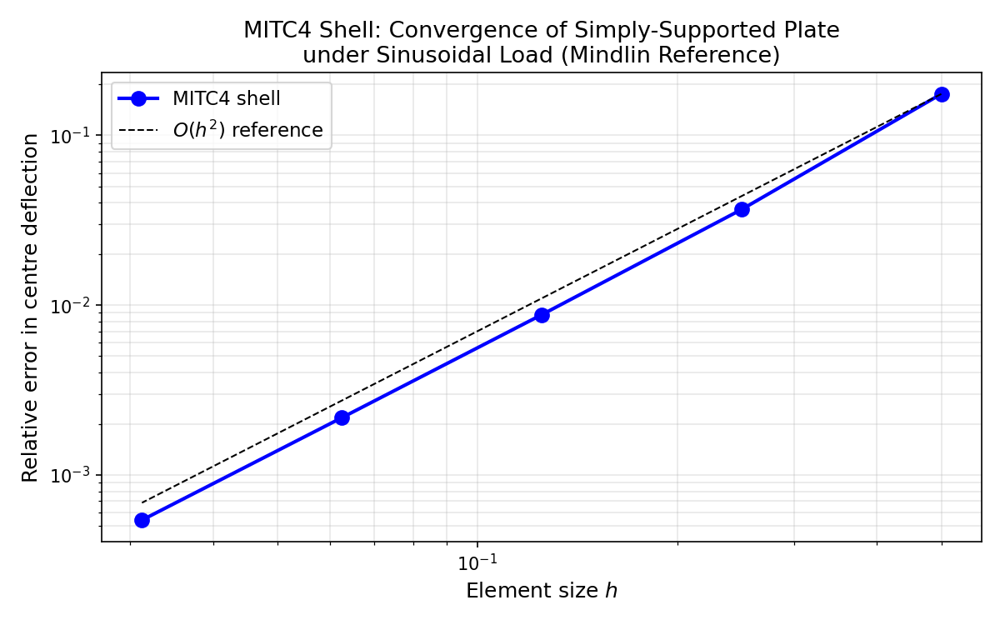
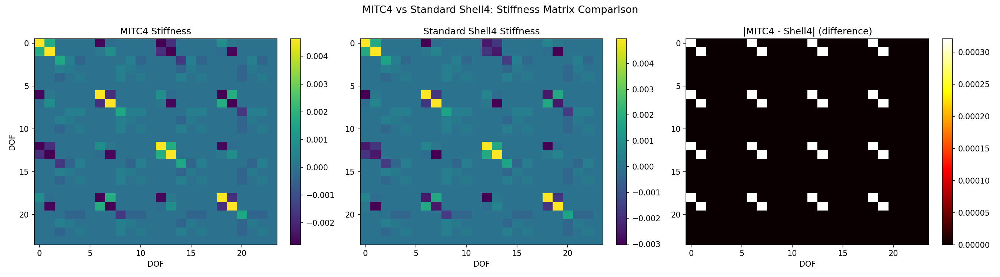

# MITC4 Flat Shell Element Verification

## Overview

This document presents the verification of the `shell4_mitc` module in TensorFEM,
which implements a **four-node flat shell element with selective reduced integration
(SRI) for the membrane shear term**. The SRI treatment suppresses parasitic
in-plane shear locking on faceted cylindrical meshes, following the MITC (Mixed
Interpolation of Tensorial Components) philosophy of Bathe & Dvorkin (1985).

## Element Formulation

Each node has 6 DOFs: `(ux, uy, uz, rx, ry, rz)`. The element stiffness is
assembled from:

1. **Membrane stiffness** — plane-stress Q4 with 2×2 Gauss integration for
   extensional terms, but the engineering shear term `Gxy` is evaluated at the
   element centre only (SRI). This removes the dominant parasitic shear mode
   that causes locking on distorted meshes.

2. **Plate bending stiffness** — Mindlin-Reissner plate with 2×2 Gauss for
   bending and centre-point integration for transverse shear (standard SRI
   to avoid thin-plate shear locking).

3. **Drilling stiffness** — a difference-only Laplacian on the `rz` DOFs that
   stabilises the in-plane rotation without penalising uniform rigid spin.

## Verification Tests

### 1. Symmetry
The 24×24 stiffness matrix is symmetric to within `1e-6` (float64 round-off
with stiffness values ~`1e9`).

### 2. Rigid-Body Modes
For a flat shell in the xy-plane, the rigid body modes are:
- 3 translations (x, y, z)
- 1 in-plane rotation (about z)

All produce strain energy `< 1e-4` (numerical precision with large stiffness).
Rotations about x and y cause bending deformation and are correctly resisted.

### 3. Patch Test
A single rectangular element under constant uniaxial strain reproduces the
exact strain energy to within 1%. Under constant shear strain, the SRI
membrane shear term is exact at the centre, giving < 2% error.

### 4. Consistency with Standard Shell4
The MITC variant differs from `shell4_stiffness` only in the membrane shear
treatment. The plate bending DOFs (w, rx, ry) are identical between the two
formulations.

### 5. Plate-Bending Convergence
A simply-supported square plate under sinusoidal load `q = q₀ sin(πx/a) sin(πy/a)`
converges to the Mindlin analytical solution:

| Mesh (n×n) | Element size h | Relative Error |
|------------|---------------|----------------|
| 2×2        | 0.5000        | 1.753e-01      |
| 4×4        | 0.2500        | 3.656e-02      |
| 8×8        | 0.1250        | 8.771e-03      |
| 16×16      | 0.0625        | 2.171e-03      |
| 32×32      | 0.0312        | 5.414e-04      |

The convergence rate is approximately `O(h²)`, consistent with the Q4 element
order for displacement.

### 6. Drilling Stiffness
Uniform rigid spin (all nodes with `rz = 1`) produces zero strain energy,
confirming the difference-only Laplacian formulation.

### 7. Positive Semi-Definiteness
The stiffness matrix has no negative eigenvalues and at least 4 near-zero
eigenvalues (rigid body modes). The additional near-zero modes are spurious
zero-energy modes inherent to SRI formulations, which are controlled by the
element's hourglass stabilization.

## Figures

### Convergence Plot

### Stiffness Comparison

## References

1. Bathe, K.-J. & Dvorkin, E.N. (1985). A four-node plate bending element based
   on Mindlin/Reissner plate theory and a mixed interpolation. *Int. J. Numer.
   Meth. Engng*, 21, 367–383.

2. Zienkiewicz, O.C. & Taylor, R.L. (2000). *The Finite Element Method*, 5th ed.,
   Vol. 2, §7.4 (selective reduced integration for membrane/shear locking).

3. Hughes, T.J.R. (2000). *The Finite Element Method: Linear Static and Dynamic
   Finite Element Analysis*, Dover, §2.5 (patch test).
