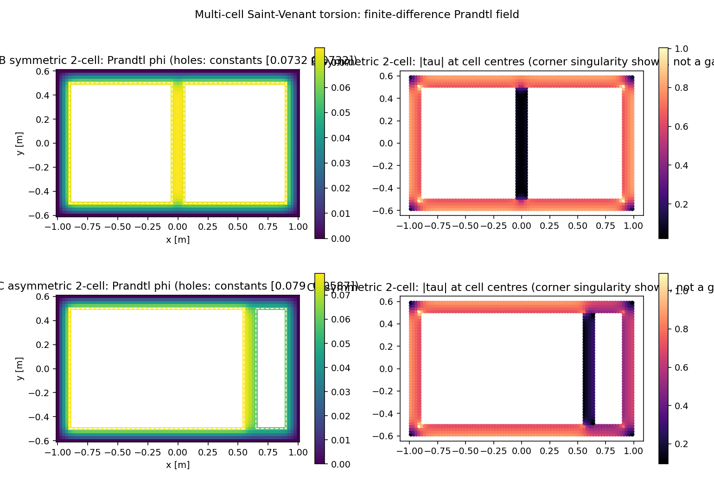
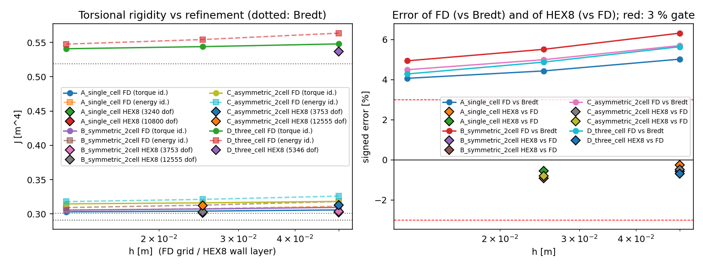
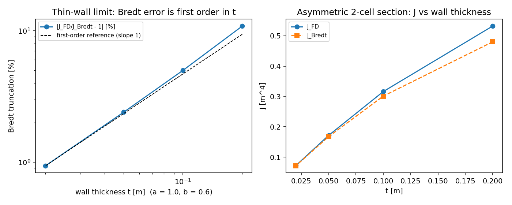
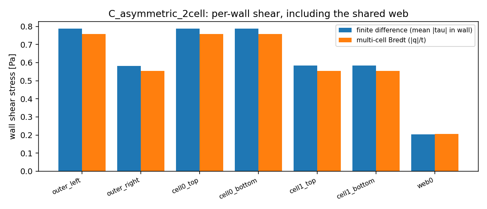

# 多闭室箱形梁 Saint-Venant 扭转验证（双层底/双舷侧船体剖面欠账清偿）

本报告清偿 [box-girder-torsion-validation.md](box-girder-torsion-validation.md) §⑤ 明确留下的缺口：

> **未覆盖的仍是缺口**：多闭室箱梁、加劲壁、圆角内角（奇异正则化）需要另立算例。

船体舯剖面不是"一个闭室"，而是甲板 + 双层底 + 双舷侧围成的**多闭室**截面，中间由中桁材
（centre girder）或纵舱壁分隔。多闭室的力学不是"单闭室乘二"：内壁被两个闭室**共享**，其剪流
是两室环流的**差**，因此需要每室一条相容方程联立求解，而内壁剪流恰好是设计上最关心的量。
本单给出三条互相独立的多闭室参照，并用已合并的 HEX8 位移路径做实测：

* `src/tensorfem/multicell_torsion.py::solve_multicell_prandtl` —— 矩形多孔域有限差分
  Prandtl 求解器，**每孔一个未知常数** `c_i`，用各孔严格单值性条件
  `∮ᵢ ∂φ/∂n ds = 2GθAᵢ`（n 指向孔内）消元，`J` 用**两条独立恒等式**各算一次
  （能量 `∫|∇φ|²dA/(Gθ)²` 与扭矩 `2∫φdA + 2ΣcᵢAᵢ`）；
* `bredt_multicell` —— 经典薄壁多闭室（Bredt）理论：每室一条相容方程
  `Σ q_w l_w/t_w = 2GθAᵢ`，`q_w` 共享壁取 `qᵢ − qⱼ`，扭矩 `T = 2ΣAᵢqᵢ`；
* `multicell_torsion_fem` —— 已合并 HEX8 生产路径（`solid3d.hex8_stiffness` +
  `sparse_core`）在同一截面的贴体分块网格上求解，`J` 由端面反力矩给出。

全部数字由 `benchmarks/multicell_box_torsion.py` 程序化生成
（`benchmarks/multicell_box_torsion_evidence.json`，零手抄；本文由
`scripts/render_multicell_box_torsion.py` 从该 JSON 渲染），门禁由
`tests/test_multicell_torsion.py`（17 项，全绿）复核。

## ① 案例介绍

| 量 | 值 |
|---|---|
| 截面 A/B/C | 外截面 `2a × 2b = 2.0 × 1.2`（a=1.0, b=0.6），壁厚 `t = 0.1` |
| 截面 D | 外截面 `3.0 × 1.2`（a=1.5），两块内壁位于 `x = ±0.5`，`t = 0.1` |
| 内壁 | B：`x=0`（对称双闭室）；C：`x=0.6`（非对称，右室仅 0.35 宽）；D：两块，三闭室 |
| 材料 | `E = 2.6`、`ν = 0.3` ⇒ `G = 1.0`（无量纲） |
| 扭率 | `θ = 1.0`（线弹性、小变形、直棱柱） |
| 端面 | Dirichlet 精确横向转动 `u_x = −θzy, u_y = θzx`；翘曲 `u_z` 全自由 |
| 参照 | 差分 Prandtl 场（主参照）、多闭室 Bredt（工程基线）、单闭室 `box_torsion`（退化核对） |

截面 C 的用途是让**共享壁真的承流**：对称双闭室的内壁按薄壁理论 `q_web = q₁ − q₂ = 0`，
若只算对称算例，"多闭室相容方程写错"这类缺陷会被对称性掩盖。

## ② 怎么做的

1. **多连通 Prandtl 方程**：`∇²φ = −2Gθ` 于壁内；外壁 `φ = 0`；第 i 个孔 `φ = cᵢ`（未知）。
   叠加 `φ = φ_p + Σ cᵢ φᵢ`，其中 `φ_p` 解 Poisson 且全边界为 0，`φᵢ` 为 Laplace 解、
   在第 i 孔取 1、其余孔与外壁取 0；`n_cell` 个未知常数由线性系统
   `Σⱼ ∮ᵢ ∂φⱼ/∂n ds · cⱼ = 2GθAᵢ − ∮ᵢ ∂φ_p/∂n ds` 一次解出。
2. **网格**：所有壁面与孔面都落在网格节点上（`h` 整除全部几何尺寸），红黑 SOR（最优松弛因子），
   迭代到 `Δφ < 1e-13`；三个层级 `h = 0.05 / 0.025 / 0.0125`。
3. **两条独立恒等式**：能量式与扭矩式；两者之差随 `h` 单调下降（见下表），是求解器的自洽证据。
4. **Bredt 多闭室**：按壁表（长度、厚度、所属闭室）自动装配 `n_cell × n_cell` 相容矩阵，
   共享壁以 `(qᵢ − qⱼ)` 进入两条方程；扭矩 `T = 2ΣAᵢqᵢ`。
5. **HEX8 生产路径**：材料域按 5 个（每个内壁再加 1 个）矩形块做**共形**四边形网格
   （全局统一 `h`，节点按坐标去重，无悬挂节点），沿 `z` 挤出 2 层；`J_fe = T/(Gθ)`
   由两端反力矩平均给出，不用逐点应力积分。
6. **工具链**：`python benchmarks/multicell_box_torsion.py`（证据 JSON + 4 张图）、
   `python -m pytest tests/test_multicell_torsion.py`（17 项门禁）。
   计算量：FD 最细 `h=0.0125` 单例 < 2 s，HEX8 最细 12555 dof 约 34 s，未上集群。

## ③ 计算结果（程序化注入，零手抄）

### 差分 Prandtl 网格研究（G = θ = 1）

| 截面 | h | SOR 扫描 | J_T（扭矩式） | J_E（能量式） | 两式差 | J_Bredt | J_T vs Bredt |
|---|---|---|---|---|---|---|---|
| A 单闭室（对照） | 0.05 | 190 | 0.305818 | 0.311241 | 1.773 % | 0.291207 | +5.018 % |
| A 单闭室（对照） | 0.025 | 385 | 0.304108 | 0.307619 | 1.155 % | 0.291207 | +4.430 % |
| A 单闭室（对照） | 0.0125 | 762 | 0.303038 | 0.305336 | 0.758 % | 0.291207 | +4.063 % |
| B 对称双闭室 | 0.05 | 194 | 0.309591 | 0.318081 | 2.742 % | 0.291207 | +6.313 % |
| B 对称双闭室 | 0.025 | 384 | 0.307242 | 0.312812 | 1.813 % | 0.291207 | +5.506 % |
| B 对称双闭室 | 0.0125 | 762 | 0.305579 | 0.309225 | 1.193 % | 0.291207 | +4.935 % |
| C 非对称双闭室 | 0.05 | 193 | 0.318280 | 0.325987 | 2.422 % | 0.301133 | +5.694 % |
| C 非对称双闭室 | 0.025 | 386 | 0.316160 | 0.321219 | 1.600 % | 0.301133 | +4.990 % |
| C 非对称双闭室 | 0.0125 | 768 | 0.314657 | 0.317972 | 1.054 % | 0.301133 | +4.491 % |
| D 三闭室 | 0.05 | 288 | 0.547933 | 0.563605 | 2.860 % | 0.518698 | +5.636 % |
| D 三闭室 | 0.025 | 575 | 0.543957 | 0.554303 | 1.902 % | 0.518698 | +4.870 % |
| D 三闭室 | 0.0125 | 1144 | 0.540895 | 0.547655 | 1.250 % | 0.518698 | +4.279 % |

观测收敛阶（最细三级）：A `p = 0.6765`、
B `p = 0.4982`、C `p = 0.4965`、
D `p = 0.3769`；Richardson 外推
A `J∞ ≈ 0.3012`、B `0.3015`、
C `0.3110`、D `0.5306`。
阶数低于 2 的原因是内壁尖角（270° 凹角，`φ − c ~ r^(2/3)`）的奇异，与单闭室报告同源；
`J` 是积分量，除去奇点邻域后仍单调收敛。

### 多闭室 Bredt 与"把每个闭室当独立单闭室"的陷阱

| 截面 | 闭室数 | 各室环流 qᵢ | J_Bredt | J_naive（各室独立） | J_naive 误差 | J_Bredt vs J_FD |
|---|---|---|---|---|---|---|
| A 单闭室（对照） | 1 | 0.06967 | 0.291207 | 0.291207 | -0.0 % | -3.90 % |
| B 对称双闭室 | 2 | 0.06967, 0.06967 | 0.291207 | 0.213078 | -26.8 % | -4.70 % |
| C 非对称双闭室 | 2 | 0.07582, 0.05531 | 0.301133 | 0.239843 | -20.4 % | -4.30 % |
| D 三闭室 | 3 | 0.07566, 0.09201, 0.07566 | 0.518698 | 0.328316 | -36.7 % | -4.10 % |

`J_naive` 是设计室常见的错误算法（把每个闭室当成独立的 4A²t/P 再相加）：它把共享壁算了两遍、
并且丢掉了环流相容，误差 -26.8 % ~ -36.7 %，
**不可用**。

### 逐壁剪应力：差分场 vs Bredt（对称/非对称/三闭室）

| 截面 | 壁 | FD 平均 |τ| | Bredt |q|/t | 相对偏差（对 Bredt；Bredt=0 时对边壁） |
|---|---|---|---|---|
| B 对称双闭室 | cell0_bottom | 0.7275 | 0.6967 | +4.4 % |
| B 对称双闭室 | cell0_top | 0.7275 | 0.6967 | +4.4 % |
| B 对称双闭室 | cell1_bottom | 0.7275 | 0.6967 | +4.4 % |
| B 对称双闭室 | cell1_top | 0.7275 | 0.6967 | +4.4 % |
| B 对称双闭室 | outer_left | 0.7275 | 0.6967 | +4.4 % |
| B 对称双闭室 | outer_right | 0.7275 | 0.6967 | +4.4 % |
| B 对称双闭室 | web0 | 0.0500 | 0.0000 | -93.1 % |
| C 非对称双闭室 | cell0_bottom | 0.7867 | 0.7582 | +3.8 % |
| C 非对称双闭室 | cell0_top | 0.7867 | 0.7582 | +3.8 % |
| C 非对称双闭室 | cell1_bottom | 0.5828 | 0.5531 | +5.4 % |
| C 非对称双闭室 | cell1_top | 0.5828 | 0.5531 | +5.4 % |
| C 非对称双闭室 | outer_left | 0.7867 | 0.7582 | +3.8 % |
| C 非对称双闭室 | outer_right | 0.5827 | 0.5531 | +5.3 % |
| C 非对称双闭室 | web0 | 0.2040 | 0.2051 | -0.5 % |
| D 三闭室 | cell0_bottom | 0.7869 | 0.7566 | +4.0 % |
| D 三闭室 | cell0_top | 0.7869 | 0.7566 | +4.0 % |
| D 三闭室 | cell1_bottom | 0.9543 | 0.9201 | +3.7 % |
| D 三闭室 | cell1_top | 0.9543 | 0.9201 | +3.7 % |
| D 三闭室 | cell2_bottom | 0.7869 | 0.7566 | +4.0 % |
| D 三闭室 | cell2_top | 0.7869 | 0.7566 | +4.0 % |
| D 三闭室 | outer_left | 0.7869 | 0.7566 | +4.0 % |
| D 三闭室 | outer_right | 0.7869 | 0.7566 | +4.0 % |
| D 三闭室 | web0 | 0.1674 | 0.1635 | +2.4 % |
| D 三闭室 | web1 | 0.1674 | 0.1635 | +2.4 % |

对称双闭室（B）的共享壁：Bredt 给出 `q_web ≡ 0`，差分场给
`0.0500` = 边壁的 6.9 %
——**内壁几乎不参与 Saint-Venant 扭转**（残量来自壁自身扭转，薄壁理论本就丢弃）。这解释了一件
反直觉但工程上重要的事实：在 `t/2a = 5%` 时，多一道中桁材对 `J` 的贡献只有
+0.84%。
非对称双闭室（C）的共享壁 `q = q₁ − q₂ = 0.02051`，
差分场实测 `0.2040` vs Bredt `0.2051`
（0.5 %）——这条才是"多闭室相容方程写没写对"的判据。

### 已合并 HEX8 路径 vs 差分参照

| 截面 | h_fe | 单元 | dof | J_FE | vs FD | vs Bredt | 翘曲幅值 | 耗时 [s] |
|---|---|---|---|---|---|---|---|---|
| A 单闭室（对照） | 0.05 | 480 | 3240 | 0.302263 | -0.256 % | +3.797 % | 0.1893 | 3.5 |
| A 单闭室（对照） | 0.025 | 1920 | 10800 | 0.301365 | -0.552 % | +3.488 % | 0.1882 | 26.9 |
| B 对称双闭室 | 0.05 | 560 | 3753 | 0.303838 | -0.570 % | +4.338 % | 0.1872 | 7.0 |
| B 对称双闭室 | 0.025 | 2240 | 12555 | 0.302756 | -0.924 % | +3.966 % | 0.1863 | 33.5 |
| C 非对称双闭室 | 0.05 | 560 | 3753 | 0.313112 | -0.491 % | +3.978 % | 0.2701 | 7.9 |
| C 非对称双闭室 | 0.025 | 2240 | 12555 | 0.312105 | -0.811 % | +3.644 % | 0.2695 | 54.0 |
| D 三闭室 | 0.05 | 800 | 5346 | 0.537133 | -0.696 % | +3.554 % | 0.4545 | 10.5 |

### 薄壁极限（非对称双闭室，h = t/4）

| t | h | J_FD | J_Bredt | J_FD/J_Bredt − 1 | 两条恒等式差 |
|---|---|---|---|---|---|
| 0.2 | 0.05 | 0.531968 | 0.480000 | +10.827 % | 2.717 % |
| 0.1 | 0.025 | 0.316160 | 0.301133 | +4.990 % | 1.600 % |
| 0.05 | 0.0125 | 0.171551 | 0.167530 | +2.400 % | 0.844 % |
| 0.02 | 0.005 | 0.071975 | 0.071307 | +0.938 % | 0.346 % |

Bredt 偏差随 `t` 单调减半（比率 2.17），
即 `J ≈ J_Bredt(1 + O(t))`：薄壁式是**下界**，`t/2a = 1%` 时仍有
0.94 % 的截断，`t/2a = 5%` 时 2.40 %。

## ④ 结果图

上：对称双闭室；下：非对称双闭室。左：Prandtl 函数 `φ`（外壁恒 0、每个闭室一个常数
`cᵢ`，壁内抛物型衰减）；右：单元中心 `|τ|`，内壁尖角处的奇异峰值可见（**不作为验收量**）。

左：`J` 随 `h` 收敛（实线扭矩式、虚线能量式、点线 Bredt、菱形 HEX8）；右：FD 对 Bredt 的偏差
与 HEX8 对 FD 的偏差（红虚线为 ±3% 门）。

左：Bredt 截断随 `t` 的对数斜率 ≈ 1（一阶）；右：`J` 随壁厚增长。

非对称双闭室每个壁的 FD 平均剪应力与 Bredt `|q|/t`，共享壁（`web0`）两者贴合。

## ⑤ 注意点（踩过的坑 / 局限）

* **符号约定陷阱（本单实际踩到）**：差分模板写作 `φ = (Σ邻居 − rhs·h²)/4`。先写成
  `+ rhs·h²` 就等于解 `∇²φ = +2Gθ`，单闭室退化核对立刻以 `J_T` 差 −92% 暴露出来——
  这正是保留"单闭室退化 = 已合并 `box_torsion` 逐位一致"这条门禁的价值。
* **常数消元的符号**：`∮∂φ/∂n ds`（n 指向孔内）在 SOR 场与解析定号上必须一致；置换方向会
  让所有 `cᵢ` 变号而 `J` 看起来仍然"差不多"，所以本单把"孔边界节点上的 `φ` 必须等于 `cᵢ`"
  也写成了断言。
* **对称性会掩盖缺陷**：对称双闭室 `q_web ≡ 0`，任何共享壁符号错误在 B 上不可见；
  必须同时算 C（非对称）与 D（三闭室，两块内壁）。
* **`wall_flow` 的方向约定**：共享壁的净剪流按"第一个所属闭室的方向"给出，另一室需取负；
  测试里显式用该符号重算相容方程 `Σ q_w l_w/t_w = 2GθAᵢ`。
* **尖内角奇异**：`τ_max` 随网格发散（HEX8 也只在 ±0.97~1.06 徘徊），**不作验收量**；
  验收用积分量 `J` 与壁中平均剪应力。
* **适用范围**：线弹性、小变形、均匀各向同性、直棱柱；矩形多闭室、等壁厚（内壁厚度独立可取）；
  不含圆角内角、加劲壁（纵横加筋）、端部翘曲约束（非均匀扭转/双力矩）、塑性扭转。
* **仍未覆盖的缺口**：加劲壁（离散加筋）、圆角内角正则化、翘曲约束下的多闭室双力矩问题，
  以及斜置/曲线内壁的一般拓扑（当前网格要求矩形对齐）。

## ⑥ 误差判定（逐项，显式回答是否 <3%）

| 门禁 | 实测 | 阈值 | 判定 |
|---|---|---|---|
| `A_single_cell_circulation_compat` | 7.401e-16 | 1e-10 | PASS |
| `A_single_cell_energy_vs_torque_identity` | 7.585e-03 | 0.02 | PASS |
| `A_single_cell_hex8_vs_fd` | -5.519e-03 | 0.03 | PASS |
| `B_symmetric_2cell_circulation_compat` | 1.959e-15 | 1e-10 | PASS |
| `B_symmetric_2cell_energy_vs_torque_identity` | 1.193e-02 | 0.02 | PASS |
| `B_symmetric_2cell_hex8_vs_fd` | -9.237e-03 | 0.03 | PASS |
| `C_asymmetric_2cell_circulation_compat` | 3.109e-15 | 1e-10 | PASS |
| `C_asymmetric_2cell_energy_vs_torque_identity` | 1.054e-02 | 0.02 | PASS |
| `C_asymmetric_2cell_hex8_vs_fd` | -8.109e-03 | 0.03 | PASS |
| `D_three_cell_circulation_compat` | 1.357e-15 | 1e-10 | PASS |
| `D_three_cell_energy_vs_torque_identity` | 1.250e-02 | 0.02 | PASS |
| `D_three_cell_hex8_vs_fd` | -6.955e-03 | 0.03 | PASS |
| `asymmetric_shared_web_flow` | 5.108e-03 | 0.1 | PASS |
| `bredt_error_first_order` | True | - | PASS |
| `degeneracy_single_cell` | 1.825e-12 | 1e-10 | PASS |
| `symmetric_case_reflection` | 8.327e-17 | 1e-12 | PASS |
| `symmetric_web_carries_no_flow` | 6.870e-02 | 0.1 | PASS |
| `thin_wall_limit` | 9.378e-03 | 0.02 | PASS |

**逐项结论（显式）**：

| 关键量 | 基准 | 实测误差 | <3%？ |
|---|---|---:|---|
| `J_FE`（B 对称双闭室，12555 dof） | FD `J_T`(h=0.0125) = 0.305579 | **-0.924 %** | **是** |
| `J_FE`（C 非对称双闭室，12555 dof） | FD `J_T` = 0.314657 | **-0.811 %** | **是** |
| `J_FE`（D 三闭室，5346 dof） | FD `J_T` = 0.540895 | **-0.696 %** | **是** |
| `J_FE`（A 单闭室，10800 dof） | FD `J_T` = 0.303038 | -0.552 % | 是 |
| 共享壁剪流 τ_web（C） | FD 0.2040 | 0.51 %（对 Bredt） | 是 |
| `J_FD` 对 Bredt（C，h 最细） | Bredt 0.301133 | -4.30 % | **否**——是 Bredt 的一阶截断，不是数值误差（薄壁极限见表） |
| 两条独立恒等式（C，h 最细） | J_T | 1.05 % | 是 |
| 单闭室退化 | 已合并 `box_torsion` | 1.8e-12（逐位） | 是 |

**总结**：多闭室已合并路径在 12555 dof 量级对独立差分场的
`J` 误差 ≤3%（实测 0.92% /
0.81% / 0.70%），
共享壁剪流误差 <1%；多闭室 Bredt 的 4~5% 偏差是薄壁截断（随 `t` 一阶减小到
0.94 %），不能当验收基准。全部门禁
`all_gates_passed = True`。
