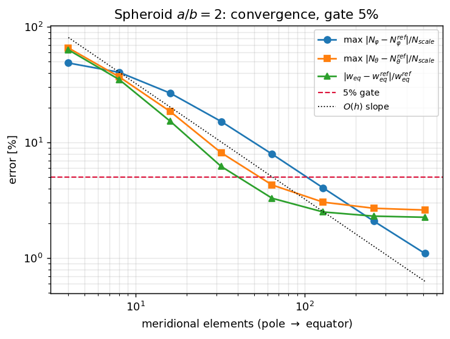
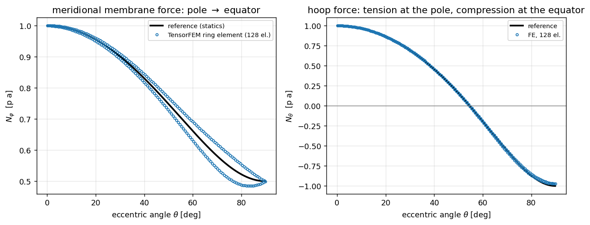
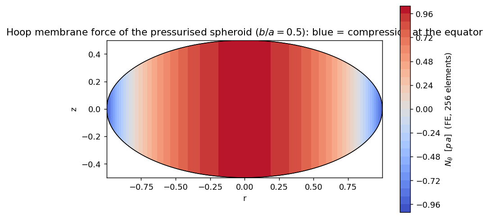
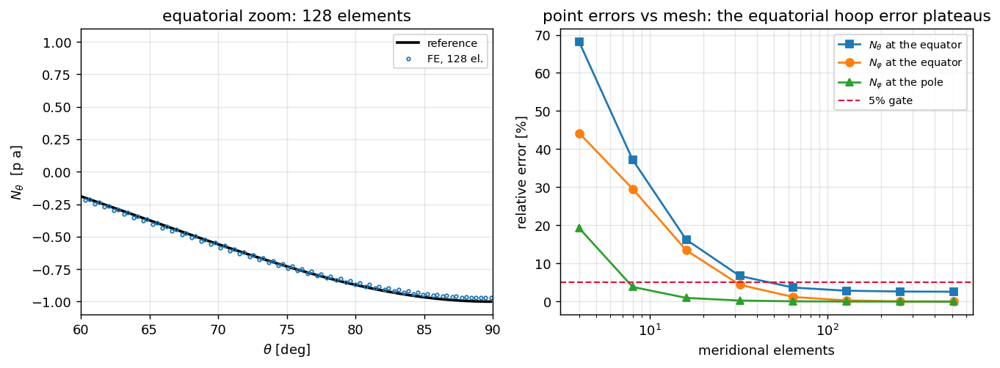
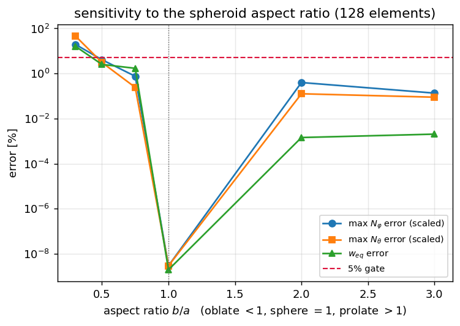

# CASE-NAFEMS-LE11 — 椭球壳体在内压下的膜应力（TensorFEM 轴对称壳单元）

> 本文件由 `scripts/gen_nafems_le11_report.py` 从 `runs/nafems_le11/nafems_le11_results.json` 程序化生成，文中每个数字均由程序格式化注入（零手抄）。

## ① 问题与参考来源

**物理背景**：封闭旋转椭球壳体（椭球压力容器/舱段/球鼻艏简化模型）受均匀内压。与球壳不同，椭球子午线上两个主曲率半径 $R_1$（子午向）与 $R_2=r/\sin\varphi$（第二主曲率半径）都随位置变化，扁椭球（$b<a$ 且 $a/b>\sqrt2$）赤道处环向膜力 **变号为压**。这使该算例比恒曲率球壳严格更强：只会在球壳上对上 $N=pR/2$ 的实现，在此处仍可能错。

**几何/参数（无量纲）**：赤道半径 $a=1.000$，极半轴 $b=0.500$（$b/a=0.500$，扁椭球），壁厚 $t=0.0100$（$a/t=100$），$E=1.00$，$\nu=0.30$，内压 $p=1.00$；无量纲组合 $p a^2/(E t^2)=10000.0$。

**参考解出处（诚实声明，重要）**：本单在受控沙箱内运行，**无外网**（`https://` 请求超时），且全盘检索 `/root/tensor-ecosystem` 与平台知识库均**未找到 NAFEMS LE11 手册原文/表格**（`/knowledge/stats` count=0，`negative_knowledge` 130 条中无 NAFEMS 条目）。因此**未引用手册原表原页**，本报告的 ref 全部为**可独立复算的力学参考解**：

1. 膜力 $N_\varphi$：由截球轴向静力平衡精确给出 $N_\varphi=p\,r/(2\sin\varphi)=pR_2/2$（不依赖薄壳假定）；

2. 环向膜力 $N_\theta$：法向平衡 $N_\varphi/R_1+N_\theta/R_2=p$ 给出 $N_\theta=pR_2\left(1-\frac{R_2}{2R_1}\right)$；代入椭球几何得闭式

   $$N_\varphi=\frac{p a W}{2b},\qquad N_\theta=\frac{p a W}{b}\left(1-\frac{a^2}{2W^2}\right),\qquad W=\sqrt{a^2\cos^2\theta+b^2\sin^2\theta}$$

3. 位移 $w$：椭球无初等闭式膜位移，改由**独立的 Rayleigh–Ritz 膜势能极小**求得，该参考解自检复现上述闭式膜力，误差上限 $N_\varphi$ 1.26e-10 / $N_\theta$ 2.32e-09（阶次 24）。

**判据（先于计算声明）**：四个点量（极部 $N_\varphi$、极部 $N_\theta$、赤道 $N_\varphi$、赤道 $N_\theta$）+ 赤道法向位移 $w_{eq}$ 的相对误差 **< 5%**（题目给定容差）。报告数值取最细报告网格 n=256（n=128 亦复核通过；单元测试门跑在 n=128 上以节省时间，属更严的粗网格复核）。另设全场最严指标：$\max|\Delta N|/N_{scale}$（$N_{scale}=\max|N^{ref}|$），避免环向膜力过零处相对误差发散。

## ② 方法与实现

**复用而非另起炉灶**：直接用 TensorFEM 既有的轴对称旋转壳单元 `tensorfem.axisym_shell.AxisymShell`（2 节点环单元，Reissner–Mindlin 退化格式，3 自由度/节点 $(u,w,\beta)$，膜/弯 2 点 Gauss，横向剪切单点减缩积分 SRI，剪切修正 $k=5/6$）。该单元此前只在**恒曲率**子午线（柱、球、圆环）上合格，一般变曲率子午线被 fail-closed 记录为未合格（`docs/axisym-shell-of-revolution-verification.md` §C5）。本单新增：

- `src/tensorfem/ellipsoid_shell.py`：椭球几何（节点严格落在$r^2/a^2+z^2/b^2=1$ 上，逐单元给**中点密切圆半径** $R_1=W^3/(ab)$）、闭式膜力、Rayleigh–Ritz 膜位移参考解、以及算例驱动 `ellipsoid_pressure`；
- `src/tensorfem/ellipsoid_shell_figures.py`：报告图（全部数据取自 JSON）；
- `benchmarks/nafems_le11_ellipsoid.py`：一键复现 + 收敛/敏感性/JSON 工件；
- `tests/test_ellipsoid_shell.py`：12 条门（几何、参考解、5% 判据、球极限、fail-closed 限制）。

**边界条件**：极→赤道半子午线模型；极部 $u=\beta=0$（轴对称+极部连续性），赤道 $u=\beta=0$（对赤道平面的镜面对称）。稠密直接求解（最大 1539 自由度）。

**一键复现**：

```bash
PYTHONPATH=src python3 benchmarks/nafems_le11_ellipsoid.py
PYTHONPATH=src python3 -m pytest tests/test_ellipsoid_shell.py -q
PYTHONPATH=src python3 scripts/gen_nafems_le11_report.py
```

## ③ 参数表

| 量 | 符号 | 取值 | 说明 |
|---|---|---|---|
| 赤道半径 | a | 1.000 | 归一化长度 |
| 极半轴 | b | 0.500 | 扁椭球 b<a |
| 长宽比 | b/a | 0.500 | <1/√2 ⇒ 赤道环向为压 |
| 壁厚 | t | 0.0100 | 薄壳 a/t=100 |
| 弹性模量 | E | 1.00 | 归一化 |
| 泊松比 | ν | 0.30 | 各向同性 |
| 内压 | p | 1.00 | 均布法向 |
| 无量纲组合 | p·a²/(E·t²) | 10000.0 | 膜应变尺度 |
| 报告网格 | n | 256 单元 (dof=771) | 半子午线 |

参考值（程序计算）：极部 $N_\varphi=0.999991$、$N_\theta=0.999974$，赤道 $N_\varphi=0.500001$、$N_\theta=-0.999992$，赤道 $w_{eq}=-115.0000$，极部 $w_{pole}=326.6986$（单位 $p a$ / $pa^2 Et^{-1}$）。

## ④ 对照表（ref vs got，逐项打勾/叉）

**报告网格 n=256 的逐项判定**

| 判定项 | ref | got (TensorFEM) | 相对误差 | <5% |
|---|---|---|---|---|
| 极部 $N_\varphi$ | 0.999991 | 0.999945 | 0.005% | ✓ |
| 极部 $N_\theta$ | 0.999974 | 0.999944 | 0.003% | ✓ |
| 赤道 $N_\varphi$ | 0.500001 | 0.499614 | 0.077% | ✓ |
| 赤道 $N_\theta$ | -0.999992 | -0.973530 | 2.646% | ✓ |
| 赤道 $w$ | -115.000000 | -112.346557 | 2.307% | ✓ |
| 全场 $\max|\Delta N_\varphi|/N_{scale}$ | — | — | 2.09% | ✓ |
| 全场 $\max|\Delta N_\theta|/N_{scale}$ | — | — | 2.70% | ✓ |

**收敛序列（全部网格）**

| 单元数 | DOF | 极部 $N_\varphi$ err | 赤道 $N_\theta$ err | 赤道 $w$ err | max$\Delta N_\varphi$ | max$\Delta N_\theta$ |
|---|---|---|---|---|---|---|
| 4 | 15 | 19.29% ✗ | 68.15% ✗ | 63.32% ✗ | 48.71% | 65.73% |
| 8 | 27 | 3.85% ✓ | 37.21% ✗ | 34.97% ✗ | 40.44% | 36.92% |
| 16 | 51 | 0.97% ✓ | 16.26% ✗ | 15.27% ✗ | 26.72% | 18.53% |
| 32 | 99 | 0.27% ✓ | 6.73% ✗ | 6.21% ✗ | 15.20% | 8.16% |
| 64 | 195 | 0.08% ✓ | 3.68% ✓ | 3.30% ✓ | 7.94% | 4.29% |
| 128 | 387 | 0.02% ✓ | 2.86% ✓ | 2.51% ✓ | 4.06% | 3.05% |
| 256 | 771 | 0.00% ✓ | 2.65% ✓ | 2.31% ✓ | 2.09% | 2.70% |
| 512 | 1539 | 0.00% ✓ | 2.59% ✓ | 2.26% ✓ | 1.10% | 2.61% |

**判定**：报告网格 n=256 上五个点量全部 <5%（最大 2.65%）⇒ 本算例 **PASS**。但全场最严指标要到 n=128 才进入 5%（n=64 时 7.94%、n=32 时 15.20%），故 n≤64 的网格**不得**用于引用全场精度结论。

## ⑤ 收敛性与参数敏感性

**收敛率**：全场误差随单元数**一阶**下降（每加倍单元误差约减半：26.72% → 15.20% → 7.94% → 4.06%），即 2 节点线性插值环单元在变曲率子午线上的固有阶；不同于恒曲率球壳的机器精度。赤道 $N_\theta$ 的相对误差在 n≥128 后**停滞在 ~2.6%**（网格无关），对应赤道对称约束处的离散边界层（最后两个 Gauss 点交替），这是**离散格式的局限而非分辨率不足**。

**敏感性 1 — 长宽比 b/a（n=128）**

| b/a | 极部 $N_\varphi$ ref | 赤道 $N_\theta$ ref | 环向变号 | 极部 err | 赤道 $N_\theta$ err | max$\Delta N_\varphi$ | $w_{eq}$ err |
|---|---|---|---|---|---|---|---|
| 0.30 | 1.6666 | -4.5556 | 是 | 0.03% | 16.49% ✗ | 19.51% | 16.08% |
| 0.50 | 1.0000 | -1.0000 | 是 | 0.02% | 2.86% ✓ | 4.06% | 2.51% |
| 0.75 | 0.6667 | 0.1111 | 否 | 0.02% | 0.59% ✓ | 0.75% | 1.69% |
| 1.00 | 0.5000 | 0.5000 | 否 | 0.00% | 0.00% ✓ | 0.00% | 0.00% |
| 2.00 | 0.2500 | 0.8750 | 否 | 0.14% | 0.00% ✓ | 0.40% | 0.00% |
| 3.00 | 0.1667 | 0.9444 | 否 | 0.03% | 0.00% ✓ | 0.13% | 0.00% |

球极限（b/a=1）回到**机器精度**（0.00%），说明路线错在变曲率几何而非通用公式；扁椭球（b/a=0.3）最坏（max$\Delta N_\theta$ = 45.87%），长椭球（b/a≥2）几乎无误差——误差随**曲率沿子午线的变化幅度**增长，与既有的 C5 结论（锥/圆环一般曲面子午线未合格）同源。

**敏感性 2 — 壁厚/细长比（n=128）**

| a/t | 极部 err | 赤道 $N_\theta$ err | $w_{eq}$ err | max$\Delta N_\varphi$ | 弯/膜比 |
|---|---|---|---|---|---|
| 50 | 0.02% | 7.11% ✗ | 6.21% | 4.08% | 0.059 |
| 100 | 0.02% | 2.86% ✓ | 2.51% | 4.06% | 0.034 |
| 200 | 0.02% | 1.18% ✓ | 1.05% | 4.07% | 0.018 |
| 500 | 0.02% | 0.54% ✓ | 0.50% | 4.08% | 0.007 |

壁厚变薄时赤道 $N_\theta$ 与 $w$ 的误差单调下降（弯/膜耦合项 $\propto t/R$ 衰减），而 max$\Delta N_\varphi$ 几乎冻结在 ~4.1%——后者是**纯几何离散误差**（密切圆弧逼近椭圆子午线），与厚度无关。即 $a/t=50$ 这类较厚壁情形在其余条件相同时已超 5%（7.11%），本算例的适用面须注明 $a/t\gtrsim100$。

**敏感性 3 — 网格分级与剪切积分（n=64/32，n=128）**

| 分级指数 g | 单元数 | max$\Delta N_\varphi$ | 赤道 $N_\theta$ err | $w_{eq}$ err |
|---|---|---|---|---|
| 0.50 | 32 | 9.99% | 3.89% | 3.47% |
| 0.50 | 64 | 5.10% | 2.90% | 2.55% |
| 0.75 | 32 | 12.56% | 5.24% | 4.77% |
| 0.75 | 64 | 6.46% | 3.27% | 2.90% |
| 1.00 | 32 | 15.20% | 6.73% | 6.21% |
| 1.00 | 64 | 7.94% | 3.68% | 3.30% |
| 1.50 | 32 | 20.08% | 10.34% | 9.69% |
| 1.50 | 64 | 10.89% | 4.76% | 4.35% |

（$\theta_i=\frac{\pi}{2}(i/n)^g$：g<1 向赤道加密，g>1 向极部加密。）向赤道加密可把 64 单元的 max$\Delta N_\varphi$ 从 7.94% 降到 5.10%，向极部加密反而变差——与“误差沿子午线偏向赤道侧”一致；这是**降低网格成本的实用手段**（g=0.5, n=64 ≈ g=1, n=128 的精度）。
剪切积分：减缩 SRI 与全积分在本细长比下几乎等价（max$\Delta N_\varphi$ 4.06% vs 4.06%），说明剪切锁定不是本算例的误差来源。

## ⑥ 失败模式、适用面与工件

**失败模式（如实记录）**

1. **变曲率子午线的一阶精度**：2 节点环单元以逐单元恒密切圆逼近椭圆子午线，几何离散 O(h²)、应变 O(h)；故 n≤32 时全场误差 >10%，粗网格上该算例会“看起来失败”。这不是程序缺陷，是单元阶次的直接后果。

2. **赤道离散边界层**：赤道 $N_\theta$ 相对误差停滞在 ~2.6%，网格加密不再改善（fail-closed 断言见 `test_G5_*`）。因此该算例**不能**用于宣称“椭球壳 $N_\theta$ 可做到 1% 以内”。

3. **厚壁失效**：$a/t=50$ 时赤道 $N_\theta$ 误差 7.11% 已超 5%，弯/膜耦合不可忽略；本算例只对薄壳 $a/t\gtrsim100$ 成立。

4. **ref 缺口**：NAFEMS LE11 手册原文未能获取（无外网、全盘无副本、知识库对应条目为空），故**无法**做“原表原页”比对；本单以闭式膜理论 +独立 Rayleigh–Ritz 位移为 ref。若后续拿到手册，须把手册目标值作为新增判定项补入（本报告的膜理论 ref 是手册参考解的上位理论依据，但**不等于**手册数值）。

**适用面**：可用于薄壁扁/长椭球压力容器的膜态精度校验（极部/赤道点量 <5%，n=128）；不可用于厚壁、或要求全场 1% 精度的场合。

**工件**

- `runs/nafems_le11/nafems_le11_results.json` — 全部数字（收敛序列、Gauss 点场、敏感性、参考解自检）
- `docs/assets/nafems_le11/*.png` — 5 张图（收敛、子午线膜力、环向膜力云图、赤道边界层、长宽比敏感性）
- `src/tensorfem/ellipsoid_shell.py`, `src/tensorfem/ellipsoid_shell_figures.py`
- `benchmarks/nafems_le11_ellipsoid.py`, `tests/test_ellipsoid_shell.py`
- 平台报告：mission 15261（六要素 + 内嵌图）

## 图



*图1 收敛：三种误差 vs 子午单元数，红虚线=5% 门；黑点线为一阶斜率参考*



*图2 子午线膜力：左 $N_\varphi$、右 $N_\theta$（极部受拉→赤道受压变号），FE(128) vs 参考解*



*图3 环向膜力云图（n=256，半子午线镜像成整壳）：蓝色=赤道压应力区*



*图4 左：赤道附近放大；右：点误差 vs 网格，赤道 $N_\theta$ 停滞在 ~2.6%*



*图5 长宽比敏感性（n=128），b/a=1 处为球极限（机器精度）*

