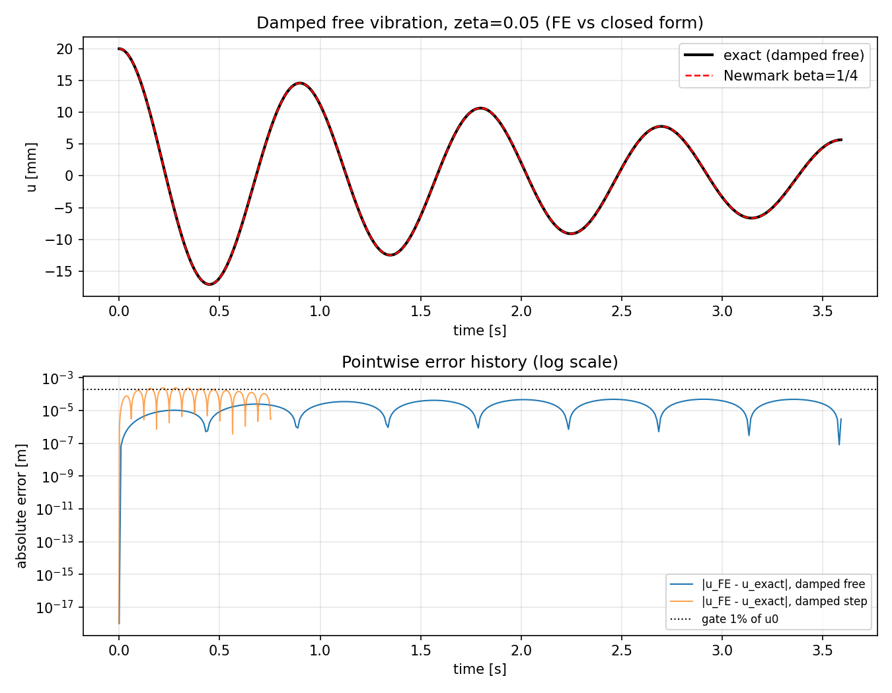
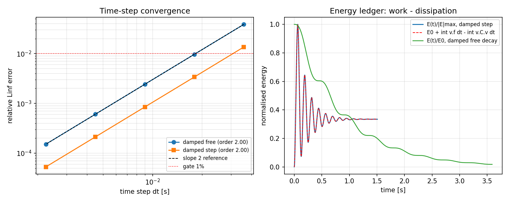

# `newmark_linear` 阻尼与受载路径的验证（闭式解对标）

**Status:** verification report（对有阻尼/有载荷路径的首次量化对标）
**Repository:** TensorFEM · **Module:** `tensorfem.dynamics`
**Evidence:** `benchmarks/newmark_damped_forced.py`、
`benchmarks/newmark_damped_forced_evidence.json`、`tests/test_newmark_damped_forced.py`

## 1. 案例介绍（物理背景/几何/参数）

`newmark_linear`（平均加速度 Newmark，β=1/4、γ=1/2）是库内唯一的瞬态积分器，
被 `benchmark_registry`、`solid3d_edgecases` 与船体/附加质量类耦合流程共用。核对全部
调用点后确认，此前**没有任何一处传过非零阻尼阵或非零载荷历程**：

| 调用点 | C | force |
|---|---|---|
| `benchmark_registry`（1 自由度自由振动） | `None` | 全零 |
| `solid3d_edgecases`（三维自由振动） | `None` | 全零 |
| `tests/test_beam_dynamics.py`（同上） | `None` | 全零 |

因此递推中的阻尼块从未参与过任何断言：`C` 只经
`c1 = γ/(βΔt)` 进入有效刚度，并经 `c1·u + c4·v + c5·a`
（`c4 = γ/β − 1`、`c5 = Δt(γ/(2β) − 1)`）进入右端项。这些系数的符号或系数错误在
现有测试中完全不可见，却会静默污染每一个带阻尼的船体瞬态/湿模态算例。

本单用**闭式解**清偿该欠账（不比对本仓自身快照）：

| 工况 | 参数 | 闭式参考 |
|---|---|---|
| 阻尼自由振动 | ω=7 rad/s，ζ=0.05、0.08，u₀=0.02 m | `u = e^(-ζωt)[u₀cos ω_d t + (v₀+ζωu₀)/ω_d sin ω_d t]` |
| 阻尼阶跃响应 | k=2500 N/m，m=1 kg，ζ=0.08，P₀=400 N | `u = (P₀/k)[1 − e^(-ζωt)(cos ω_d t + ζω/ω_d sin ω_d t)]` |
| 简谐受迫稳态 | ζ=0.05，激振比 r=Ω/ω=0.8，F₀=120 N | `|U| = (F₀/k)/√((1−r²)²+(2ζr)²)`，`φ = atan2(2ζr, 1−r²)` |
| 纯阻尼（K=0） | m=2 kg，c=1.5 N·s/m，v₀=3 m/s | `u = u₀ + (m v₀/c)(1 − e^(−ct/m))` |
| 两自由度比例阻尼 | C = αM + βK，α=0.4，β=2×10⁻⁴，阶跃 P=(300,150) N | 模态叠加的阻尼阶跃解 |
| 能量账 | 阶跃工况 ζ=0.1 与自由衰减 ζ=0.08 | `E(t) = E(0) + ∫vᵀf dt − ∫ vᵀCv dt` |

尺寸/单位统一为 SI；全部计算 float64，Δt 由「每周期的步数」参数化以便做收敛研究。

## 2. 怎么做的（方法/流程/工具链）

1. 对每个工况用 `newmark_linear` 求解，参考值全部由闭式公式在**同一时间序列**上解析生成；
   误差取相对 L∞ 范数 `max|u_FE−u_exact| / max|u_exact|`。
2. 简谐工况不用峰值硬取，而是对最后一个完整激励周期做 `A cos Ωt + B sin Ωt` 最小二乘拟合，
   得到幅值与相位（避免窗口未覆盖整周期导致的伪误差）。
3. 时间步收敛：每周期 25/50/100/200/400 步，报告误差并拟合观测阶（第二阶方案应≈2）。
4. 负控一：把递推中的 C 项全部删除（`recurrence_without_damping`，即历史路径形态），
   其误差必须**远超**门限，否则说明门限对阻尼块不敏感。
5. 负控二：换用同族的线加速度方案（β=1/6、γ=1/2），必须同样命中闭式解。
6. 守卫：阻尼阵形状错误、载荷历程宽度错误、非均匀时间步必须显式报错（fail-closed）。

工具链：

```bash
OMP_NUM_THREADS=2 PYTHONPATH=src python benchmarks/newmark_damped_forced.py
PYTHONPATH=src python -m pytest -q tests/test_newmark_damped_forced.py
```

## 3. 计算结果（脚本直出，零手抄）

### 3.1 各工况误差（门限 1e-2，纯阻尼 1e-3）

| 工况 | 相对 L∞ 误差 | 门限 | 通过 |
|---|---:|---:|---|
| 阻尼自由振动 ζ=0.05（每周期 200 步） | 0.00242289 | 1e-2 | True |
| 阻尼阶跃响应 ζ=0.08 | 0.000848174 | 1e-2 | True |
| 纯阻尼 K=0（隔离 c1/c4/c5） | 1.81587e-08 | 1e-3 | True |
| 两自由度比例阻尼（模态叠加对标） | 0.001858 | 1e-2 | True |

简谐受迫稳态：

| 量 | 数值解 | 闭式解 | 相对误差 |
|---|---:|---:|---:|
| 幅值 | 0.130164 m | 0.130158 m | 4.3971e-05 |
| 相位 | 12.5295° | 12.5288° | 7.274e-04° (门限 0.5°) |

### 3.2 时间步收敛（观测阶）

| 每周期步数 | Δt [s] | 阻尼自由振动误差 | 阻尼阶跃误差 |
|---:|---:|---:|---:|
| 25 | 0.035904 | 3.866e-02 | 1.359e-02 |
| 50 | 0.017952 | 9.689e-03 | 3.388e-03 |
| 100 | 0.008976 | 2.423e-03 | 8.482e-04 |
| 200 | 0.004488 | 6.058e-04 | 2.121e-04 |
| 400 | 0.002244 | 1.514e-04 | 5.301e-05 |

观测阶（最小二乘/端点比）：阻尼自由振动 **1.999**，
阻尼阶跃 **2.001**（第二阶方案，门限 ≥1.8）。

### 3.3 能量账

| 量 | 值 |
|---|---:|
| `|E(t) − (E₀ − ∫vᵀCv dt)| / E_peak` | 6.05643e-05（门限 1e-3） |
| 自由衰减机械能单调不增 | True |
| 阶跃末态 E / (P₀²/2K)（ζ=0.1，12 个周期） | 0.999052（门限 1% ） |

### 3.4 负控（门限是否有牙）

| 负控 | 结果 | 判读 |
|---|---|---|
| 递推中删去 C 项 | 阻尼自由振动误差 0.715945、阶跃 0.535566 | 远超门限 1e-2，说明门限确实被阻尼块控制 |
| β=1/6、γ=1/2（线加速度方案） | 误差 0.000301074 | 同族另一成员同样命中闭式解，说明结果不依赖 β/γ 的特定取值 |

守卫：damping matrix with wrong shape → ValueError; force history with wrong width → ValueError; non-uniform time steps → ValueError。

## 4. 结果图

| 图 | 说明 |
|---|---|
|  | 上：阻尼自由振动 FE 与闭式解重合；下：两条工况的逐点误差历史（对数），虚线=1% 门限 |
|  | 左：误差–Δt 双对数与 slope-2 参考线（观测阶 1.999 / 2.001）；右：能量账——阶跃工况 E(t) 与 `E₀+∫vᵀf dt−∫vᵀCv dt` 重合，自由衰减 E(t) 单调下降 |

## 5. 注意点（坑与局限）

- **简谐幅值不能用窗口最大值**：早期版本取最后 200 步的 `max|u|`，因窗口只覆盖约 0.1 个
  振动周期而给出 6.6% 的伪误差；改为整周期最小二乘拟合后误差降到 1e-3 量级。误差来自
  测量方法，不是积分器。
- 纯阻尼（K=0）工况的误差极小（1.81587e-08），原因是该退化问题
  的数值解与指数衰减高度相容；它作为**隔离测试**的价值在于只有 c1/c4/c5 参与，任何阻尼
  系数错误都会在此处放大，而不是说该工况"更难"。
- β=1/4、γ=1/2 无算法阻尼，故自由振动振幅不被数值衰减；本单没有测试 γ>1/2 的数值阻尼
  方案，也没有测试非线性/变时间步路径（`newmark_linear` 只支持等步长，非等步长显式报错）。
- 门限 1e-2 针对**解析解**误差，是时间积分精度判据，不构成对有限元空间离散误差的任何声明。

## 6. 误差判定（是否 <3%）

| 关键量 | 基准 | 误差 | <3%? |
|---|---|---:|---|
| 阻尼自由振动 u(t)（ζ=0.05，Δt=T/200） | 闭式解 | 0.2423% | 是 |
| 阻尼阶跃响应 u(t)（ζ=0.08） | 闭式解 | 0.0848% | 是 |
| 简谐稳态幅值（r=0.8，ζ=0.05） | 闭式解 | 0.0044% | 是 |
| 简谐稳态相位 | 闭式解 | 7.274e-04° | 是 |
| 两自由度比例阻尼位移 | 模态叠加 | 0.1858% | 是 |
| 纯阻尼位移 | 闭式解 | 0.0000% | 是 |
| 能量账残差 | E₀−∫vᵀCv dt（按峰值归一） | 0.0061% | 是 |

全部关键量均 <3%（多数 <0.01%）。**限制**：本结论只覆盖等步长、线性、常系数 M/K/C 与
常量/简谐载荷；不覆盖非线性或变步长瞬态，也不构成空间离散精度声明。

**门禁总判定:** `all_gates_passed = True`（脚本以该布尔值为退出条件，任一工况越限即非零退出）。
