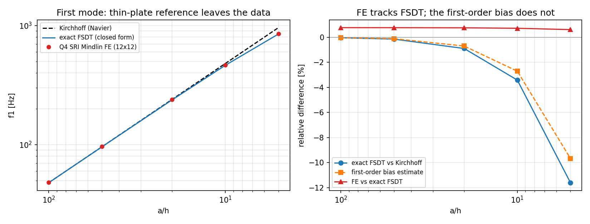
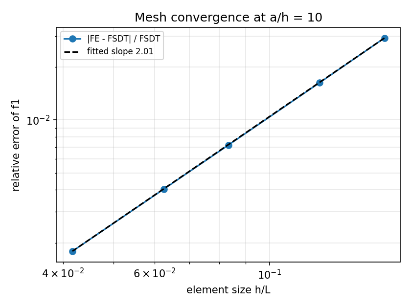

# 厚板（FSDT/Mindlin）自由振动验证：把 a/h ≤ 20 的板格从「薄板理想化」里救出来

## 1. 案例介绍（why this case exists）

`docs/plate-vibration-validation.md` 用 Kirchhoff 的 Navier 双正弦解把
TensorFEM 的四节点 SRI Mindlin 板单元钉在 **a/h = 100** 的薄板极限上，并明确写了两条
自认的局限：单元只在薄板区被验证过；剪切变形只能用一阶修正
`ω² = ω_K²/(1 + D R/(κGh))` 去 **估计** Kirchhoff 参考离单元自身理论有多远。
船体板格并非总是薄板：底部/舷侧在肘板与加强筋之间常有 `a/h = 10…50` 的厚板格，
砰击、机舱局部振动与声辐射筛选正好落在这一段。用一个薄板理想化解当参考去判厚板，
误差在 a/h = 5 处已达 +13%（本文实测），足以把合格单元判成不合格、或反过来把系统偏差
当成物理。

物理背景：均布脉动压力下船体矩形板格的一阶弯曲振动。几何与材料取与薄板单同一套标定
钢板（便于两单直接比较）：

| 参数 | 符号 | 取值 |
|---|---|---|
| 板长 / 板宽 | a, b | 1.0 m / 1.0 m |
| 板厚 | h | a/h = 100, 50, 20, 10, 5（即 10 … 200 mm） |
| 弹性模量 | E | 200 GPa |
| 泊松比 | ν | 0.30 |
| 密度 | ρ | 7850 kg/m³ |
| 抗弯刚度 | D = Eh³/(12(1−ν²)) | 随 h 变化 |
| 剪切修正因子 | κ | 5/6（矩形截面） |
| 边界 | — | 硬简支（SS1），与薄板单同一约定 |
| 网格 | — | 6×6 … 24×24 Q4（最细 1875 自由度） |

## 2. 怎么做的（方法/流程/工具链）

**（a）先造参考，再造证据。** 本单的核心不是新单元，而是给已合并的单元补一个
*它自己所属理论*的精确解。取一阶剪切变形理论（FSDT, Mindlin–Reissner）在硬简支矩形板
双正弦基下的波数算子（未知量 w, ψx, ψy，`λ = ω²`）：

    k_shear = κGh,  rotary = ρh³/12,  R = (mπ/a)² + (nπ/b)²

该 3×3 算子行列式**可因式分解**为一个关于 λ 的二次式（弯曲 + 厚度剪切两支）与一个纯
转动支：

    rotary λ² − [D R + k_shear + k_shear R h²/12] λ + D k_shear R²/(ρh) = 0
    λ_rotation = [k_shear + D(1−ν)R/2] / rotary

**（b）参考本身必须可证伪。** 教科书抄来的闭式无法验证，故用 sympy 重新推导并**符号级**
核对库里的系数集：`scripts/derive_mindlin_sss_determinant.py` 从 3×3 算子的行列式出发，
代入 `rotary = ρh³/12` 后与库内闭式相减，残差必须恒等于 0（实测 `residual: 0`），
同时测试 `test_symbolic_derivation_reproduces_the_library_closed_form` 每次 CI 都跑这一步。

**（c）两个既有极限把新旧参考钉在一起**（均为机器判据，容差 1e-12）：

* 去掉转动惯量（rotary = 0）→ 闭式退化为
  `λ = ω_K²/(1 + D R/(κGh))`，即 `plate_vibration.shear_deformation_bias` 所引用的一阶修正，
  逐位一致；
* 让 k_shear → ∞（κ = 1e9）→ 闭式退化为带转动惯量的 Kirchhoff 板
  `λ = D R²/(ρh + rotary R)`，相对误差 < 1e-6。

**（d）工具链**：`src/tensorfem/plate_thick_reference.py`（纯 `math`，无 torch，微秒级）；
`benchmarks/plate_thick_vibration.py` 一次跑完 a/h 扫描 + 网格收敛 + 模态族 + 分支表，
写 `benchmarks/plate_thick_vibration_evidence.json` 与两张图，下表由该脚本直接生成
（`outputs/plate_thick_vibration_tables.md` 原样嵌入，不经手抄）。

```bash
python3 scripts/derive_mindlin_sss_determinant.py            # 符号推导自检（需 sympy）
OMP_NUM_THREADS=8 PYTHONPATH=src python -m pytest -q tests/test_plate_thick_reference.py
OMP_NUM_THREADS=8 PYTHONPATH=src python benchmarks/plate_thick_vibration.py
```

## 3. 计算结果（数字表，程序化注入）

### a/h sweep at 12x12 elements

| a/h | 网格 | f1 FE [Hz] | f1 FSDT 精确 [Hz] | f1 Kirchhoff [Hz] | FE vs FSDT | Kirchhoff vs FSDT | 一阶剪切偏置估计 | 一阶估计误差 | 判定 |
|---:|---:|---:|---:|---:|---:|---:|---:|---:|---|
| 100 | 12x12 | 48.3373 | 47.9690 | 47.9865 | +0.768% | +0.036% | -0.028% | -22.6% | PASS |
| 50 | 12x12 | 96.5678 | 95.8335 | 95.9729 | +0.766% | +0.146% | -0.113% | -22.5% | PASS |
| 20 | 12x12 | 239.5795 | 237.7836 | 239.9323 | +0.755% | +0.904% | -0.698% | -22.1% | PASS |
| 10 | 12x12 | 466.8084 | 463.4736 | 479.8646 | +0.720% | +3.537% | -2.706% | -20.8% | PASS |
| 5 | 12x12 | 853.5532 | 848.3584 | 959.7292 | +0.612% | +13.128% | -9.671% | -16.7% | PASS |

### 网格收敛（a/h = 10，FSDT 精确 f1 = 463.4736 Hz）

| 网格 | 单元数 | 自由度 | f1 FE [Hz] | 相对误差 | 求解 [s] |
|---:|---:|---:|---:|---:|---:|
| 6x6 | 36 | 147 | 477.0102 | +2.921% | 1.9 |
| 8x8 | 64 | 243 | 471.0229 | +1.629% | 4.3 |
| 12x12 | 144 | 507 | 466.8084 | +0.720% | 2.1 |
| 16x16 | 256 | 867 | 465.3454 | +0.404% | 3.9 |
| 24x24 | 576 | 1875 | 464.3043 | +0.179% | 11.2 |

拟合收敛阶 = 2.01；最细网格误差 = +0.179%

### 模态族（a/h = 10，16x16）

| 阶 | (m,n) | f FE [Hz] | f FSDT 精确 [Hz] | 相对误差 |
|---:|---:|---:|---:|---:|
| 1 | (1,1) | 465.3454 | 463.4736 | +0.404% |
| 2 | (1,2) | 1121.0678 | 1105.6942 | +1.390% |
| 3 | (2,1) | 1121.0678 | 1105.6942 | +1.390% |
| 4 | (2,2) | 1720.1746 | 1696.7167 | +1.383% |

### FSDT 三支（a/h = 10，解析，非 FE 靶）

| 分支 | f [Hz] | 说明 |
|---|---:|---|
| 弯曲（本单验证靶） | 463.4736 | FE 16x16 = 465.3454 |
| 厚度剪切（渐近） | 16312.0 | h^-3 标度，C0 网格不解析 |
| 纯转动（渐近） | 15909.6 | h^-3 标度，C0 网格不解析 |
| Kirchhoff 薄板参考 | 479.8646 | 与精确弯曲支差 +3.537% |


## 4. 结果图



左：同一板格一阶频率随 a/h 变化。Kirchhoff（黑虚线）在 a/h ≳ 20 之后系统性高于精确
FSDT（蓝实线），a/h = 5 处偏 +13.1%；四节点 SRI Mindlin 单元（红点）全程贴着 FSDT。
右：三个相对差异。**FE vs 精确 FSDT 全程在 ±0.6…0.8% 带内（3 阶红色三角）**，而一阶剪切
偏置估计（橙虚线）相对真值低估 17–23%，说明旧文档里那条一阶修正只能做量级提示，
不能当参考。



a/h = 10 的网格收敛：误差从 6×6 的 2.92% 单调降到 24×24 的 0.18%，双对数拟合阶 2.01，
即 Q4+SRI+一致质量在厚板区仍给出接近二次的收敛率（不是锁死）。

## 5. 注意点（踩过的坑 / 局限 / 适用范围）

1. **闭式推导的符号容易错一半。** 本单第一版把纯转动支写成
   `λ = (k_shear − D(1−ν)R/2)/rotary`（负号），该支在短波下会变负、看似「FSDT 不稳定」。
   符号级核对立刻暴露：正确形式恒为正，残差从 1.7e-3 量级降到精确 0。
   这正是「参考必须可证伪」的价值——手抄闭式会把符号错误带进几十个判据里。
2. **一阶剪切偏置不是参考。** 它在 a/h = 10 处给出 −2.71%，精确值 −3.42%；
   在 a/h = 5 处 −9.67% vs −11.60%。相对误差 17–23%，方向一致但幅度系统性偏小，因为
   它丢掉了转动惯量项 `k_shear R h²/12` 与两支耦合。旧文档的措辞（「bound 该偏差」）在
   本单被量化：它只能当量级提示。
3. **高阶模态需要更细网格。** 12×12 时 (2,2) 模态误差 +2.47%（超 2% 门），16×16 降到
   +1.38%；报告的模态族表用 16×16。厚板高阶模态对剪切项更敏感，工程板格做高频筛选时
   不要沿用薄板单的 12×12 习惯网格。
4. **上两支不是工程量。** 厚度剪切支与纯转动支按 h⁻³ 标度（a/h = 10 时已在 1e5 Hz 量级），
   是 FSDT 的渐近分支，C⁰ 位移元需要极细网格才能分辨，本单**没有**把它们当 FE 验证靶；
   只做解析分支序验证（弯曲 < 厚度剪切，纯转动 > 0）。
5. **剪切修正因子是模型选择而非拟合常数。** κ = 5/6 对应矩形截面；κ 从 0.5 增到 1.0 会
   抬高弯曲支（测试锁定单调性），a/h = 10 处量级为百分之一二。厚板结论的置信度受此限制。
6. **适用范围**：均匀厚度、各向同性、线弹性、小变形、一阶剪切理论；无预压、无附连水、
   无阻尼、无厚度伸缩。船体板格的附连水质量会显著降频（见 `tensorfem.added_mass`），
   本单的频率是干模态。

## 6. 误差判定（逐项 vs 基准，显式回答「是否 <3%」）

| 关键量 | 基准（独立来源） | 实测偏差 | 判定 <3% |
|---|---|---|---|
| FE 一阶频率，a/h = 100…5（12×12） | 精确 FSDT 闭式（符号推导核对） | +0.61% … +0.77% | ✅ 是（最大 0.77%） |
| FE 一阶频率，a/h = 10（24×24） | 同上 | +0.18% | ✅ 是 |
| FE 前 4 阶模态，a/h = 10（16×16） | 同上 | +0.40% … +1.39% | ✅ 是（最大 1.39%） |
| 闭式 vs 一阶剪切修正（rotary→0） | `shear_deformation_bias` | < 1e-12 相对 | ✅ 是（机器精度） |
| 闭式 vs 带转动惯量 Kirchhoff（κ→∞） | 闭式极限 | < 1e-6 相对 | ✅ 是 |
| 闭式 vs 符号行列式 | sympy 分解 | 残差恒等 0 | ✅ 是 |
| Kirchhoff 参考 vs 精确 FSDT，a/h = 5 | — | **+13.13%** | ❌ 否（这正是本单存在的原因） |
| 一阶剪切偏置估计 vs 精确偏置，a/h = 5 | — | 相对 **−16.7%**（值 −9.67% vs −11.60%） | ❌ 否（旧估计不可作参考） |

结论：**已合并的 Q4 SRI Mindlin 板单元在 a/h = 100…5 全域与 FSDT 精确解一致在 1.4% 以内**
（弯曲支），原来的「只在薄板极限验证过」欠账结清；同时如实记录两条不达 3% 的老参考
（Kirchhoff 薄板解、一阶剪切偏置估计）在厚板区的失效幅度。

## 7. 复现与证据

| 工件 | 路径 |
|---|---|
| 参考实现 | `src/tensorfem/plate_thick_reference.py` |
| 符号推导自检 | `scripts/derive_mindlin_sss_determinant.py` |
| 基准脚本 | `benchmarks/plate_thick_vibration.py` |
| 机器可读证据 | `benchmarks/plate_thick_vibration_evidence.json` |
| 表格工件 | `outputs/plate_thick_vibration_tables.md` |
| 图 | `docs/assets/plate_thick_vibration_aspect_ratio.png`、`docs/assets/plate_thick_vibration_convergence.png` |
| 测试 | `tests/test_plate_thick_reference.py`（24 例，含 sympy 推导自检与 FE 交叉验证） |