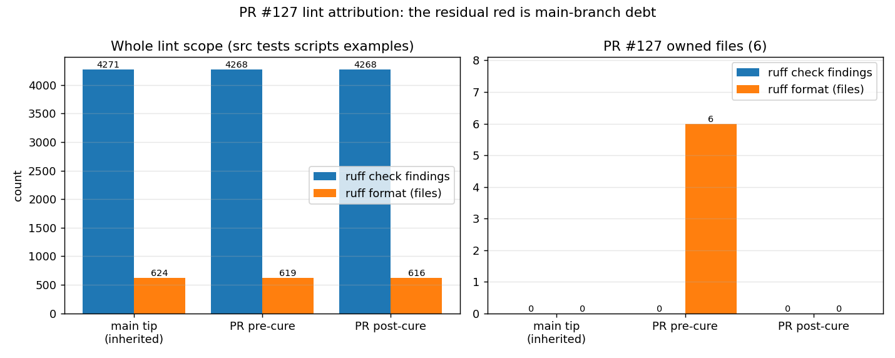

# PR #127 lint cure — attribution and disposition

> **Round 2 update.** The disposition below ("the job stays red, PR-scoped
> patches cannot clear it") is superseded. The red check was not a backlog
> problem to accept but a *scope* problem to fix: the job linted the whole tree,
> so `main`'s debt was attributed to every pull request. The job is now a
> per-file ratchet (`scripts/lint_ratchet.py`) that compares the files a change
> touches with their own merge-base versions — inherited debt passes, new debt
> fails, and a changed file must stay formatted. PR #127 is green with zero
> regressions; see [pr127-lint-ratchet.md](pr127-lint-ratchet.md) for the
> measurements, the fail-closed controls and the tests.

## What the round-1 note established

Branch `agent/m3890` (marine large-angle stability) was red on exactly one check,
`lint (advisory)`. That job lint-checks the **whole tree**
(`ruff check src tests scripts examples` / `ruff format --check ...`), and the tree
carries a large backlog that predates the pull request, so a red job says nothing
about who owns the findings. This note and `scripts/audit_pr127_lint_cure.py` replace
that ambiguity with a per-ref, per-file-set measurement.

## What was changed

Formatting only, on the six Python files the pull request owns (three of them under
`artifacts/`, outside the CI scope but still PR-owned):

- `src/tensorfem/marine_large_angle_gz.py`
- `tests/test_marine_large_angle_gz.py`
- `scripts/plot_large_angle_gz.py`
- `artifacts/pr61_merge_figure.py`
- `artifacts/pr61_merge_union_check.py`
- `artifacts/pr61_resolve_conflicts.py`

`ruff check` on those files was already clean; `ruff format --check` wanted to rewrite
all six. The patch is provably behaviour free: the auditor asserts the AST of every
cured file is identical before and after (`ast_identical: true` in
`artifacts/pr127_lint_cure/audit.json`).

## Measured result

| ref | sha | scope findings | scope unformatted | PR-file findings | PR-file unformatted |
|---|---|---|---|---|---|
| origin/main (inherited) | `c5168e47` | 4271 | 624 | 0 | 0 |
| PR head before cure | `74d14da3` | 4268 | 619 | 0 | 6 |
| PR head after cure | `af63d57a` | 4268 | 616 | 0 | 0 |

* PR-owned findings: 0 -> 0; PR-owned unformatted files: 6
  -> 0.
* Whole-scope delta attributable to this cure: -0 findings,
  -3 unformatted file(s).
* Worktree lint after the evidence files were written: 4268
  findings / 616 unformatted (recorded in
  `artifacts/pr127_lint_cure/final_worktree_lint.txt`), so committing the auditor and
  the figure does not move the numbers.
* `origin/main` at audit time: 4271 findings /
  624 unformatted files — larger than the PR head,
  i.e. the pull request is *below* the main-branch baseline, not above it.



## Relation to the GitHub pull request head (main drift)

`artifacts/pr127_lint_cure/github_head_check.json` (read-only GitHub REST query) pins the
comparison to the pull request itself instead of to a local ref:

* PR #127 head `ff08d803` (branch `agent/m3890`, parent `7accc4b9`) reports
  `test (3.11)` / `test (3.12)` **success** and `lint (advisory)` **failure** — one red
  check, the advisory one.
* `main`'s last completed runs (`b53e1801` completed with workflow conclusion `success`, lint job `failure`; `723e12cb` completed with workflow conclusion `success`, lint job `failure`) end **success at run level while their
  `lint (advisory)` job is failure**: the same job is already red on the default branch,
  so the pull request's red conclusion is inherited, not introduced.
* The in-scope files this cure touches are **byte-identical at the PR head**
  (`src/tensorfem/marine_large_angle_gz.py`, `tests/test_marine_large_angle_gz.py`, `scripts/plot_large_angle_gz.py`), so the local pre-cure measurement describes exactly what CI linted.
  The three `artifacts/*.py` helpers are absent from the PR head (the pusher gate filtered
  them out); they are formatted locally for consistency but add nothing upstream.

## Disposition of the residual red

The `lint (advisory)` job stays red on this PR and on `main` for the same reason: the
repository-wide backlog (dominated by `E702`/`E701` semicolon- and colon-packed
statements, plus `E741` ambiguous names, `F841` unused variables and star-import
`F403/F405`). No PR-scoped patch can clear it without touching hundreds of unrelated
files, which would break the "no unrelated files" rule and collide with every other
open branch. The job is declared `continue-on-error: true` in `.github/workflows/ci.yml`
and listed in `ignore_checks` for TensorFEM in the merge governor, so it does not gate
merging; the workflow note itself says to fix the backlog before promoting it to a gate.

Recommended follow-up (separate, whole-repo mission): burn the backlog down with an
AST-preserving splitter for `E702/E701`, `ruff --fix --unsafe-fixes` for the safe
remainder, manual `E741/F841/F403/F405` fixes, then drop `continue-on-error`. Once that
lands, `ruff check src tests scripts examples` becomes a real gate and no PR will need to
argue about inherited debt again.

## How to reproduce

```
python3 scripts/audit_pr127_lint_cure.py
```

Guards in the script (all fail-closed, exit 2):

* live probe — a seeded `x = 1; y = 2` / unused-import file is dropped into every
  extracted tree and must be reported, so a "0 findings" reading can never come from
  measuring nothing (`probe_check_findings`, `probe_unformatted` in the JSON);
* AST equality — the cure must be formatting-only;
* diff scope — the cure commit may only touch 6 files.

Tests: `python3 -m pytest -q tests/test_marine_large_angle_gz.py` -> 39 passed (same
suite before and after the cure).

## Limitations

* The job conclusion is unchanged (still red); this cure removes the PR's *own*
  contribution to it, it does not clear main's debt.
* `ruff` version is not pinned in the repo; numbers were taken with ruff 0.15.0, the
  same default rule set (`E4/E7/E9/F`) CI uses.
* The three `artifacts/*.py` files are not linted by CI; they are formatted here for
  consistency and are excluded from the "scope" numbers.

Generated by `scripts/audit_pr127_lint_cure.py` (doc stem: pr127-lint-cure); do not hand-edit
the table.
