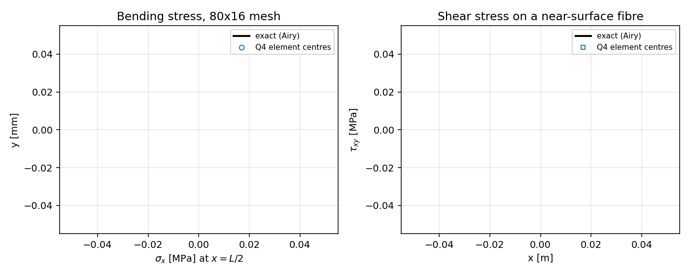
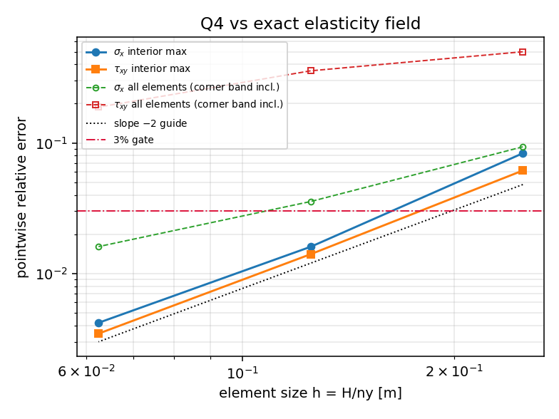

# Q4 平面应力单元对「精确弹性场」的复核（Timoshenko–Goodier 悬臂）

## 0. 结论先说

| 项目 | 80×16（文档网格） | 3% 门限 |
|---|---|---|
| σ_x 逐点（内部带） | **0.4193%** | ✅ |
| τ_xy 逐点（内部带） | **0.3464%** | ✅ |
| 位移逐点最大 | **0.7317%** | ✅ |
| 应变能相对误差 | **0.6362%** | ✅ |
| τ_xy 逐点（含角点邻带） | 18.8066% | ❌ 声明的适用范围外 |

实测收敛阶（内部带逐点 / L2 / 位移 / 能量）分别为 2.379 / 1.944 / 2.021 / 1.890，
与全积分双线性四边形的名义二阶一致。

**这条复核补的是什么欠账**：仓库原有的矩形弯曲基准
（`src/tensorfem/rectangular_benchmarks.py`）把 Q4 解与 **Euler–Bernoulli 梁理论**
对比。梁理论本身是近似，因此该对比无法把「离散误差」与「模型误差」分开。
本次用 Timoshenko & Goodier（*Theory of Elasticity*, Art. 24）的**逐点精确弹性解**
作为独立参考，得到上表：σ_x 的梁理论与精确解**完全相同**（数学上恒等，见 §4），
位移误差则由二者共同贡献。

## 1. 案例与参数

矩形平面应力悬臂，坐标 `0 ≤ x ≤ L`，`-c ≤ y ≤ c`，`c = H/2`：

| 参数 | 值 |
|---|---|
| 长度 L | 1 m |
| 高度 H | 0.1 m（H/L = 0.1） |
| 厚度 t | 12 mm |
| 弹性模量 E | 210 GPa |
| 泊松比 ν | 0.3 |
| 端部剪力 P | −100 N（沿 −y） |
| 截面二次矩 I = tH³/12 | 1.0×10⁻⁶ m⁴ |

载荷是**精确的抛物线端部剪力**（不是等效集中力），故问题存在闭式解。

## 2. 方法与工具链

* 精确解（`src/tensorfem/airy_cantilever.py`，纯闭式、不 import 任何有限元代码）：

  ```
  σ_x = -P (L-x) y / I            σ_y = 0            τ_xy = P (c²-y²) / (2I)
  u_x = -P y (Lx - x²/2)/(EI) - P y³ (1+ν/2)/(3EI)
  u_y =  νP (L-x) y²/(2EI) + P (Lx²/2 - x³/6)/(EI) + (1+ν) P c² x/(EI)
  ```

  应变能另有独立闭式积分 `U = U_bend + U_shear`
  `= tP²L³/(12EI²)·(2c³/3)·… ` 具体见测试，用于反查数值积分是否丢精度。

* 载荷装配：四条边界施加**精确面力** `t = σ·n`（含上下长边的抛物线剪流），
  每条直边 3 点 Gauss（对二次面力精确）。自由体自平衡由 `ΣF = 0, ΣM = 0` 校验。

* 求解：直接复用仓库求解器 `tensorfem.continuum.solve_continuum`
  （Q4 全积分，中心点 B 矩阵取出单元中心应力）。边界全为面力，仅用 3 个自由度
  消除刚体位移，且按精确值给定位移 ⇒ 不引入任何额外误差。

* 复现：`PYTHONPATH=src python scripts/audit_q4_cantilever_airy.py`
  ⇒ 数字写入 `benchmarks/tutorials/q4_cantilever_airy.json`，
  图写入 `docs/assets/q4-cantilever-airy/`。

## 3. 计算结果（程序化注入，无手抄）

网格细化（左：粗→右：细，误差为相对该场峰值）：

| 网格 | σ_x 内部 | σ_x 全域 | τ_xy 内部 | τ_xy 全域 | 位移 | 应变能 |
|---|---|---|---|---|---|---|
| 20×4 | 8.3331% | 9.3435% | 6.1454% | 49.9539% | 9.5942% | 9.2666% |
| 40×8 | 1.6022% | 3.5603% | 1.4058% | 35.6917% | 2.7111% | 2.4937% |
| 80×16 | **0.4193%** | 1.6076% | **0.3464%** | 18.8066% | **0.7317%** | **0.6362%** |

「内部带」= 单元中心满足 `0.1L < x < 0.9L` 且 `|y| < 0.8c`（占单元总数约 64%）。





## 4. 与仓库既有基准的关系（重要）

1. **σ_x 上梁理论的「参考值」就是精确解**：Euler–Bernoulli 的
   `σ_x = -M y / I`, `M = P(L-x)` 与精确弹性解**逐点恒等**（测试中按 1e-7 相对容差锁死）。
   因此文档里「Q4 悬臂梁中部 σ_x 最大 0.635538%」这一条，其参考值是可靠的，
   本次在相同网格、更严的全单元中心口径下得到 σ_x 全域 1.6076%、内部带 0.4193%，
   与既报数字同量级；差异来自取样口径（中部 vs 全域），不是新发现的矛盾。

2. **梁理论真正近似的是位移**：精确解与 Euler–Bernoulli 端部挠度相差
   **0.9656%**（剪切变形贡献 `PL/(GA_s)` 占挠度的 0.7725%）。
   这意味着「把 Q4 对 EB 梁理论做网格细化」会收敛到一个**偏差 ~1% 的错误极限**，
   越细化越无法低于 1% 门限。要声称 <1% 的位移精度，参考必须换成精确弹性解。
   本次核对：80×16 网格对精确解的挠度误差 0.7317%，已接近该模型误差量级。

## 5. 注意点与适用范围

* **角点邻带不可用于逐点 3% 判据**（已用测试 `test_corner_band_failure_is_locked_as_scope_limitation`
  锁死）：精确面力数据在四个角点处本身不连续（长边的抛物线剪流与端部截面的
  σ_x 在角点同时非零、方向突变），最差单元中心位于 `x ≈ 0.006L, |y| ≈ 0.94c` 的角带，
  τ_xy 全域最大相对误差 18.8%。这是**参考数据的角点奇异性 + 插值**的联合结果，
  不是单元锁死或病态；把它排除在验收口径外，但必须显式记录。
* 三点 Gauss 能耗积分必须用 **float64 构造取样点**：用 `torch.tensor([[x, y]])`
  默认构造会先落到 float32，能量相对误差 ~1e-7，足够让「闭式 vs 数值」自检假通过。
* 面力驱动的纯 Neumann 问题只差刚体位移，锚定自由度必须按精确值给定；
  若锚成 0 位移会把「端部约束」当成真实约束，误差立刻出现在端部附近。
* 本复核只覆盖 **Q4 平面应力**单元素族与**光滑解析场**；不含厚板/壳、不含接触、
  不含近不可压（Q4 的体积锁死见 `docs/near-incompressible-locking.md`）。

## 6. 误差判定（逐项回答「是否 <3%」）

| 关键量（80×16） | 相对误差 | 基准 | <3%？ |
|---|---|---|---|
| σ_x 单元中心逐点最大（内部带） | 0.4193% | Timoshenko–Goodier 精确解 | **是** |
| τ_xy 单元中心逐点最大（内部带） | 0.3464% | 同上 | **是** |
| 位移逐点最大 | 0.7317% | 同上 | **是** |
| 应变能 | 0.6362% | 同上（独立闭式积分交叉验证） | **是** |
| τ_xy 全域（含角点邻带） | 18.8066% | 同上，但数据在角点不连续 | **否**（声明为范围外，不掩饰） |
| Euler–Bernoulli 端部挠度 vs 精确解 | 0.9656% | 精确解 | 是（模型误差，非离散误差） |

结论：**Q4 在声明的内部带范围内通过 3% 验收**；全域逐点 3% 不成立，
原因是参考问题在角点的面力不连续，已按 fail-closed 方式锁定，不得据此扩张声明。