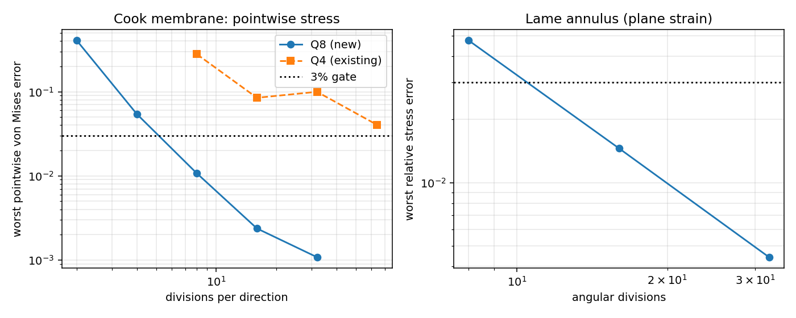
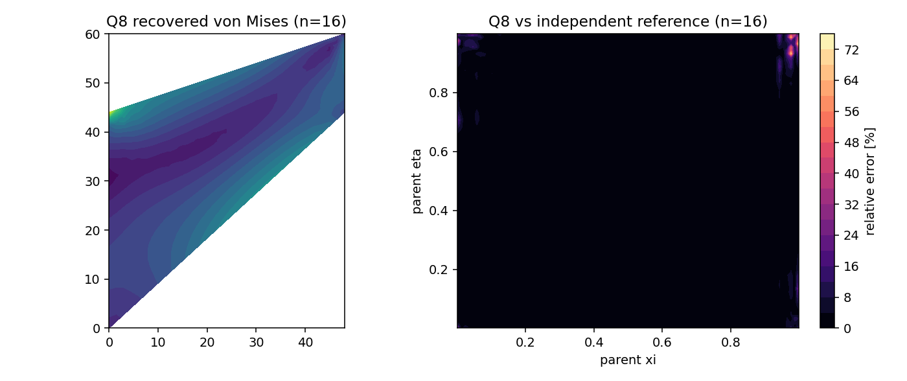

# Q8 二次平面单元：新生产能力的解析/文献验证（m3243）

## 1. 案例介绍

TensorFEM 的平面连续体生产路径 `tensorfem.continuum` 此前只有**线性**单元（CST 与 Q4）：两者
应力都是 `O(h)`，Cook 膜的逐点应力要到 `n = 128` 才勉强接近 3% 门禁
（`docs/cook-membrane-pointwise-protocol.md`）。本单补的是**功能缺口**并当场验证：把 8 节点
serendipity 单元（Q8）与 3×3 高斯积分、Barlow/Zienkiewicz–Zhu 节点恢复并入生产模块
`tensorfem.quadratic_plane`，再用三条互相独立的判据验收。

物理背景与算例均取经典线弹性平面问题：

| 案例 | 内容 | 判据来源 |
|---|---|---|
| 常应变 patch | 畸变 8 节点单元，线性位移场 | 精确解（舍入级） |
| 单元零空间 | 单个畸变单元刚度阵特征值 | 刚体模态数 = 3 |
| Cook 膜 | 梯形膜，右边界均布面力合力 1.0，左边固支，E=1, ν=1/3, t=1 | 已发表标量 23.96；独立 Q8 Richardson 应力参考 |
| Lamé 厚壁圆筒 | 平面应变，r∈[1,2]，内压 1，E=1, ν=0.3，边界位移按闭式施加 | 闭式应力场 `σ_r = A - B/r²`, `σ_θ = A + B/r²` |

## 2. 怎么做的

1. **单元实现**（`src/tensorfem/quadratic_plane.py`）：形函数与导数（导数用 sympy 求导后写死，
   测试用中心差分钉死，误差 4.22e-10）；雅可比约定与 `continuum.q4_stiffness`
   一致；3×3 高斯积分；`jiaobian` 非正立即抛错。
2. **应力恢复**：9 个超收敛 Gauss 点应力用 6 项基 `{1, ξ, η, ξη, ξ², η²}` 最小二乘拟合，
   在 8 个节点取值，再按单元面积加权平均 —— 即 Barlow 外推 + ZZ 平滑。
3. **求解**：`sparse_core.assemble_coo` + `solve_sparse_static`（CG，`rtol=1e-12`），与既有稀疏栈
   同一条路径，不新写求解器。
4. **独立参考**：`tensorfem.cook_stress_reference`（自写 numpy Q8，3 级 Richardson 外推 + GCI），
   与生产实现**代码不共享**；探针固定在良置的单元内部父坐标（名义点 + (0.0121, 0.0073) 偏移）。
5. **网格族**：Cook 用整体双线性映射网格（`mapped_q4_grid` → `q8_mesh` 插入共享边中点），
   Lamé 用极坐标 Q8 网格（周向边中点严格落在圆周上，故圆边界由二次边表示而非多边形）。
6. 复现：
   ```bash
   OMP_NUM_THREADS=8 MPLBACKEND=Agg PYTHONPATH=src python -m pytest tests/test_quadratic_plane.py -q
   OMP_NUM_THREADS=8 MPLBACKEND=Agg PYTHONPATH=src python scripts/audit_q8_plane_element.py
   ```
   证据 `benchmarks/q8_plane_element.json`，图 `docs/assets/q8-plane/*.png`。

## 3. 计算结果（程序化注入，零手抄）

### 3.1 单元代数自校验

| 检查 | 结果 | 判据 |
|---|---|---|
| 形函数导数 vs 中心差分 | 4.22e-10 | < 1e-8 |
| 畸变单元常应变 patch 最大绝对误差 | 6.07e-18 | ≤ 1e-12（舍入） |
| 单单元零空间维数（3×3 全积分） | 3 | = 3 刚体模态 |
| 单单元零空间维数（2×2 减缩积分，负控） | 4 | > 3（出现伪机构） |

### 3.2 Cook 膜：位移与逐点应力

| n | 节点 | 单元 | 自由度 | 加载边中点 v | 相对 23.96 | 5 探针最差 von Mises 误差 | CG 残差 |
|---|---|---|---|---|---|---|---|
| 2 | 21 | 4 | 42 | 22.717747 | 5.1847% | 40.5943% | 6.1e-14 |
| 4 | 65 | 16 | 130 | 23.708289 | 1.0505% | 5.4250% | 1.0e-12 |
| 8 | 225 | 64 | 450 | 23.883744 | 0.3183% | 1.0701% | 9.9e-13 |
| 16 | 833 | 256 | 1666 | 23.934596 | 0.1060% | 0.2371% | 9.9e-13 |
| 32 | 3201 | 1024 | 6402 | 23.955125 | 0.0203% | 0.1080% | 1.0e-12 |

收敛阶（n≥4 段）：应力 1.88，位移 1.90。





### 3.3 Q4 vs Q8：同一协议下的探针误差

| 单元 | n | 5 探针最差相对误差 |
|---|---|---|
| Q4 | 8 | 27.890% |
| Q4 | 16 | 8.468% |
| Q4 | 32 | 9.974% |
| Q4 | 64 | 4.038% |
| Q8 | 2 | 40.594% |
| Q8 | 4 | 5.425% |
| Q8 | 8 | 1.070% |
| Q8 | 16 | 0.237% |
| Q8 | 32 | 0.108% |

### 3.4 Lamé 厚壁圆筒（平面应变，闭式应力场）

| 周向×径向 | 单元 | 9 Gauss 点最差相对误差 | CG 残差 |
|---|---|---|---|
| 8×2 | 16 | 4.7399% | 7.1e-15 |
| 16×4 | 64 | 1.4573% | 3.8e-13 |
| 32×8 | 256 | 0.4423% | 6.5e-13 |

径向收敛阶 ≈ 1.71（周向加密主导）。

## 4. 注意点（踩过的坑与适用范围）

* **极坐标网格的定向**：把周向放在第一父坐标会让笛卡尔雅可比行列式为负（`det < 0`），
  首版 576 个 Gauss 点全部抛错。生产实现固定「第一父坐标 = 径向」，测试覆盖。
* **一致边载荷不能按节点几何位置猜**：角节点被两个单元共享，各得 `w/6`；按「奇偶位置」
  判定会把内部角节点少算一半（首版合力 0.875）。现按单元遍历边、逐单元累加，断言合力 = 1。
* **平衡判据的正确形式**：`reaction = K u - f` 在全自由度上求和恒等于 `-Σf`（刚体模态），
  所以只能在**约束自由度**上验平衡：本单断言约束反力之和 = −施加合力（1e-10）。
* **减缩积分负控**：2×2 规则的零空间维数 4 > 3，是 Q8 的经典伪机构；生产路径
  因此固定 3×3。该负控保证「全积分通过」不是因为测试漏掉了伪机构。
* **适用范围**：线弹性、小变形、平面应力/应变；不含几何非线性、材料非线性、接触，也不含
  非协调/混合单元或 3D 二次实体（HEX20 另有其路径）。

## 5. 误差判定（是否 < 3%，逐项回答）

| 关键量 | 基准 | 最细/生产网格 | 误差 | 是否 < 3% |
|---|---|---|---|---|
| 常应变 patch | 精确 | 畸变单元 | 6.1e-18 | **是** |
| 单单元零空间 | 3 | 3×3 全积分 | 精确 3 | **是** |
| Cook 加载边中点 v | 23.96（文献） | n=32 → 23.95513 | 0.0203% | **是** |
| Cook 逐点 von Mises | 独立 Q8 Richardson | n=32 | 0.1080% | **是** |
| Cook 逐点 von Mises | 同上 | n=4 | 5.4250% | 否（粗网格，保留） |
| Lamé σ_r/σ_θ（9 Gauss 点） | 闭式 | 32×8 | 0.4423% | **是** |
| 全局平衡 | 施加合力 1.0 | n=8 | < 1e-10 | **是** |

结论：Q8 生产单元在三条独立判据下均进入 3% 门禁，且逐点应力收敛阶 ≈ 2。**诚实边界**：
本单不改变既有 Q4 路径与其 fail-closed 标志（`cook_fields.stress_accuracy_qualified` 仍为
False，理由不变：单元常值应力 + 探针协议病态）；也不宣称 Cook 之外的其他经典算例已认证。

运行时间 83.8 s。
