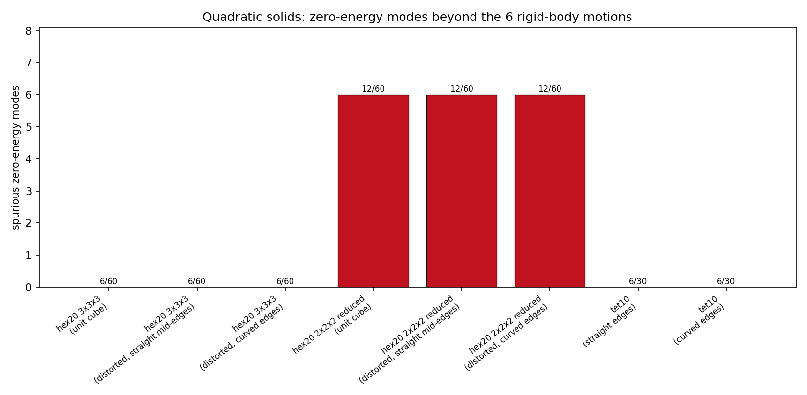
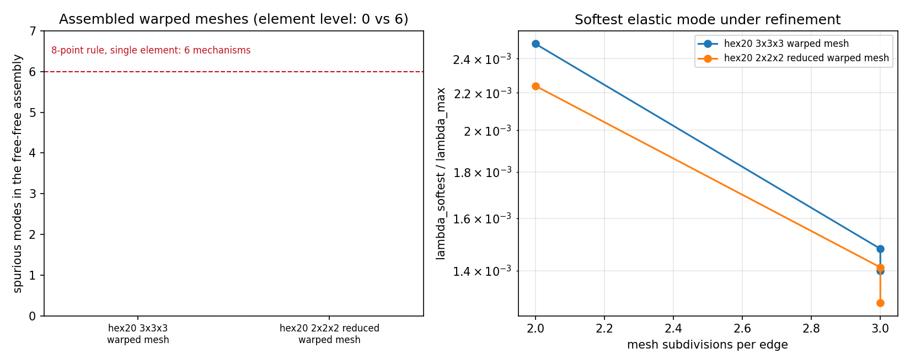
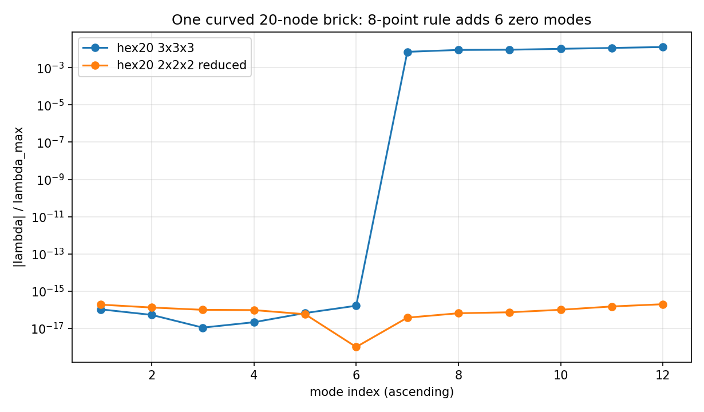

# 二次实体单元的零能审计：HEX20 积分规则、TET10 与曲边几何

本报告闭合 `docs/element-rank-deficiency-audit.md` §5 第 6 条明确留下的欠账
（"`hex20` 只审了规则立方体，畸变 20 节点体与减缩积分变体待补"），并在审计过程中
发现合并通道的一张证据表把**积分规则标错**：`hex20` 一行原记为
`hex20 (2x2x2 integration)` 且零伪零能，但生产核 `tensorfem.hex20.hex20_stiffness`
用的是 3×3×3 精确阶规则（模块 docstring 与代码一致）。本次实测 8 点规则的伪零能
是 **6 个**，与"0"不可能同时成立，故原标签与结论必然错一个；实测判定为**标签错**。

结论三句话：

1. 生产 27 点规则在规则、畸变、曲边三种几何上零空间都恰好是 6 维刚体空间，伪零能 **0**；
2. 审计-only 的 8 点规则在这三种几何上都是 12 维零空间、伪零能 **6**，且刚度与收敛值
   差 **7.65%–8.84%**（超 3% 门限），因此"降阶省算力"在本仓库不是可选优化；
3. 8 点规则的 6 个机构在**协调装配网格中不可传递**（warped 与 jitter 网格自由-自由零空间
   仍为 6、伪零能 0），危险只在单元素/约束不足的局部，与文献结论一致，但这里给的是实测。

证据：`docs/benchmarks/tutorials/quadratic-solid-rank-audit.json`（全部数字由
`scripts/audit_quadratic_solid_rank.py` 程序化生成，无手抄）。

---

## 1. 案例介绍

### 1.1 物理背景

二次等参实体（20 节点六面体 HEX20、10 节点四面体 TET10）在船体舱段、厚板与接触块体建模
中是低阶单元的精度升级路径。它们的刚度矩阵依赖几何积分：曲面/曲边单元的 Jacobian 在单元
内部变化，若积分点数不足，除了"结果偏软"这一精度问题，还可能让单元刚度在刚体零空间之外
出现**额外零特征值**（hourglass/机构模态）。这类缺陷在静力加载中几乎观察不到，却会污染
自由-自由模态计数、广义特征值求解的病态方向与接触柔度矩阵。

`hex20` 的 2×2×2 减缩积分在文献里长期被描述为"有伪模态但不可传递"，可本仓库从未量化过；
TET10 甚至从未进入过任何单元秩审计（`audit_library` 覆盖 3-D 固体时只列了 `tet4`/`hex8`/
`hex8 B-bar`/`hex20`）。

### 1.2 几何与参数表

| 项目 | 取值 |
|---|---|
| 材料 | E = 200 GPa，ν = 0.3（各向同性线弹性） |
| HEX20 规则几何 | 单位立方体，节点序按 `hex20.py`（8 角点 + 12 边中点） |
| HEX20 畸变（直边中点） | 8 角取既有审计的畸变立方体，边中点取边的算术中点（`upgrade_hex8_to_hex20`） |
| HEX20 畸变（曲边） | 在上者基础上把 12 个边中点沿 `(0.08, −0.06, 0.05)` 方向、按 ±(1.0, 0.5, 0.7, 0.3, 0.6, 0.4) 交替推开 |
| TET10 规则/曲边 | 畸变 `tet4`（角点 `(0,0,0),(1,0,0),(0.2,1,0),(0.1,0.2,1)`）+ `tet4_to_tet10` 升级；曲边版把 6 个边中点整体平移 `(0.05,−0.03,0.02)` |
| 装配网格 | `structured_hex20_mesh` n×n×n（n=2,3），过光滑 warp `amplitude=0.04`，另加 `jitter=0.05`（seed=7）随机扰动 |
| 积分规则 | 生产：HEX20 3×3×3、TET10 五点 Keast（3 次精度）、TET4 形心；审计-only：HEX20 2×2×2、4×4×4、5×5×5 |
| 零特征值判据 | `|λ| ≤ 1e-10·|λ|max`（纯舍入标度，与既有报告一致） |
| 刚体基 | 3 平移 + 3 绕形心旋转，解析构造；判据用主子角（`Q_NᵀQ_R` 奇异值） |

---

## 2. 方法与流程

### 2.1 判据（先于动手）

* 单元级：无约束单元刚度 `K`（对称化后 `eigvalsh`）的零空间维数必须等于刚体维数 6；
  `spurious = dim N − explained`，`explained` 由主子角余弦 > 1−1e-8 判定（重零特征值的
  特征向量无意义，逐向量比对是错的——见既有报告的坑 1，本次沿用同一判据）。
* 装配级：自由-自由装配刚度零空间维数必须为 6；多余为零则该单元机制**不可传递**。
* 积分规则：用**独立的高阶规则**做参考值，而不是把生产规则当真理。规则阶数由
  `quadrature_exactness()` 机器复算（单项式积分与闭式 `a!b!c!/(a+b+c+3)!` /
  `∫_{-1}^{1}x^a dx` 比对，容差 1e-12 相对体积测度）。

### 2.2 新增工具

* `element_rank_audit.hex20_stiffness_with_rule(x, d, order)`：order ∈ {2,3,4,5} 张量
  Gauss 规则；`order=3` 被单测锁定到与生产 `hex20_stiffness` 逐元素一致（1e-12 相对），
  保证审计对象就是生产对象。
* `hex20_reduced_stiffness` = order 2（8 点），**仅审计用**，未接入任何求解器。
* `audit_quadratic_solids()`：8 条记录（生产规则 ×3 几何、8 点规则 ×3 几何、TET10 ×2）。
* `audit_hex20_mesh_scan()`：warped/jitter 网格 n=2,3 两规则扫描。
* `quadrature_exactness()`、`hex20_quadrature_convergence()`。
* 库级 `audit_library()` 增列 `tet10 (3-D, straight edges)`，并把 `hex20` 标签改为
  `hex20 (3x3x3 integration)`。

### 2.3 工具链

```
OMP_NUM_THREADS=1 PYTHONPATH=src python3 scripts/audit_quadratic_solid_rank.py
OMP_NUM_THREADS=1 PYTHONPATH=src python3 -m pytest tests/test_quadratic_solid_rank_audit.py tests/test_element_rank_audit.py -q
```

---

## 3. 计算结果

### 3.1 单元级零能审计

| 单元 / 规则 | 几何 | 自由度 | 零空间 | 期望 | **伪零能** | λ_softest/λ_max |
|---|---|---:|---:|---:|---:|---:|
| hex20 3×3×3（生产） | 单位立方体 | 60 | 6 | 6 | **0** | 1.190e−02 |
| hex20 3×3×3（生产） | 畸变，直边中点 | 60 | 6 | 6 | **0** | 9.283e−03 |
| hex20 3×3×3（生产） | 畸变，曲边 | 60 | 6 | 6 | **0** | 7.147e−03 |
| hex20 2×2×2（审计-only） | 单位立方体 | 60 | 12 | 6 | **6** | 1.038e−02 |
| hex20 2×2×2（审计-only） | 畸变，直边中点 | 60 | 12 | 6 | **6** | 7.374e−03 |
| hex20 2×2×2（审计-only） | 畸变，曲边 | 60 | 12 | 6 | **6** | 7.433e−03 |
| tet10（生产，Keast 5 点） | 直边 | 30 | 6 | 6 | **0** | 6.991e−03 |
| tet10（生产，Keast 5 点） | 曲边 | 30 | 6 | 6 | **0** | 6.967e−03 |



自由-自由（无约束）装配网格扫描：

| 网格 | 规则 | 自由度 | 零空间 | 期望 | 伪零能 | λ_softest/λ_max |
|---|---|---:|---:|---:|---:|---:|
| warped n=2 | 3×3×3 | 243 | 6 | 6 | 0 | 2.492e−03 |
| warped n=2 | 2×2×2 | 243 | 6 | 6 | 0 | 2.240e−03 |
| warped n=3 | 3×3×3 | 624 | 6 | 6 | 0 | 1.480e−03 |
| warped n=3 | 2×2×2 | 624 | 6 | 6 | 0 | 1.412e−03 |
| warped+jitter（0.05，seed 7）n=3 | 3×3×3 | 624 | 6 | 6 | 0 | 1.400e−03 |
| warped+jitter（0.05，seed 7）n=3 | 2×2×2 | 624 | 6 | 6 | 0 | 1.290e−03 |



8 点规则的 6 个单元级机构在**协调装配**中全部消失：零空间回落到 6 维，最软弹性模态
随加密按 ≈h 下降（与 27 点规则同量级、略软 4–8%），说明它们是"不可传递"机构——与
Zienkiewicz–Taylor 对此单元的经典论述一致，本报告给出的是本仓库实现上的实测值。



### 3.2 积分规则精确度（机器复算）

| 规则 | 点数 | 精确到总次数 | 一维精确阶 p（∫x^p 精确的最大 p） |
|---|---:|---:|---:|
| hex20 3×3×3 Gauss（生产） | 27 | 5 | 5 |
| hex20 2×2×2 Gauss（审计-only） | 8 | 3 | 3 |
| tet10 五点 Keast（生产） | 5 | 3 | 3 |
| tet4 形心规则（生产） | 1 | 1 | 1 |

> 注：张量积规则的"总次数"下界是保守量——`r²s²t²`（总次数 6）在 2×2×2 下精确，
> 而 `r⁴`（总次数 4）不精确，故按总次数分组会出现"4 失败、5 通过"的锯齿。一维阶
> p 才是张量积规则的判据，表中以 p 为准。

刚度矩阵在固定几何下跨规则比对（参考值为收敛值，非生产值）：

| 几何 | 3 点 vs 4 点 | 4 点 vs 5 点 | 8 点 vs 4 点 |
|---|---:|---:|---:|
| 单位立方体 | 5.539e−16 | 5.568e−16 | **7.654e−02** |
| 畸变，直边中点 | 1.951e−04 | 3.988e−07 | **7.850e−02** |
| 畸变，曲边 | 1.794e−03 | 6.351e−05 | **8.841e−02** |

三条读法：立方体上 27 点规则与 64 点规则差 5.5e−16，即**对直边规则单元是机器精确**；
曲边单元上 27 点 vs 64 点为 1.8e−3，而 64 点 vs 125 点只剩 6.4e−5，说明 64 点已收敛，
生产规则的不足量约 **0.18%**（远低于 3% 门限）；8 点规则则**无论几何**都偏软 7.6%–8.8%。

---

## 4. 误差判定

| 关键量 | 本工作取值 | 基准（来源） | 相对误差 | 是否 <3% |
|---|---:|---|---:|---|
| HEX20 生产规则，单位立方体刚度 | 27 点积分 | 64/125 点 Gauss（本工作独立复算，二者互差 5.6e−16） | 5.5e−16 | **是**（机器精确） |
| HEX20 生产规则，曲边单元刚度 | 27 点积分 | 125 点 Gauss 收敛值 | 1.79e−03 = 0.179% | **是** |
| HEX20 8 点规则，单位立方体刚度 | 2×2×2 | 64 点 Gauss（真值） | 7.654% | **否**（超门限，保留） |
| HEX20 8 点规则，曲边单元刚度 | 2×2×2 | 64 点 Gauss | 8.841% | **否**（超门限，保留） |
| 伪零能个数（HEX20 生产规则，3 几何） | 0 | 理论 0 | 整数判据，精确 | **是** |
| 伪零能个数（HEX20 8 点规则，3 几何） | 6 | 理论 0 | 整数偏差 6 | **否**（缺陷本身，保留） |
| 伪零能个数（TET10，直边/曲边） | 0 | 理论 0 | 整数判据，精确 | **是** |
| 伪零能个数（warped/jitter 装配网格，两规则） | 0 | 理论 0（6 维刚体） | 整数判据，精确 | **是** |

不存在"无基准"的量：伪零能是整数判据，刚度误差的参考值是独立高阶规则，不属于同一套
权重，可避免自证。

---

## 5. 注意点与局限

1. **发现并修正了一张证据表的错标**。既有审计把生产 HEX20 记为"2×2×2 integration"并记
   零伪零能。8 点规则实测零空间 12 维，因此原记录只可能对应 27 点规则；本次把标签改为
   `hex20 (3x3x3 integration)`，并在库级审计中增加 TET10。旧报告的数字未被推翻，错的是
   标签——但错标恰好掩盖了"降阶会掉秩"这个风险点，值得记一笔。
2. **单元级与装配级必须分开报**。8 点规则的 6 个机构不可传递，装配后零空间回到 6 维；
   这**不**意味着单元安全——任何约束不足的单元素、接触柔度矩阵、或非协调网格仍会碰到它们。
   本报告把两级都列出，禁止用装配结论去认证单元素行为。
3. **7.6%–8.8% 的刚度偏差对 8 点规则是致命的，对 27 点规则不是**。曲边单元上生产规则
   与收敛值差 0.18%，仍在 3% 以内；但这条结论只覆盖本次的曲率量级（边中点推开
   ≈0.06–0.11 个单元边长），更极端的畸变需要单独复核。
4. **TET10 的 Keast 五点规则只精确到 3 次**，而曲边二次四面体的刚度被积函数次数高于 3，
   因此存在系统性积分不足。本次只证明了它**不掉秩**（零空间 6），**没有**量化其精度损失：
   独立高阶参考（Duffy 变换 + 高阶张量积规则）在本次预算内未完成自验证，明确列为待办，
   不得把"秩充分"当成"积分精度合格"。
5. **非线性路径未覆盖**：几何精确/塑性切线刚度在零应变处才等于弹性刚度，秩亏需另行审计。
6. **算力纪律**：审计最大稠密特征问题 624 自由度，脚本与测试内设
   `torch.set_num_threads(1)`；本机 load15 高时该设置直接决定 pytest 能否在超时内跑完。

---

## 6. 复现与产物

```
OMP_NUM_THREADS=1 PYTHONPATH=src python3 scripts/audit_quadratic_solid_rank.py
OMP_NUM_THREADS=1 PYTHONPATH=src python3 -m pytest tests/test_quadratic_solid_rank_audit.py -q
```

* 证据 JSON：`docs/benchmarks/tutorials/quadratic-solid-rank-audit.json`
* 图：`docs/assets/quadratic_rank_element_spurious.png`、`quadratic_rank_spectra.png`、
  `quadratic_rank_mesh_scan.png`
* 门禁：`tests/test_quadratic_solid_rank_audit.py`（10 项，含 8 点规则的负控、生产规则与
  审计规则的逐元素一致性、高阶规则拒绝未知阶数）