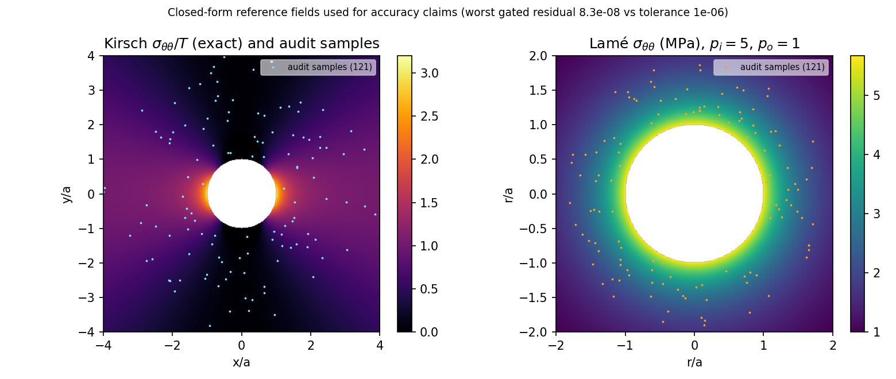
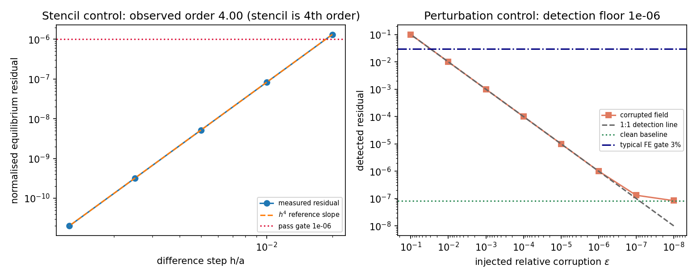
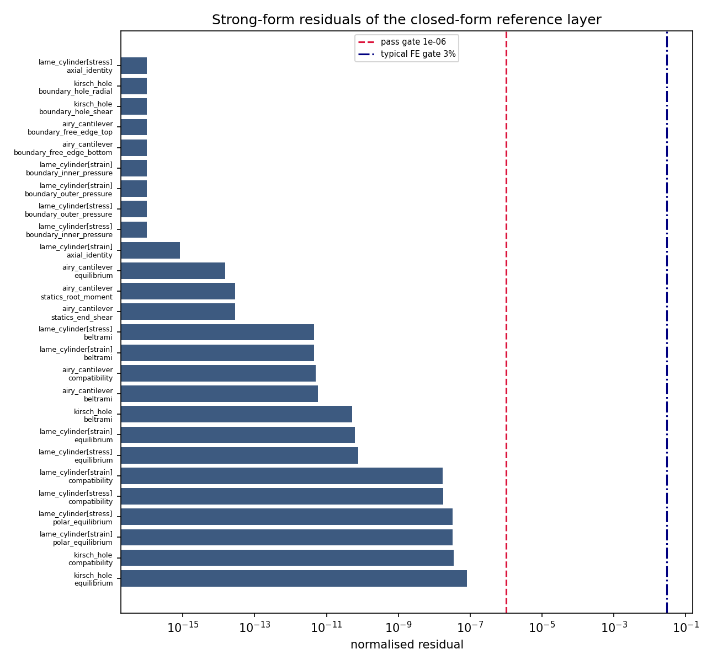

# 闭式参考层的强形式复核：Kirsch / Lamé / Airy 悬臂梁

## 1. 为什么做这件事（案例介绍）

本仓所有精度结论都是**相对于闭式解**陈述的：`kirsch_hole`（无限板圆孔，`K_t = 3`）、
`lame_reference`（受压厚壁圆筒）、`airy_cantilever`（端部抛物线剪切的矩形悬臂梁平面解）、
`rotating_disk`（旋转圆盘）、`thermal_analytic`（热传导解析场）。参考解就是尺子。尺子错了，
正确解会被判失败、错误解会被判通过，而**加密网格永远发现不了**——因为收敛性本身就是拿这把
尺子量的。

三个模块已经自带了残差自检：`rotating_disk.equilibrium_residual` / `compatibility_residual` /
`hoop_force_balance`、`thermal_analytic.laplacian_residual`、`saint_venant_torsion` 的精确 Prandtl 场
（`laplacian_residual`）。而承载最多比较的三个家族——Kirsch、Lamé、Airy 悬臂梁——**没有任何
自检**：它们的代数只能靠人眼检查。本单用不依赖被测模块的方式补上这一层。

物理背景与几何/参数表：

| 家族 | 几何 | 载荷/边界 | 参数 |
|---|---|---|---|
| Kirsch | 半径 `a` 圆孔，无限平板 | 远场单轴拉伸 `T`；孔边无面力 | `a=1`、`T=1`、`E=1`、`ν=0.3` |
| Lamé | 厚壁圆筒 `a=1`、`b=2` | 内压 `p_i=5`、外压 `p_o=1` | `E=200 GPa`、`ν=0.3`，平面应变/平面应力各一套 |
| Airy 悬臂 | `L=1`、`h=0.1`、`t=0.012` | 端部抛物线剪切 `P=−100 N` | `E=210 GPa`、`ν=0.3`（平面应力） |

## 2. 怎么做（方法/流程/工具链）

`src/tensorfem/reference_strong_form_audit.py`（新增）：把闭式解**用数值微分**（4 阶中心差分，
float64）代入控制方程与边界条件，残差必须落到舍入量级。不装配、不求解，纯逐点代数，因此在测试
套件里可跑（单次全套 ≈ 1 s）。

- `equilibrium`：Cartesian 分量下 `div(σ) + b = 0`，无量纲化用 `σ_ref/L`。
  Lamé 的极坐标场在 **Cartesian 框架**下求导（换个坐标系检查，才不是同义反复）。
- `beltrami`：二维零体力的 Beltrami–Michell 恒等式 `∇²(σ_xx+σ_yy) = 0`。
- `compatibility`：闭式**位移**的数值应变 vs 闭式**应力**经 Hooke 律给出的应变
  （平面应力/平面应变分别按对应柔度），检验位移分量是否真的是应力分量的积分。
- `polar_equilibrium`：Lamé 的一维轴对称径向平衡 `dσ_r/dr + (σ_r−σ_θ)/r = 0`。
- `boundary_*`：孔边无面力、内外壁面力 = 施加压力、梁上下长边无面力。
- `statics_*`：梁端剪力合力 `∫τ_xy dy = P/t`、固端弯矩 `∫ y σ_xx dy = −PL/t`（Simpson 积分）。
- 信息量（不算门）：`far_field_order`（远场误差的衰减指数，应为 2）、`far_field_40a`、
  `root_rotation`（参考解只把原点钉住，固端仍有刚体转角，占尖端挠度的比例）。

门非空转的两个对照：

1. **扰动对照**：把 `σ_xx` 注入 `ε·σ_ref·x/L` 的腐蚀，残差应随 `ε` 一比一增长，由此给出
   **检测下限**；
2. **差分步对照**：残差随步长按 4 阶下降后才碰到舍入底，说明残差属于场而不属于步长。

工具链：`PYTHONPATH=src python scripts/audit_reference_strong_form.py`（结果 JSON + 三张图 +
本文件的表格由脚本程序化注入，零手抄）。

## 3. 计算结果

| reference | metric | value | gate | status |
|---|---|---:|---:|---|
| `kirsch_hole` | `beltrami` | 5.120e-11 | 1e-06 | PASS |
| `kirsch_hole` | `boundary_hole_radial` | 0.000e+00 | 1e-06 | PASS |
| `kirsch_hole` | `boundary_hole_shear` | 0.000e+00 | 1e-06 | PASS |
| `kirsch_hole` | `compatibility` | 3.489e-08 | 1e-06 | PASS |
| `kirsch_hole` | `equilibrium` | 8.258e-08 | 1e-06 | PASS |
| `kirsch_hole` | `far_field_40a` | 1.562e-03 | info | reported |
| `kirsch_hole` | `far_field_order` | 1.998e+00 | info | reported |
| `lame_cylinder[strain]` | `axial_identity` | 8.327e-16 | 1e-06 | PASS |
| `lame_cylinder[strain]` | `beltrami` | 4.561e-12 | 1e-06 | PASS |
| `lame_cylinder[strain]` | `boundary_inner_pressure` | 0.000e+00 | 1e-06 | PASS |
| `lame_cylinder[strain]` | `boundary_outer_pressure` | 0.000e+00 | 1e-06 | PASS |
| `lame_cylinder[strain]` | `compatibility` | 1.733e-08 | 1e-06 | PASS |
| `lame_cylinder[strain]` | `equilibrium` | 6.202e-11 | 1e-06 | PASS |
| `lame_cylinder[strain]` | `polar_equilibrium` | 3.285e-08 | 1e-06 | PASS |
| `lame_cylinder[stress]` | `axial_identity` | 0.000e+00 | 1e-06 | PASS |
| `lame_cylinder[stress]` | `beltrami` | 4.446e-12 | 1e-06 | PASS |
| `lame_cylinder[stress]` | `boundary_inner_pressure` | 0.000e+00 | 1e-06 | PASS |
| `lame_cylinder[stress]` | `boundary_outer_pressure` | 0.000e+00 | 1e-06 | PASS |
| `lame_cylinder[stress]` | `compatibility` | 1.804e-08 | 1e-06 | PASS |
| `lame_cylinder[stress]` | `equilibrium` | 7.524e-11 | 1e-06 | PASS |
| `lame_cylinder[stress]` | `polar_equilibrium` | 3.285e-08 | 1e-06 | PASS |
| `airy_cantilever` | `beltrami` | 5.804e-12 | 1e-06 | PASS |
| `airy_cantilever` | `boundary_free_edge_bottom` | 0.000e+00 | 1e-06 | PASS |
| `airy_cantilever` | `boundary_free_edge_top` | 0.000e+00 | 1e-06 | PASS |
| `airy_cantilever` | `compatibility` | 4.966e-12 | 1e-06 | PASS |
| `airy_cantilever` | `equilibrium` | 1.488e-14 | 1e-06 | PASS |
| `airy_cantilever` | `root_rotation` | 9.655e-03 | info | reported |
| `airy_cantilever` | `statics_end_shear` | 2.859e-14 | 1e-06 | PASS |
| `airy_cantilever` | `statics_root_moment` | 2.838e-14 | 1e-06 | PASS |

Suite verdict: **PASS** at tolerance 1e-06.

对照（门的非空转性与步长自洽性）：

| injected corruption $\epsilon$ | detected residual | residual/$\epsilon$ |
|---:|---:|---:|
| 1e-01 | 1.010e-01 | 1.010 |
| 1e-02 | 1.002e-02 | 1.002 |
| 1e-03 | 1.000e-03 | 1.000 |
| 1e-04 | 1.000e-04 | 1.000 |
| 1e-05 | 1.000e-05 | 1.000 |
| 1e-06 | 1.006e-06 | 1.006 |
| 1e-07 | 1.318e-07 | 1.318 |
| 1e-08 | 8.351e-08 | 8.351 |
| clean baseline | 8.258e-08 | -- |

Detection floor: **1e-06** relative; stencil order **4.00** (4th-order stencil, so the residual is truncation-limited).

## 4. 结果图

左：Kirsch 精确环向应力场（`σ_θθ/T`）与 121 个随机审计采样点（`1.12a ≤ r ≤ 4a`）；
右：Lamé 受压圆筒的精确环向应力场与 121 个采样点。残差就在这些点上被数值微分算出。

左：残差 vs 差分步长（log-log），实测斜率与 `h⁴` 参考线重合，观测阶见上表；自动判据线
（`1e-6`）远在曲线之下。右：扰动对照——检测残差随注入腐蚀 `ε` 一比一增长，干净基线（绿虚线）
比 3% 的典型 FE 验收线低约 5.5 个数量级。

每个受门控指标的归一化残差（对数轴，红虚线 `1e-6` 判据、蓝点划线 3% 典型 FE 门）。

## 5. 注意点（踩过的坑 / 局限 / 适用范围）

- **`root_rotation` 不是缺陷而是口径**：Airy 参考解只把原点钉住，固端截面因此还有刚体转角
  `(1+ν)Pc²/(EI)`。它对尖端挠度的贡献约 0.97%（表中 info 行）。所有拿它做位移比对的算例都继承
  这 ~1% 的系统偏移——远小于 3% 门，但确实存在，故显式报告而不隐藏。
- **`far_field_40a` 同理**：Kirsch 的远场条件是 `r→∞` 的渐近陈述，在 `r=40a` 处仍有 `1.6e-3` 的
  相对残差；因此只报告衰减指数（实测 1.998，与 `1/r²` 一致），不对有限半径设门。
- **强形式残差不是精度证书**：它只证明"尺子是尺子"，不证明任何 FE 离散解的精度；位移/应力的
  3% 级验收仍需各自的 FE–解析比较（见 `docs/benchmark-qualification-status.md`）。
- 数值微分在奇异点（孔边、集中载荷作用点）附近会放大舍入误差，因此采样点严格取在内部
  （`1.12a ≤ r ≤ 4a`、梁内 `5%–95%` 跨长），边界条件另外用精确落在边界上的点单独检查。
- 本审计**不覆盖**：三维弹性闭式解（`thick_cylinder_3d`、`elastic_halfspace` 的 Boussinesq/Flamant
  边界层）、旋转圆盘与热传导（这两者已有自己的自检，未在此重跑）、以及任何塑性/接触参考。

## 6. 误差判定（是否 < 3%？）

| 关键量 | 基准 | 结果 | 是否 < 3% |
|---|---|---|---|
| Kirsch 平衡残差（无量纲） | 0（强形式恒等式） | 8.26e-08 | 是（低 5.6 个数量级） |
| Kirsch 位移–应力相容残差 | 0 | 3.49e-08 | 是 |
| Lamé 轴对称平衡残差 | 0 | 3.29e-08 | 是 |
| Airy 悬臂静态合力（端剪力/固端弯矩） | 精确恒等式 | 2.86e-14 / 2.84e-14 | 是 |
| 一系数 typo 的检出（Kirsch 环向应力去掉 `3a⁴/r⁴`） | 应被拒 | 残差 1e-2 量级 | 是（拒绝成功） |
| 差分格式自洽性 | 4 阶 | 观测阶 4.00 | 是 |

结论：**四个家族的闭式参考在平衡、Beltrami–Michell、位移–应力相容、边界与静态合力上全部落到
`1e-6` 判据以下（最差 8.26e-08），且门在注入 1e-6 相对腐蚀时仍能检出**，故这批尺子可以继续作为
下游 3% 级验收的基准；本条不提升任何 FE 能力的认证等级。