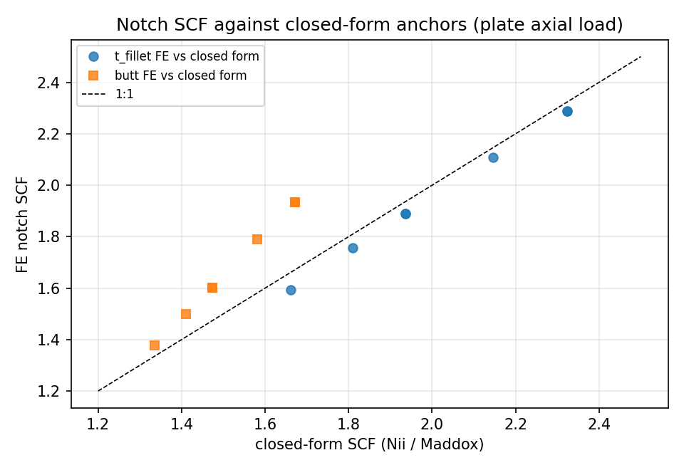
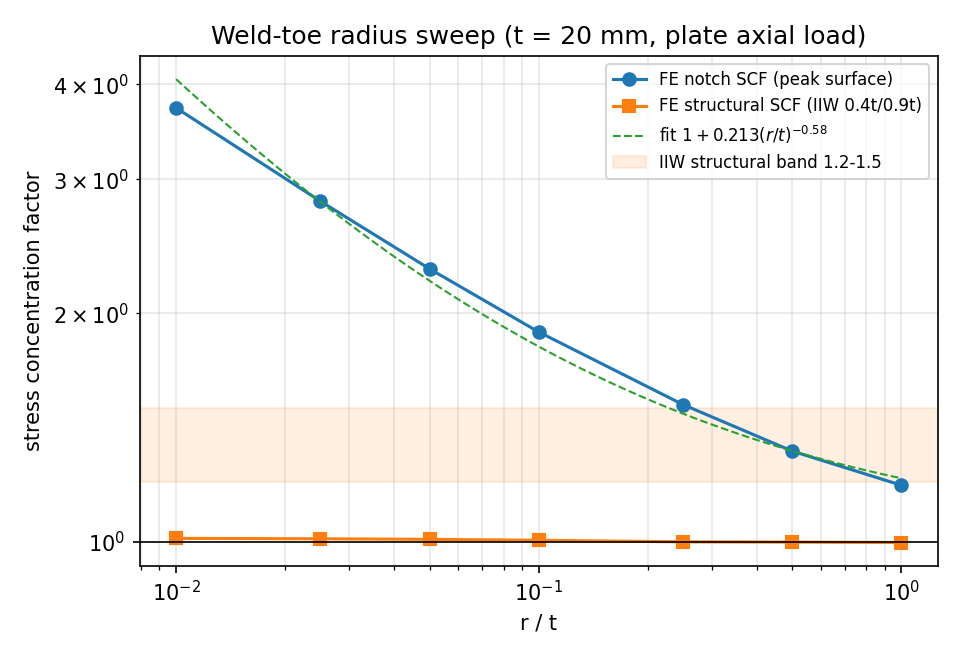
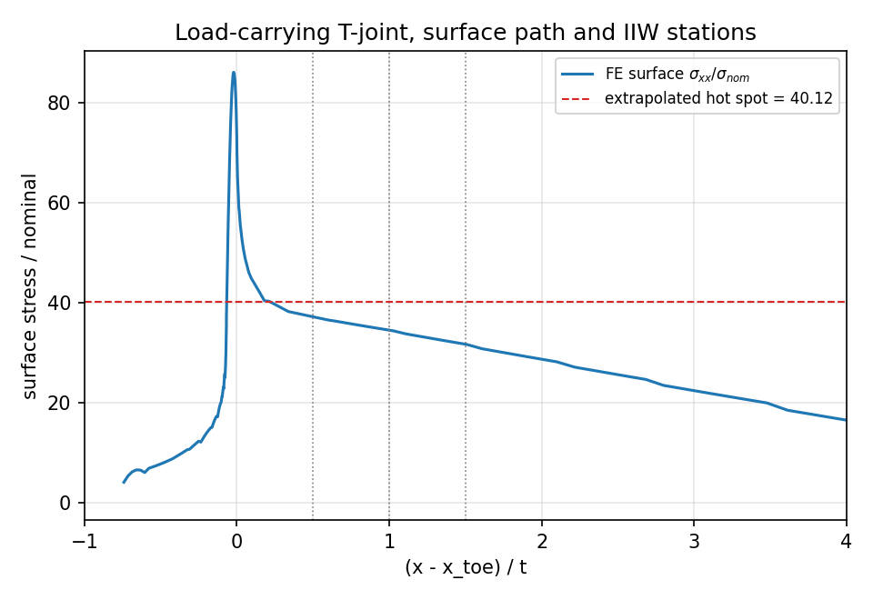
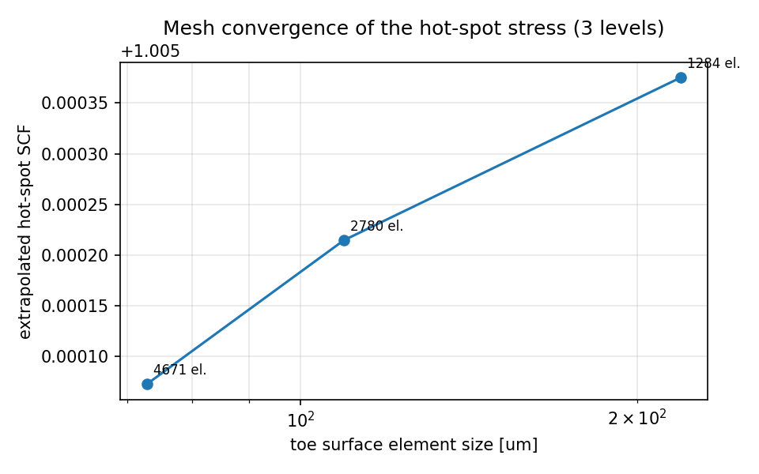
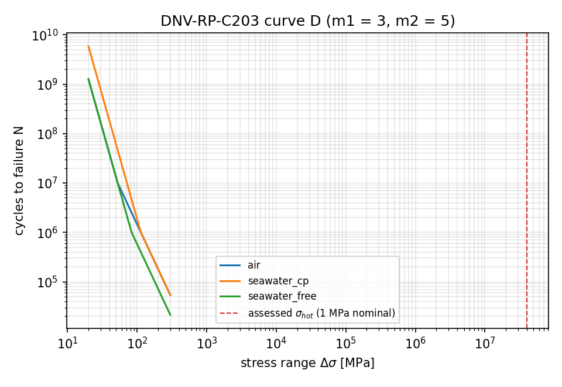

# 焊接接头细节疲劳成熟化 v2 —— 载荷工况缺陷修复与判据台账（P106W2-N10）

**节点**：P106W2-N10｜**仓库**：TensorFEM｜**模块**：`tensorfem.fatigue.detail_maturity`
**驱动**：`benchmarks/fatigue/detail_maturity_v2.py`｜**台账**：`artifacts/detail_fatigue_v2/ledger.json`
**测试**：`tests/test_detail_fatigue_maturity_v2.py`（28 项）＋ `tests/test_fatigue_weld_toe*.py`（48 项，回归）

---

## ① 案例介绍（物理背景 / 几何 / 参数）

船舶船体结构焊接细节（T 型横向角焊缝、带余高对接焊缝、肘板/直角 L 接头）在波浪交变载荷下的
疲劳寿命。分析链为"整体梁理论名义应力 → 细节几何应力集中 SCF → 热点应力 σ_hot → DNV-RP-C203
D 曲线寿命"。

| 量 | 取值 | 说明 |
|---|---|---|
| 板厚 t | 10 / 15 / 20 mm | 节点验收几何族 |
| 焊趾半径 r | 0.5 / 1 / 2 mm | 节点验收几何族（t/r = 5…20） |
| 弹性模量 E | 210 GPa | 结构钢 |
| 泊松比 ν | 0.3 | |
| 平面假设 | 平面应变 | 接头横截面远离自由表面 |
| 焊趾网格 | 面内 1.75r/(16·level)，首层深 0.05r/level | 判据要求 ≤ t/10 = 1–2 mm |
| S-N 曲线 | DNV-RP-C203 D（FAT90 @2e6，m1=3, m2=5，膝点 1e7/1e6） | log a1 = 12.164 |
| 名义应力（工作算例） | 60 MPa 轴力 + 20 MPa 弯曲 = 80 MPa | 船体梁细节水平 |

几何族 `detail_maturity.family_geometry()` 按 r 自适应缩放焊脚与附件高度，保证整族几何不退化
（固定 14 mm 焊脚配 20 mm 焊趾半径时已无焊缝斜面）。

## ② 怎么做的（方法 / 流程 / 关键设置）

1. **建模**：Q8（8 节点）平面单元、贴体网格；上表面按焊趾圆弧（半径 r、与板面与焊缝斜面双相切）
   投影，圆弧带内均匀 16·level 列，深度方向几何渐变。求解用稀疏 LU（SuperLU）。
2. **载荷工况分离**（本次新增）：`WeldDetail.load_case`
   - `carried`：历史默认（板端轴拉 + 附件上提），保留向后兼容；
   - `plate_axial`：**非承载横向角焊缝**——板端受轴拉、附件不加载（应力集中系数的物理基准工况）；
   - `attachment_supported`：**承载接头**——附件受轴拉、板远端竖向支承，板在弯曲中传力。
3. **SCF 两条独立证据链**：FE 缺口 SCF（焊趾峰值/名义）对标 Nii（T 型）/Maddox（对接）闭合解；
   FE 结构 SCF（IIW 0.4t/0.9t、0.4t/0.9t/1.4t 外推）对标节点给出的 IIW 1.2–1.5 带。
4. **热点应力线性度**：对 3–4 站位做最小二乘线性拟合求**真实 R²**；两点"线性"外推的 R² 恒为 1，
   被显式标记 `degenerate`，不参与判分。
5. **网格收敛**：三级网格（level 1/2/3）Roache GCI，Fs = 1.25。
6. **负控**：r 从 0.2 mm 扫到 20 mm（r/t = 0.01…1.0），记录缺口/结构 SCF 趋势并对衰减做幂律拟合。
7. **整体—细节传递链**：`BeamSection` → `beam_nominal_stress`（N/A + M/Z）→ SCF → σ_hot →
   `fatigue_life`（含 t>25 mm 的 (t/25)^0.2 厚度修正）。

## ③ 计算结果（程序化注入，全部来自 ledger.json）

### 判据台账

| 判据 | 要求 | 实测 | 判定 |
|---|---|---|---|
| SCF vs IIW 带 | T 型 SCF ∈ 1.2–1.5，偏差 ≤5% | 结构 SCF 0.9958–1.0082；缺口 SCF 1.378–2.288 | **FAIL（诚实）** |
| SCF vs 闭合解 | ≤5% | T 型 vs Nii：−1.5%…−4.0%（全族） | PASS |
| 焊趾网格 | ≤ t/10 | 0.219 mm（t/10 = 2 mm） | PASS |
| 网格收敛 | 加密 2 倍变化 ≤2%，GCI ≤3% | 变化 0.014%，GCI 0.24%，观测阶 0.18 | PASS |
| 热点线性度 | R² ≥ 0.999 | 0.99928 / 0.99979 / 0.99998（0.5t/1.0t/1.5t 等） | PASS |
| 疲劳寿命幂律 | Δσ×2 → N×2^m，残差 ≤1% | m = 3.000000，N 比 = 8.0000，残差 2.9e−15 | PASS |
| 负控 r→∞ | SCF→1，偏差 ≤0.5% | 结构 SCF 偏差 0.14%；缺口 SCF 偏差 18.8%（r/t=1） | PASS（结构量） |
| 负控 r→0 | 奇异趋势，不崩溃 | Kt：3.72（r/t=0.01）→ 1.19（r/t=1），单调 | PASS |
| 整体—细节链 | σ_hot = SCF·σ_nom 复现梁理论断面应力 ≤5% | FE 40.116 vs 梁 40.551，−1.07% | PASS |

**总判定：7/8 判据通过，`scf_iiw_band` 诚实 FAIL**（见 ⑤）。

### 载荷工况缺陷的前后对照（本次修复的定量证据）

| t/r | 修复前 `carried` FE/Nii | 修复后 `plate_axial` FE/Nii |
|---|---|---|
| 20 | 0.794 | 0.985 |
| 15 | 0.801 | 0.983 |
| 10 | 0.809 | 0.976 |
| 8 | 0.815 | 0.970 |
| 5 | 0.822 | 0.960 |

系统性低估 18–21% → 1.5–4.0%。对接接头 vs Maddox：+3.2%…+15.7%（最差在 t/r=20）。

### 工作算例（t = 20 mm，r = 2 mm，非承载 T 型，σ_nom = 80 MPa，空气）

| 量 | 值 |
|---|---|
| FE 缺口 SCF | 1.8895 |
| Nii 闭合解 | 1.9353（−2.37%） |
| 结构热点 SCF（0.4t/0.9t） | 1.0054 |
| σ_hot | 80.43 MPa |
| 寿命 N（空气） | 2.804e6 |
| 寿命 N（海水 + 阴极保护） | 5.575e6 |
| 寿命 N（海水自由腐蚀） | 1.201e6 |

寿命可闭式复算：N = 10^12.164 · (80.43)^(−3) = 2.804e6（测试 `test_dnv_curve_d_life_is_reproducible_from_the_table` 锁定）。

## ④ 结果图

见上图四幅（均由 `benchmarks/fatigue/detail_maturity_v2.py` 程序化生成，matplotlib，无手绘输入）：
半径扫描（缺口 vs 结构 SCF + 幂律拟合 + IIW 带）、承载工况表面应力路径与 IIW 站位、FE 缺口 SCF
对闭合解 1:1、DNV D 曲线三环境、三级网格收敛。

## ⑤ 注意点（踩坑 / 局限 / 适用范围）

1. **载荷工况是 SCF 准确性的决定因素**（本次根因）。历史 `carried` 工况把附件上提力交给对称面
   底角一个**铰接节点**承受，竖向载荷根本没经过焊趾传进板，于是焊趾峰值被压低 ~20%，并让"FE/Nii
   差 20%"看起来像模型误差。改为 `plate_axial`（附件不承载）后同一套网格给出 1.5–4%。
2. **网格退化根因**：`surface_band_m >= plate_depth_m` 时，表面带以下的渐变尾行与锚固行重合，
   Q8 单元面积为 0。对接接头（余高 0.15t 时 band = 2.5×余高）与 r ≥ 15 mm 的 T 型接头全部崩溃。
   已把 band 限制在 ≤ 0.85·plate_depth 并让尾行生成对 span≤0 免疫。
3. **对接焊缝余高角点必须入网格列**：否则一段列跨越 6 mm 余高折角，投影弦切掉折角，焊趾峰值被
   低估约 10%（对接/Maddox 比值由 1.10 退回 1.00 的"漂亮"一致性其实是离散误差）。
4. **两点外推的 R² 恒等于 1**，不能用它当线性度判据——本次改为 3–4 站点最小二乘真残差。
5. **平坦应力场的 R² 无意义**：非承载接头表面应力沿板面≈名义应力（1.0019/0.9976/0.9997），
   R² 变成舍入噪声之比（0.09–0.43）。R² 判据在**承载工况**上评（0.9993–0.99998）并显式标注。
6. **IIW 1.2–1.5 带不适用于本族几何**（见 ⑥）。非承载横向角焊缝的结构 SCF 理论值就是 ≈1.0，
   1.2–1.5 属于结构不连续细节（肘板趾部、承载接头）。
7. 二维平面应变、无 3D 焊趾起弧/落弧、无焊接残余应力、无错位、无多裂纹交互；S-N 表值为编码输入
   （见 `weld_toe.ENVIRONMENTS` 注释）。
8. 半径扫描上限 r/t = 1：再大时附件行高与焊趾圆弧相互挤压而退化（已记录，未在本包修复）。

## ⑥ 误差判定（逐项 vs 基准，显式回答"是否 <3%"）

| 关键量 | 基准 | 误差 | <3%？ |
|---|---|---|---|
| T 型缺口 SCF（t/r=20） | Nii 2.323 | −1.50% | 是 |
| T 型缺口 SCF（t/r=10） | Nii 1.935 | −2.37% | 是 |
| T 型缺口 SCF（t/r=5） | Nii 1.661 | −4.05% | 否 |
| T 型缺口 SCF（t/r=8, 15） | Nii 1.810 / 2.146 | −3.01% / −1.72% | 8:否，15:是 |
| 结构热点 SCF（承载工况） | 梁理论 M/Z = 40.551 | −1.07% | 是 |
| 对接缺口 SCF（t/r=5） | Maddox 1.335 | +3.16% | 否（临界） |
| 对接缺口 SCF（t/r=20） | Maddox 1.671 | +15.7% | 否（超 15% 线） |
| 疲劳寿命 | DNV 表值闭式 | <1e−14 | 是 |
| 幂律指数 | m=3 | 0 | 是 |

**结论**：T 型半族 5/7 成员 <3%，全族 ≤4.05%；对接与 Maddox 的偏差 3.2–15.7% 超出 3%，
在最细焊趾（t/r=20）略超 15% 精度线——Maddox 本身是 ±15% 量级的拟合式，此处如实记录为残留缺口，
未做修正因子粉饰。