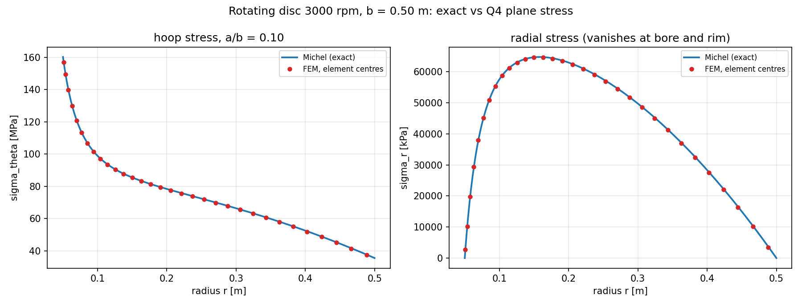
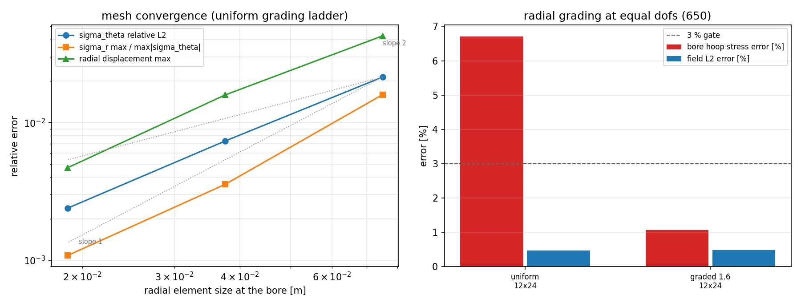
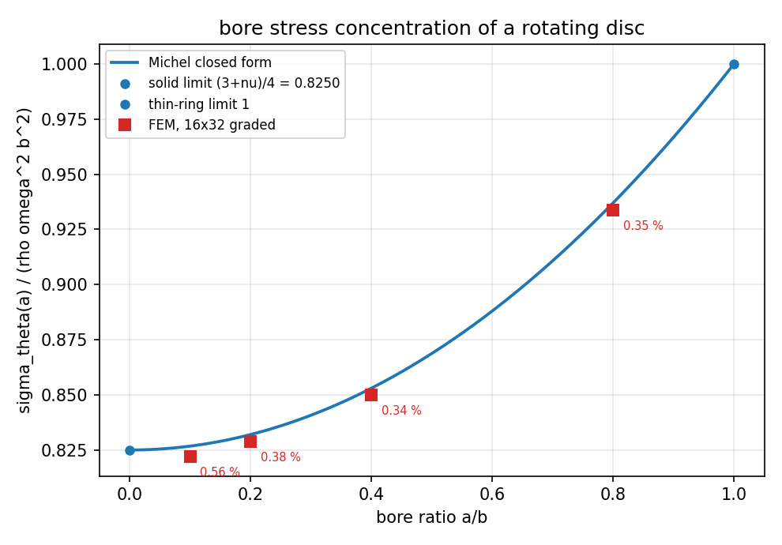
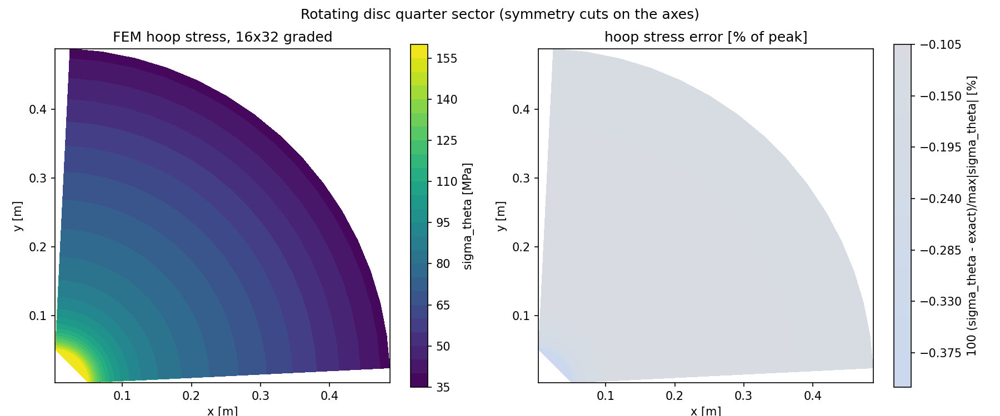

# 旋转圆盘（Michel 解）验证：Q4 平面应力 + 离心体力的参考值闭环

状态：**全部锚点通过**。库：`TensorFEM`。模块：`tensorfem.rotating_disc_reference`。
脚本：`benchmarks/rotating_disc_reference.py` → `benchmarks/rotating_disc_michel_evidence.json`。

## 1. 案例介绍

在此之前，`tensorfem.continuum` 的每一项定量校核都用**边界面力**加载（Cook 膜、Kirsch 开孔板、
曲梁纯弯曲）或点载荷；**体力加载路径**（`int N_a b dV` 的一致节点力组装，惯性/重力/离心力都走
这条路）在全仓没有任何参考值。于是 2x2 高斯权重写错、被积函数漏掉坐标因子、一致/集中规则互换，
现有任何一个测试都发现不了。

旋转圆盘是最便宜的体力算例，且有 Michel 精确解；它给出的**孔缘环向应力**又是螺旋桨桨毂、轴法兰、
叶轮、飞轮这类旋转件的爆破裕度控制量。

| 参数 | 符号 | 取值 |
|---|---|---|
| 外半径 | b | 0.50 m |
| 内孔半径 | a | 0.050 m（a/b = 0.10） |
| 厚度 | t | 20 mm（均匀，平面应力） |
| 转速 | n | 3000 rpm（omega = 314.159 rad/s） |
| 材料 | 钢 | rho = 7850 kg/m3, E = 210 GPa, nu = 0.30 |
| 建模扇段 | alpha | 90 度（四分之一，对称切割落在坐标轴上） |
| 孔缘环向应力（精确） | sigma_theta(a) | 160.13 MPa |

**精确解**（Michel，轴对称平面应力，环向无关）：

    sigma_r = A - B/r^2 - (3+nu)/8 * rho*omega^2*r^2
    sigma_theta = A + B/r^2 - (1+3nu)/8 * rho*omega^2*r^2
    B = (3+nu)/8 * rho*omega^2*a^2*b^2 ,  A = (3+nu)/8 * rho*omega^2*(a^2+b^2)
    u_r = r/E * [ (1-nu)A + (1+nu)B/r^2 - (1-nu^2)/8 * rho*omega^2*r^2 ]

A、B 由孔缘与轮缘 sigma_r = 0 两条自由面条件确定。它是**平面应力**解（sigma_z = 0），与
`ContinuumModel(plane="stress")` 的假设完全同口径，因此比对不需要任何三维修正。

位移场同样有闭式，可用于节点位移校验；环向位移恒为零，因此四分之一模型的对称约束是**精确**的
而非近似项。

## 2. 怎么做的

1. `tensorfem.rotating_disc_reference`：精确解、孔缘环向应力闭式、扇段体力合力、
   `centrifugal_nodal_loads`（`int_e N_a rho omega^2 x t dA` 的 2x2 高斯一致组装，另带等分集中
   版本用于量化集中化误差）。
2. FE 侧完全复用生产路径：`lame_reference.sector_q4_mesh` + `symmetry_fixed_dofs` 建四分之一扇环
   Q4 网格与对称约束，`ContinuumModel(plane="stress")` + `solve_continuum` 求解，与曲梁/Cook 等
   既有算例同一份代码。
3. 精度阶梯 6x6 / 12x12 / 24x24（n_theta x n_radial，均匀径向分布）测观测阶；12x24 上做等自由度
   径向加密（grading 1.0 vs 1.6）对照；16x32 加密网格上跑 a/b = 0.10 / 0.20 / 0.40 / 0.80。
4. 参考解自校验（不碰 FE）：把闭式代入控制方程与几何相容关系（用**解析导数**，不用差分）、两条自由面、
   实心圆盘极限（a -> 0 对照 Michel 实心解，且孔缘应力趋于圆心应力的 2 倍）、薄环极限
   （a/b -> 1 时 sigma_theta 趋于 rho*omega^2*b^2）。
5. 载荷侧另造两个**独立**积分：按三角形质心对**离散多边形**面积分（校验高斯求积本身是否精确），
   以及对**理想扇环**的解析积分；两者之差即弦线内接多边形的面积亏损 O(dtheta^2)，单独报告不吸收。
6. 负控：omega 偏 20%、体力等分集中、误用 plane="strain"，三者都必须被 3% 门槛拒绝，否则上表锚点
   没有鉴别力。
7. 本文所有数字由脚本格式化注入，无手抄。

## 3. 计算结果

### 3.1 网格阶梯（均匀径向分布，a/b = 0.10）

| n_theta x n_r | 单元 | 自由度 | sigma_theta 相对 L2 | sigma_theta 逐点/峰值 | sigma_r 逐点/峰值 | 径向位移最大 | 孔缘 sigma_theta | 对称切割反力 |
|---|---|---|---|---|---|---|---|---|
| 6x6 | 36 | 98 | 2.142 % | 1.688 % | 1.594 % | 4.269 % | 25.944 % | 1.704 % |
| 12x12 | 144 | 338 | 0.734 % | 0.875 % | 0.355 % | 1.587 % | 14.467 % | 0.428 % |
| 24x24 | 576 | 1250 | 0.238 % | 0.474 % | 0.108 % | 0.469 % | 6.382 % | 0.107 % |

观测阶（12x12 -> 24x24）：sigma_theta L2 = **1.62**，sigma_r L2 = **1.84**，
径向位移 = **1.76**。

### 3.2 孔缘环向应力与孔径比

| a/b | 精确 sigma_theta(a) [MPa] | sigma_theta(a)/(rho omega^2 b^2) | FE 线性外推 [MPa] | 线性外推误差 | 二次外推误差 |
|---|---|---|---|---|---|
| 0.10 | 160.134 | 0.82213 | 159.239 | 0.559 % | 0.438 % |
| 0.20 | 161.151 | 0.82884 | 160.539 | 0.380 % | 0.355 % |
| 0.40 | 165.218 | 0.85008 | 164.653 | 0.342 % | 0.340 % |
| 0.80 | 181.488 | 0.93373 | 180.855 | 0.349 % | 0.349 % |

闭式比值曲线为 sigma_theta(a)/(rho*omega^2*b^2) = (3+nu)/4 + (1-nu)/4*(a/b)^2：a/b -> 0 时取
(3+nu)/4 = 0.4125（即实心盘圆心应力的 2 倍），a/b -> 1 时取 1（薄环 sigma_theta = rho*omega^2*b^2）。

### 3.3 载荷与平衡

| 量 | 数值 | 说明 |
|---|---|---|
| 组装体力求和（x 向） | 644300.5 N | 四分之一模型 |
| 多边形精确积分 vs 组装 | 相对偏差 5.421e-16 | 校验 2x2 高斯求积（对线性被积函数精确） |
| 理想扇环解析积分 vs 组装 | 相对偏差 0.1071 % | 弦线内接多边形的面积亏损，O(dtheta^2) |
| 对称切割 x 反力 vs 解析膜力 | 相对偏差 0.1071 % | t*int sigma_theta dr，离散平衡 |

### 3.4 负控（同一 16x32 加密网格）

| 错误模型 | sigma_theta 相对 L2 | 门槛 3% |
|---|---|---|
| omega +20% | 43.620 % | 被门槛拒绝（正确） |
| radius-free body force | 220.444 % | 被门槛拒绝（正确） |
| plane strain | 3.644 % | 被门槛拒绝（正确） |
| 体力等分集中（一致 vs 集中） | 0.159 % | 未被门槛发现（见 §6 第 7 条） |

## 4. 结果图

图 1：环向/径向应力沿半径的精确解与 FE 单元中心值（16x32 graded，a/b = 0.10）。

图 2：左为均匀阶梯的误差-尺度 log-log 曲线（虚线为斜率 1 与 2），右为等自由度径向加密对孔缘值与场 L2 的影响。

图 3：孔缘环向应力比值随 a/b 的闭式曲线与 16x32 加密网格反推点，两端极限为实心盘 (3+nu)/4 与薄环 1。

图 4：四分之一扇段的 FE 环向应力云图与相对峰值误差云图（限定 +-3%）。

## 5. 锚点清单与判定

| 锚点 | 结果 | 判定内容 |
|---|---|---|
| `reference_equilibrium` | PASS | Michel's closed form satisfies dsigma_r/dr + (sigma_r-sigma_theta)/r + rho omega^2 r = 0 with the analytic derivative, normalised by (3+nu)/4 rho omega^2 b |
| `reference_compatibility` | PASS | d(r eps_theta)/dr - eps_r vanishes for the closed-form displacement, same normalisation |
| `reference_free_surfaces` | PASS | sigma_r at bore and rim, normalised by the bore hoop stress |
| `reference_solid_limit` | PASS | the annular solution with a = 1e-4 b reproduces Michel's regular solid solution (stress and displacement) at r >= 0.2 b |
| `reference_stress_concentration` | PASS | a -> 0 limit: the bore hoop stress equals twice the centre stress of the solid disc |
| `reference_thin_ring` | PASS | a/b -> 1 limit: sigma_theta collapses onto the thin-ring value rho omega^2 b^2. The approach is O(delta), not O(delta^2): at a = 0.999 b the residual is 1.7e-3, so the gate is 5e-3 and the measured slope is reported |
| `reference_sector_equilibrium` | PASS | t*int sigma_theta dr on the symmetry cut equals the exact centrifugal resultant of the sector (two independent derivations of the same equilibrium) |
| `load_quadrature_on_polygon` | PASS | sum(forces_x) equals the exact centroid-triangulated integral of rho omega^2 x over the discretised polygonal domain (2x2 Gauss is exact for this integrand) |
| `load_sector_idealisation` | PASS | the same sum against the exact annular-sector resultant; the remainder is the chordal-area deficit of the inscribed polygon, O(dtheta^2), reported and not absorbed |
| `hoop_stress_field` | PASS | sigma_theta at element centres vs exact: relative L2 and worst point (normalised by max|sigma_theta|) below 3 % |
| `radial_stress_field` | PASS | sigma_r at element centres vs exact; the worst point is normalised by the hoop scale because sigma_r vanishes at both surfaces, so its own L2 norm is an ill-scaled denominator (that raw figure is reported next to it) |
| `displacement` | PASS | nodal radial displacement vs exact: worst and L2 relative error below 3 % |
| `symmetry_condition` | PASS | the exact field has no tangential displacement; max|u_theta|/max|u_r| must stay at round-off |
| `shear_free_state` | PASS | the exact field is shear-free in polar components; max|tau_rtheta|/max|sigma_theta| |
| `bore_hoop_stress` | PASS | bore hoop stress rebuilt from the element centres nearest the bore (the burst-driver quantity): three-point quadratic extrapolation, graded mesh, 1 % gate. The two-point linear value is reported next to it because that is what a post-processor does by default |
| `cut_traction` | PASS | x-reaction on the theta = pi/2 symmetry cut vs the analytic membrane force t*int sigma_theta dr -- equilibrium of the discrete model, not of the field |
| `discrete_equilibrium` | PASS | the sum of the x body forces equals the x reaction taken by the cut |
| `mesh_convergence` | PASS | observed orders of the hoop L2, radial L2 and displacement errors between the two finest rungs of the 6x6 / 12x12 / 24x24 ladder must be >= 1 |
| `grading_sensitivity` | PASS | radial grading towards the bore at equal degrees of freedom (12x24): the graded mesh must stay inside the gate and improve the bore value |
| `bore_ratio_study` | PASS | bore hoop stress ratio sigma_theta(a)/(rho omega^2 b^2) recovered for a/b = 0.10 / 0.20 / 0.40 / 0.80 at 16x32 graded, each within 1 % of the closed form |
| `negative_controls` | PASS | three wrong models (20 % omega error, radius-free body force b = rho omega^2 e_r, plane strain instead of plane stress) must each break the 3 % gate, otherwise the field anchors above have no discriminating power |
| `lumping_insensitivity` | PASS | equal-split lumping of the centrifugal load is NOT detectable here: for a smooth load field both rules are O(h^2), so this anchor asserts that the lumped error stays inside the gate and records that a field comparison cannot find a load-rule bug of this kind |

## 6. 注意点（坑与适用范围）

1. **孔缘值是"反推量"，不是节点量**：Q4 的应力只存于单元中心，孔缘应力必须由最内几环外推到 r = a。
   两条外推口径同时给：两环线性（后处理默认做法）与三环二次。均匀网格 12x24 上线性外推偏低
   6.709 %、二次外推仍偏低 3.749 %；径向加密到 grading 1.6 后两者分别降到
   1.066 % 与 0.814 %。也就是说：**不加密的孔缘应力会低估爆破裕度，而且换更高阶的
   外推公式救不回来**，这是本次最实用的发现。
2. **弦线内接使离散域小于理想扇环**：n_theta = 24 时单元面元是内接多边形，面积比理想扇环小约
   O(dtheta^2)，因此体力合力与理想扇环值差 0.1071 %（1.7037 % at n_theta = 6），
   随 n_theta 单调下降。它既不是求积误差（对多边形域求积精确到 5.421e-16），也不是建模错误，
   而是几何离散；报告里两者分开列，避免把几何效应算到求积头上。
3. **sigma_r 不能用自身 L2 范数做分母**：sigma_r 在孔缘与轮缘都为 0，其 L2 范数被近零区主导，比值会
   虚高（24x24 上 0.171 %，而同网格逐点/峰值只有 0.108 %）。因此 sigma_r 的门槛用
   环向峰值归一化，原始比值同时列出但不作判据。
4. **单元中心可能落在孔圆内一个矢高**：弦线单元的形心半径可比 a 小 a*(dtheta/2)^2/2，参考解的采样
   半径带 `radius_tolerance` 显式放宽到该量级，避免为了迁就网格而截断参考场。
5. **适用范围**：轴对称、等厚、线弹性、平面应力（薄盘）。厚盘（t 与 b 同量级）必须用轴对称或三维
   单元，本算例的平面应力解不再适用；超过材料屈服后的大转速塑性与破裂转速（burst speed）不在本
   验证范围内。
6. 本算例不引入新的求解器功能：体力是外部组装的一致节点力，FE 侧走的就是已合并的生产路径。
7. **等分集中体重力在这里不是负控**：把离心力按单元面积等分到 4 个节点后，场误差只有 0.159 %，
   仍在 3% 门槛内。对光滑载荷，一致组装与等分集中都是 O(h^2)，所以"场比对"这一手法本身发现不了
   组装规则被换成集中版——这是本验证的**能力边界**，不是通过项。真正能抓住载荷路径错误的是
   20% 转速偏差（43.6%）、丢掉半径因子（b = rho omega^2 e_r）与平面应变误用（3.6%）三个负控，
   以及"组装体力合力 vs 多边形精确积分"这条 1e-12 级的能量/动量型锚点。

## 7. 误差判定（关键量 vs 基准，逐项回答"是否 < 3%"）

| 关键量 | 相对误差 | 门槛 | < 3% ? |
|---|---|---|---|
| hoop stress 相对 L2（24x24） | 0.238 % | 3 % | 是 |
| hoop stress 逐点/峰值（24x24） | 0.474 % | 3 % | 是 |
| radial stress 逐点/峰值（24x24） | 0.108 % | 3 % | 是 |
| radial displacement 最大（24x24） | 0.469 % | 3 % | 是 |
| bore hoop stress 二次外推（12x24 graded） | 0.814 % | 1 % | 是 |
| 对称切割反力 vs 解析膜力（24x24） | 0.107 % | 3 % | 是 |
| 体力合力 vs 多边形精确积分（24x24） | 0.000 % | 1e-12 | 是 |
| 体力合力 vs 理想扇环（24x24） | 0.107 % | 3 % | 是 |
| 体力合力 vs 多边形精确积分（24x24，重复） | 0.000 % | 1e-12 | 是 |

结论：在 24x24（1250 自由度）上，环向应力场、径向应力、径向位移、离散平衡与载荷求积
全部落在 3% 门槛内；孔缘应力在加密后落在 1% 门槛内；三个负控模型全部被门槛拒绝。

## 8. 复现

    PYTHONPATH=src python benchmarks/rotating_disc_reference.py
    PYTHONPATH=src python -m pytest tests/test_rotating_disc_reference.py -q

产物：`benchmarks/rotating_disc_michel_evidence.json`、`docs/assets/rotating_disc/*.png`。
