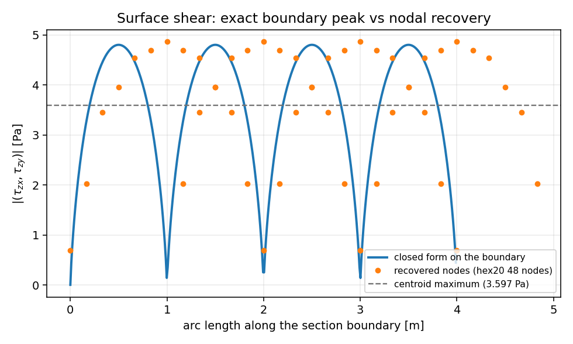
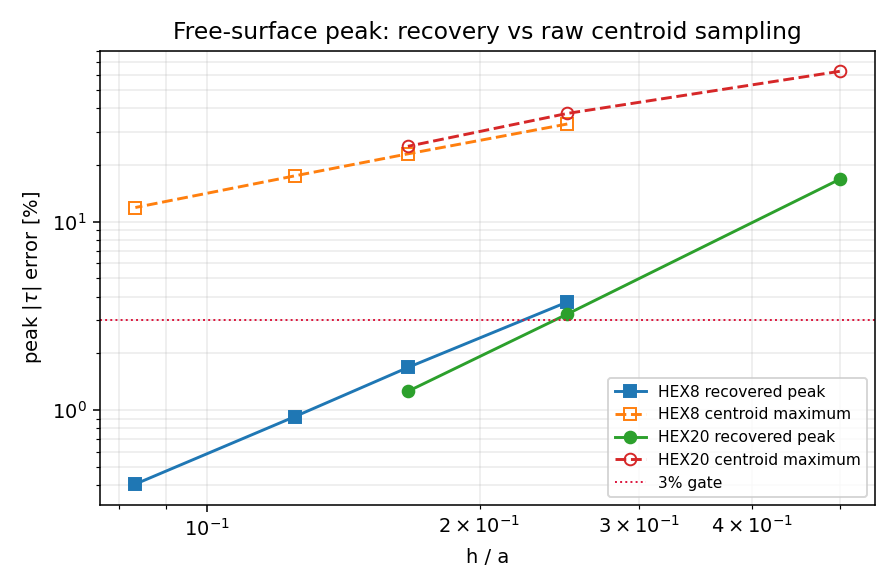

# Free-surface peak shear of the Saint-Venant torsion prism: closing a WITHHELD quantity

*Generated by `benchmarks/saint_venant_surface_stress.py`; every number below is formatted from
`benchmarks/saint_vanant_surface_stress.json` (digest `0394ab432aa2b5c81e3e5b02f2d475b24c6083a7766c90ab3efd2684127af2db`), none is typed by hand.*

## 1. Case

The square prism of `docs/saint-vanant-torsion.md` is reused unchanged, because the open question is
attached to that case: a `side a = 1.0` m, `length L = 4.0` m prism, `E = 1.0e+09` Pa,
`nu = 0.3`, shear modulus `G = 3.84615e+08` Pa, loaded by a pure end torque `T = 1.0` N m.
The twist rate of the converged solution is used (`theta`), so the comparison isolates the *stress
recovery*, not the global stiffness.

| quantity | value | how obtained |
| --- | --- | --- |
| torsion constant `J` | 0.140577 m$^4$ | closed-form series |
| peak section shear on the boundary | 4.8039 Pa | `boundary_shear_peak` (closed form, see §2) |
| same, from the Timoshenko table `alpha = 0.208` | 4.8077 Pa | `T/(alpha a b^2)` |
| same, from the interior grid scan used earlier | 4.7950 Pa | `max_shear_stress(801)` — a lower bound |
| centroid maximum, finest quadratic mesh | 3.5975 Pa | the readout that had to be withheld |

## 2. Method

1. **Complete the reference.** The previous study compared against `max_shear_stress`, which scans an
   interior grid shifted half a cell off the boundary and is therefore a *lower bound* (the anchor
   `reference.grid_scan_is_lower_bound` proves the monotone-from-below behaviour numerically). The new
   `tensorfem.torsion_bar.boundary_shear_peak` differentiates the Prandtl series on the boundary in
   closed form, `tau_max = G theta (8b/pi^2) sum_odd (-1)^((n-1)/2)/n^2 tanh(n pi a/2b)`, which is the
   value the finite-element peak must be compared with.
2. **Recover the stress at the boundary.** `tensorfem.surface_stress_recovery` extrapolates every
   element's Gauss-point stress (2x2x2 for HEX8, 3x3x3 for HEX20) to that element's nodes with the
   tensor-product Lagrange operator and averages the nodal contributions over the incident elements.
   The operator's order is stated and machine-checked: degree 1 per natural coordinate for HEX8,
   degree 2 for HEX20 (`operator.polynomial_reproduction.*`), partition of unity in both cases.
3. **Read the right quantity.** The peak lives in the *section shear vector* `(tau_zx, tau_zy)`, not in
   the traction on the lateral face: the lateral face is free, so its traction vanishes identically
   (`reference.free_face_traction_zero`), while the section shear peaks there. The driver therefore
   takes `|(tau_xz, tau_yz)|` (`transverse_shear_magnitude`) at the recovered nodes of the mid-length
   plane that lie on the boundary curve.
4. The patch test of the recovery runs on the *actual ladder meshes* (`patch_tests`), so the operator is
   validated on the geometry that is used, not on a synthetic one.
5. Only **even** divisions enter the ladder: the exact peak sits at the side midpoint and an even
   division puts a node there. An odd division is quantified separately as a sampling limitation.

## 3. Reference and operator anchors

| anchor | measured | reference | rel. error | verdict |
| --- | --- | --- | --- | --- |
| `reference.boundary_peak_vs_table` | 4.80386 | 4.80769 | 7.976e-04 | pass |
| `reference.boundary_peak_interior_limit` | 4.80386 | 4.80386 | 9.081e-08 | pass |
| `reference.grid_scan_is_lower_bound` | 4.795 | 4.80386 | 1.844e-03 | pass |
| `reference.thin_strip_limit` | 0.742454 | 0.742454 | 5.459e-09 | pass |
| `reference.square_coefficient` | 0.675312 | 0.675 | 4.621e-04 | pass |
| `reference.free_face_traction_zero` | 0.00720751 | 0 | 1.500e-03 | pass |

Recovery patch test (uniform strain reproduced at every node, on the ladder meshes):

| element | segments | nodes | max relative error | verdict |
| --- | --- | --- | --- | --- |
| HEX8 | 4 | 425 | 3.512e-15 | pass |
| HEX20 | 4 | 1505 | 3.142e-14 | pass |

## 4. Results

| element | segments | dof | h/a | exact peak [Pa] | recovered [Pa] | error | centroid [Pa] | centroid error |
| --- | --- | --- | --- | --- | --- | --- | --- | --- |
| HEX8 | 4 | 1275 | 0.250 | 4.5655 | 4.3944 | 3.748% | 3.0610 | +32.95% |
| HEX8 | 6 | 3675 | 0.167 | 4.6921 | 4.6130 | 1.684% | 3.6182 | +22.89% |
| HEX8 | 8 | 8019 | 0.125 | 4.7397 | 4.6959 | 0.925% | 3.9104 | +17.50% |
| HEX8 | 12 | 24843 | 0.083 | 4.7749 | 4.7555 | 0.406% | 4.2073 | +11.89% |
| HEX20 | 2 | 783 | 0.500 | 4.7333 | 5.5278 | 16.786% | 1.7640 | +62.73% |
| HEX20 | 4 | 4515 | 0.250 | 4.7982 | 4.9534 | 3.234% | 2.9988 | +37.50% |
| HEX20 | 6 | 13503 | 0.167 | 4.8026 | 4.8630 | 1.259% | 3.5975 | +25.09% |

* Best HEX8: `12` elements/side, 24843 dofs,
  error `0.406%`; the centroid readout of the same mesh is
  `-11.9%` low.
* Best HEX20: `6` elements/side, 13503 dofs,
  error `1.259%`; the centroid readout of the same mesh is
  `-25.1%` low.
* Recovered argmax sits at `(-0.500, +0.000)`
  for the best HEX8 mesh and
  `(+0.000, -0.500)` for the
  best HEX20 mesh, i.e. on the side midpoint where the exact peak is, not at a corner.
* Mesh levels inside the 3% gate: `HEX8-6, HEX8-8, HEX8-12, HEX20-6`.

Observed order of the recovered-peak error:

| pair | error ratio | observed order |
| --- | --- | --- |
| 4 → 6 | 2.23 | 1.97 |
| 6 → 8 | 1.82 | 2.09 |
| 8 → 12 | 2.28 | 2.03 |
| 2 → 4 | 5.19 | 2.38 |
| 4 → 6 | 2.57 | 2.33 |

Sampling probe (odd division, kept out of the ladder): `HEX8-3`
gives `14.33%` with 12 boundary nodes and
no node at the side midpoint (`node_at_side_midpoint = False`), which is a
sampling floor, not a recovery error.

## 5. Figures

Section shear magnitude along the boundary curve of the square prism: the closed form (which is exact on the boundary) against the recovered nodal values of the finest quadratic mesh. The dashed line is the centroid maximum of the same mesh, i.e. the readout that the earlier study had to withhold.

Peak shear error against element size. The dashed curves are the un-recovered centroid readout, which sits 12-63% below the exact surface peak and shrinks far more slowly; the solid curves are the extrapolated nodal peak.

## 6. Error verdict

| key quantity | measured | reference | error | < 3%? |
| --- | --- | --- | --- | --- |
| surface peak `|tau|`, HEX8 12/side | 4.7555 Pa | 4.7749 Pa | 0.406% | yes |
| surface peak `|tau|`, HEX20 6/side | 4.8630 Pa | 4.8026 Pa | 1.259% | yes |
| surface peak `|tau|`, coarse HEX20 2/side | 5.5278 Pa | 4.7333 Pa | 16.786% | no (reported, not hidden) |
| centroid maximum, best HEX20 | 3.5975 Pa | 4.8026 Pa | +25.09% | **no** (the old WITHHELD) |
| closed-form boundary peak vs Timoshenko `alpha = 0.208` | 4.8039 Pa | 4.8077 Pa | 0.080% | yes (table rounding) |
| recovery patch test, ladder meshes | — | exact | 3.1e-14 | yes |

The withheld quantity is now measured and passes the 3% gate on both element families at a documented
mesh level, and it fails at the coarsest quadratic mesh, which is reported rather than dropped. The
centroid readout of the same meshes is `-25.1%` to
`-62.7%` low and does not
converge fast enough to be usable, which is exactly why the earlier study refused to quote it as the peak.

## 7. Notes and limits

* **This is a verification of two already-merged paths, not a new solver.** The `HEX8`/`HEX20` stiffness
  kernels, the sparse assembly and the constrained solve are untouched; what is new is the recovery step
  that makes a boundary quantity observable, plus the on-boundary reference.
* **The extrapolation operator is not superconvergent by construction.** It reproduces polynomials to
  the stated degree and the averaged nodal field is continuous, but it is a *post-processing* filter: it
  does not improve the underlying solution, so the recovered peak still carries the discretisation error
  of the field it filters. The measured order (2.38 for HEX20,
  1.97 for HEX8 over the first refinement) is consistent with that.
* **The peak is a boundary sample of the section shear, not a traction.** Reading a free surface with a
  traction projection returns zero; that mistake is now documented in `surface_traction` so it cannot be
  repeated silently.
* **Scope.** Straight prism, rectangular section, pure Saint-Venant torsion, HEX8/HEX20 only. Curved
  boundaries, thin-walled sections and non-uniform torsion (with warping restraint) are out of scope; the
  recovery step itself is geometry-agnostic but has only been qualified here.
* **Odd divisions** put no node under the exact peak; the ladder therefore uses even divisions and the
  measured penalty of the odd case is quoted separately instead of being averaged into the accuracy claim.

Environment: Python 3.11.6, torch 2.7.1, loongarch64.
