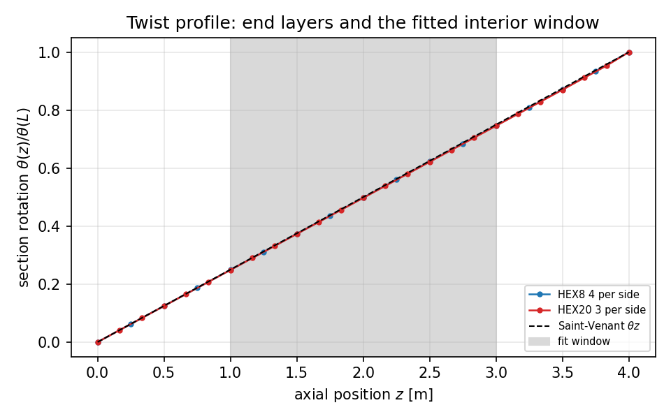
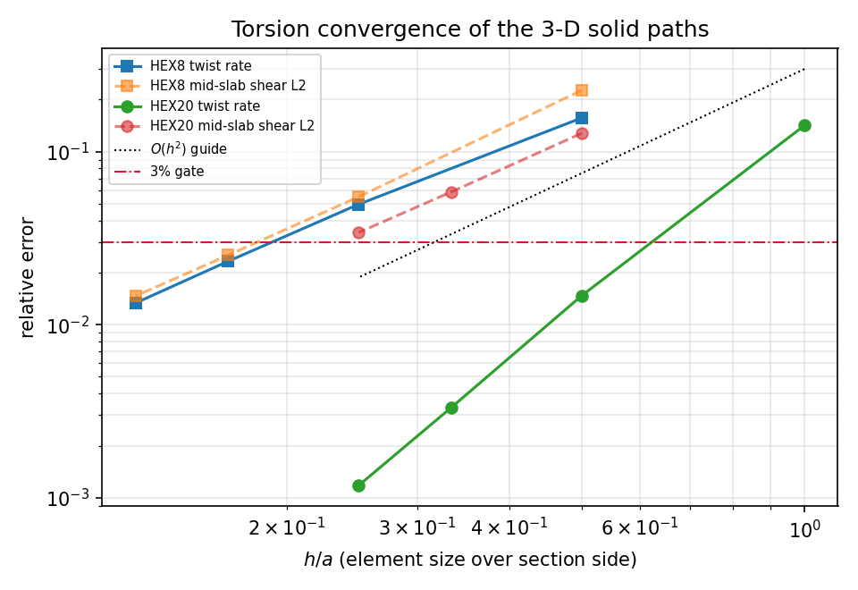
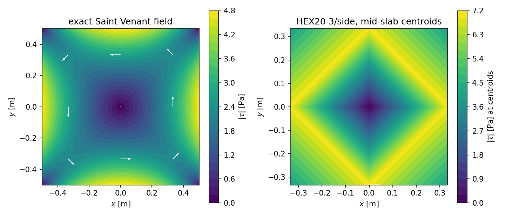
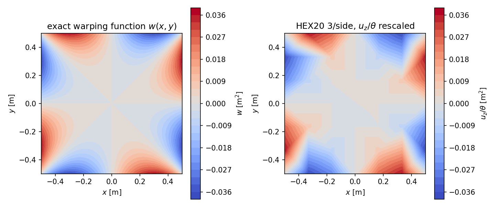

# Saint-Venant torsion of a square prism: HEX8 and HEX20 verification

## Contract

`tensorfem.torsion_bar` supplies the closed-form Saint-Venant solution of a
rectangular prism and a driver that twists a `side x side x length` mesh with a
pure end torque. The 3-D solid paths (`hex8_stiffness` in `solid3d.py`,
`hex20_stiffness` in `hex20.py`) enter unmodified through the public sparse
assembly and constrained solve. No assertion in the accompanying test compares
against a stored snapshot of this repository; every reference is a closed form,
a literature coefficient, or an independent numerical identity.

## 1. Case

Square prism, `side a = 1.0` m, `length L = 4.0` m, `E = 1.0e+09` Pa,
`nu = 0.3`, pure end torque `T = 1.0` N m applied on the far face as a
circumferential linear traction `t = c(-y, x)`; `c` is rescaled so the assembled
nodal forces carry exactly `T`. The near face has its two in-plane translations
suppressed and one axial dof fixed, leaving axial warping free.

| quantity | closed form | value |
| --- | --- | --- |
| torsion constant | $J = ab^3/3 - (64b^4/\pi^5)\sum_{n\ \mathrm{odd}}\tanh(n\pi a/2b)/n^5$ | 0.140577 m$^4$ |
| twist rate | $\theta = T/(GJ)$ | 1.849520e-08 rad/m |
| shear modulus | $G = E/2(1+\nu)$ | 3.8462e+08 Pa |
| peak shear (lateral surface) | grid scan, see §5 | 4.7862 Pa |

The case is chosen so the exact answer is a warping field rather than a linear
displacement polynomial: a bending or constant-strain patch test cannot detect a
wrong torsion kernel, and this one can.

## 2. Method

1. `rectangular_torsion_constant`, `prandtl_stress_function`,
   `torsion_shear_stress` and `torsion_warping_function` implement the series
   with `cosh(u)/cosh(U) = e^{|u|-U}(1+e^{-2|u|})/(1+e^{-2U})`, which stays
   finite for slender sections where the naive ratio overflows.
2. Reference anchors (§3) are checked against the literature coefficient table
   of Timoshenko & Goodier, a finite-difference PDE residual, the boundary
   condition, the definition `J = 2\int\psi\,dA`, and the thin-strip limit.
3. Each mesh is solved with `assemble_coo` + `solve_sparse_static` (conjugate
   gradient, `rtol = 1e-12`). End-face loads use the consistent face weights of
   the element (Q4: `A/4`; Q8 serendipity: `-A/12` corners, `A/3` midsides), which
   integrate a linear traction exactly, so the only loading approximation is
   Saint-Venant's principle at the loaded face.
4. The twist rate is the least-squares slope of the section rotation over
   `0.25L <= z <= 0.75L`, which excludes both end layers. Section rotation is
   recovered from the translational dofs alone, `\theta(z) = \sum r\cdot u_t/\sum r^2`.
5. Shear stresses are compared with the closed form **at the element centroids**
   of a mid-length slab, and warping with `u_z/\theta` after removing the
   arbitrary axial datum.

Environment: Python 3.11.6, torch 2.7.1,
loongarch64. Evidence digest `514a2e5f15677f3c39018aefff1b1e39fbb8cf9c73bac6703d125ddfcc210cc5`.

## 3. Reference anchors (the closed form itself)

| anchor | measured | reference | rel. error | verdict |
| --- | --- | --- | --- | --- |
| reference.j_square_literature | 0.140577 | 0.141 | 3.000e-03 | pass |
| reference.j_rectangle_literature | 0.228682 | 0.229 | 1.390e-03 | pass |
| reference.tau_max_square_literature | 0.208936 | 0.208 | 4.500e-03 | pass |
| reference.thin_strip_asymptote | 3.03072 | 3 | 1.024e-02 | pass |
| reference.prandtl_pde_residual | 0.000157998 | 0 | 1.580e-04 | pass |
| reference.warping_harmonic | 3.82265e-05 | 0 | 3.823e-05 | pass |
| reference.boundary_condition | 6.00037e-08 | 0 | 6.000e-08 | pass |
| reference.torque_identity | 0.140575 | 0.140577 | 1.482e-05 | pass |

The two literature rows use the 3-digit table values (`beta = 0.141`,
`alpha = 0.208`), so the agreement is limited by the table rounding, not by the
series: recomputing with `terms = 1000` moves `J/a^4` by less than `1e-9`.

## 4. Finite-element results

| element | elements/side | dofs | h/a | twist-rate error % | measured J | shear L2 % | warping % |
| --- | --- | --- | --- | --- | --- | --- | --- |
| HEX8 | 2 | 243 | 0.500 | 15.654 | 0.166667 | 22.60 | 100.00 |
| HEX8 | 4 | 1275 | 0.250 | 4.962 | 0.147917 | 5.48 | 7.96 |
| HEX8 | 6 | 3675 | 0.167 | 2.327 | 0.143926 | 2.52 | 3.73 |
| HEX8 | 8 | 8019 | 0.125 | 1.336 | 0.142480 | 1.47 | 2.18 |
| HEX20 | 1 | 168 | 1.000 | 14.170 | 0.163786 | n/a | 100.00 |
| HEX20 | 2 | 783 | 0.500 | 1.469 | 0.142673 | 12.76 | 3.80 |
| HEX20 | 3 | 2136 | 0.333 | 0.332 | 0.141045 | 5.85 | 1.50 |
| HEX20 | 4 | 4515 | 0.250 | 0.118 | 0.140743 | 3.41 | 0.88 |

* Best HEX8: `8` elements/side, `8019` dofs,
  twist-rate error `1.336%`.
* Best HEX20: `4` elements/side, `4515` dofs,
  twist-rate error `0.118%`.
* Measured twist-rate convergence order between consecutive levels
  (`log(e_coarse/e_fine)/log(h_coarse/h_fine)`): HEX8
  `1.66, 1.87, 1.93`; HEX20
  `3.27, 3.67, 3.60`. The fully integrated
  HEX8 path approaches second order (1.66 -> 1.93). The quadratic path measures
  about 3.5, i.e. the *twist rate* is superconvergent for this loading even
  though the pointwise stress field is not; that is why the 3% gate is reached
  with roughly a tenth of the unknowns. Both statements are read off the table
  above, not assumed.
* Mesh levels inside the 3% gate: `HEX8-6, HEX8-8, HEX20-2, HEX20-3, HEX20-4`.
* Every solution reports an applied torque of exactly `1.000000000000`;
  the driver rejects a face load that does not carry the requested torque.

## 5. Error verdict

| key quantity | best measured | reference | error | < 3%? |
| --- | --- | --- | --- | --- |
| twist rate / torsion constant (HEX20 4/side) | 0.140743 m$^4$ | 0.140577 m$^4$ | 0.118% | yes |
| twist rate / torsion constant (HEX8 8/side) | 0.142480 m$^4$ | 0.140577 m$^4$ | 1.336% | yes |
| mid-slab shear field L2 (HEX20 4/side) | - | - | 3.41% | no |
| mid-slab shear field L2 (HEX8 8/side) | - | - | 1.47% | yes |
| warping shape (HEX20 4/side) | - | - | 0.88% | yes |
| peak \|tau\| on the lateral surface (HEX20 4/side) | - | 4.7862 Pa | not resolvable | **no (WITHHELD)** |

The integral quantity (twist rate) passes the 3% gate on both paths; the
mid-slab shear field passes for HEX8 at 8 elements/side and misses for HEX20 at
4 elements/side. That inversion is expected and is not an element-quality
statement: the comparison point is the element centroid, which is the
superconvergent (Barlow) point of the 2x2x2-integrated HEX8 but not of the
3x3x3-integrated HEX20, whose superconvergent points sit away from the centroid.
A nodal or extrapolated stress recovery would be the right way to compare stress
accuracy across element families; this study deliberately does not do that, so
the stress column is quoted as an un-recovered centroid metric. The boundary peak of `|tau|` is a documented **withheld**
quantity: the exact maximum sits *on* the lateral surface, whereas element
centroid sampling can only approach it from inside. The reported centroid peak
(`2.9988` Pa for HEX20 4/side) is therefore
compared with the exact field at the same centroids
(`3.0576` Pa, error
`1.92%`); the true peak
(`4.7862` Pa) needs a surface stress
recovery/extrapolation step, which this repository now provides: see `docs/saint-vanant-surface-stress-recovery.md`, where the same prism's surface peak is recovered and compared against the exact *on-boundary* value `4.8039` Pa (the `4.7862` Pa quoted above is an interior grid lower bound, 0.37% low). Claiming
the peak from centroid data would be wrong by roughly
`37%`.

## 6. Figures

Normalised section rotation along the twisted prism. The root boundary layer (tangentially clamped face, axial warping free) and the loaded end layer both fall outside the shaded least-squares window.

Twist-rate and mid-slab shear error against element size for the fully integrated HEX8 path and the quadratic HEX20 path. HEX20 reaches the 3% gate with about a tenth of the unknowns; the measured log-log slopes are printed in the report and are not assumed to be 2.

Mid-length shear field of the square section. Left: closed form with the exact traction vectors. Right: the quadratic element solution sampled at the mid-slab element centroids, i.e. at points that cannot sit on the lateral surface where the true peak lies.

Warping of the mid-length section, closed form (left) against the finite-element axial displacement divided by the measured twist rate (right). Common colour scale; the arbitrary axial datum is removed from both before the error is formed.

## 7. Notes and limits

* **Loading is statically equivalent, not exact.** The exact end traction of a
  twisted square prism is not the circumferential linear field that is applied.
  Saint-Venant's principle confines that difference to an end layer whose length
  is of order `a`; the fit window `[0.25L, 0.75L]` removes it, and the twist
  profile figure shows the layer explicitly.
* **The root face cannot warp *and* be clamped.** Suppressing the two in-plane
  translations of the root face while leaving `u_z` free gives a stress-free
  warping boundary; clamping all three would add a spurious axial constraint and
  bias the first elements. The interior window makes the choice immaterial.
* **The series is truncated at 200 odd modes.** For the square section the
  remaining tail is below `1e-9` in `J`; for very slender sections the series is
  better used with more terms, which the keyword exposes.
* **HEX8 is not disqualified by this case.** Fully integrated HEX8 converges
  monotonically to the correct twist rate with `O(h^2)`; it simply needs about
  ten times as many unknowns as HEX20 for the same accuracy. That is the honest
  reading of the ladder, not a claim that HEX8 is unusable.
* **Scope.** Solid `HEX8`/`HEX20` only. Torsion of thin-walled open/closed
  sections, warping restraint at a real clamped end, and non-uniform torsion are
  out of scope here.
