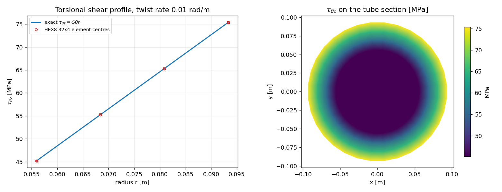
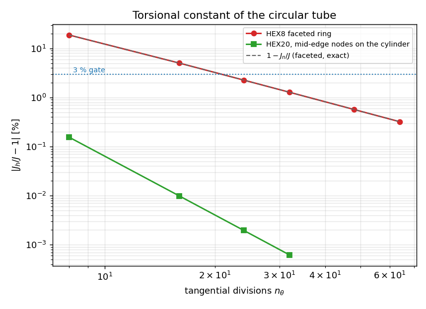

# Saint-Venant 圆管扭转：HEX8 分面误差 vs HEX20 曲边复原（TensorFEM 验证欠账清偿）

## ① 案例介绍

环截面钢圆管，内半径 `R_i = 0.05 m`、外半径 `R_o = 0.1 m`、
长 `L = 0.4 m`，`E = 2.100e+11 Pa`、`nu = 0.3`，
剪切模量 `G = 8.076923e+10 Pa`。载荷为单位扭率 `theta = 0.01 rad/m`
的纯扭转（`phi(z) = theta z`）。圆管是**唯一无翘曲**承受 Saint-Venant 扭转的截面：

```
u = theta z (z_hat x r),  tau_theta_z = G theta r,  tau_max = 80.769 MPa
J = pi (R_o^4 - R_i^4)/2 = 1.472622e-04 m^4,  T = G J theta = 1.189425e+05 N m
```

选题理由（缺口账）：TensorFEM 的三维线弹性内核（`solid3d` / `hex20`）已有弯曲、内压、热、平面应变 Lamé 等
证据，但**仓库内无任何扭转验证**；而扭转正是舵杆、轴系、管节点的主导工况。本单为该欠账补做验证。

## ② 方法与工具链

* 两端施加精确刚性旋转斜坡（`u_x=-theta z y, u_y=theta z x, u_z=0`），侧面自由——这正是无载 Saint-Venant 边界条件。
* 由 `z=L` 端**反力矩**给出 `J_h = T/(G theta)`（不用应力单点积分，见 ⑤ 陷阱）。
* 双重参考：精确圆 `J`（工程目标）+ 内接 n 边形管 `J_n = (n/12) sin(dphi)(2+cos dphi)(R_o^4-R_i^4)`（离散几何的锐利参考）。
* 新增 `src/tensorfem/torsion_reference.py`（解析参考 + O 形环网格 + 驱动 + 反力矩），
  求解走既有 `solid3d.solve_solid`（HEX8，2x2x2 积分）与 `hex20.solve_hex20`（20 节点，3x3x3 积分）；
  HEX20 变体把两个圆柱面上的中边节点**投影到真圆**（`project_hex20_to_cylinders`）以得到曲边。
  全程 `torch.float64`，OMP_NUM_THREADS=8，最大模型 3168 dofs（稠密直接解）。

## ③ 计算结果（程序化注入，零手抄）

| 单元 | 几何 | n_theta | 单元数 | dofs | J_h [m^4] | vs 真圆 | vs 分面参考 | patch 误差 | 3% 门 |
|---|---|---|---:|---:|---|---|---|---|---|
| hex8 | faceted | 8 | 64 | 360 | 1.196383e-04 | -18.7583 % | +8.22e-13 % | 3.5e-15 | FAIL |
| hex8 | faceted | 16 | 128 | 720 | 1.398650e-04 | -5.0231 % | +2.09e-12 % | 2.4e-15 | FAIL |
| hex8 | faceted | 24 | 192 | 1080 | 1.439321e-04 | -2.2613 % | +3.13e-12 % | 6.6e-15 | PASS |
| hex8 | faceted | 32 | 256 | 1440 | 1.453806e-04 | -1.2777 % | +9.55e-13 % | 5.4e-15 | PASS |
| hex8 | faceted | 48 | 384 | 2160 | 1.464232e-04 | -0.5697 % | -2.91e-12 % | 5.6e-15 | PASS |
| hex8 | faceted | 64 | 512 | 2880 | 1.467897e-04 | -0.3208 % | +5.75e-12 % | 2.0e-14 | PASS |
| hex20 | curved-edges | 8 | 16 | 456 | 1.470340e-04 | -0.1550 % | +2.29e+01 % | 2.2e-15 | PASS |
| hex20 | curved-edges | 16 | 64 | 1584 | 1.472477e-04 | -0.0098 % | +5.28e+00 % | 1.7e-14 | PASS |
| hex20 | curved-edges | 24 | 96 | 2376 | 1.472593e-04 | -0.0020 % | +2.31e+00 % | 1.1e-14 | PASS |
| hex20 | curved-edges | 32 | 128 | 3168 | 1.472612e-04 | -0.0006 % | +1.29e+00 % | 1.4e-14 | PASS |
| hex20 | faceted | 16 | 64 | 1584 | 1.398650e-04 | -5.0231 % | +1.01e-11 % | 4.2e-15 | FAIL |

观测阶：HEX8 分面 16→32 `p = 1.98`，32→64 `p = 1.99`（二阶，恰为分面律）；
HEX20 曲边 8→16 `p = 3.98`，16→32 `p = 3.99`（四阶，二次曲边）。

结论判据的对照量：单元 patch 误差 2.0e-14，`J_h` 对分面参考的偏差 5.8e-14，
单元中心剪应力对 `G theta r` 的最大相对误差 5.55e-14，扭转角线性偏差 <1e-12 rad。
即**单元本身精确**，与理想圆管的全部分歧来自网格几何折面。



左：n_theta=32 HEX8 单元中心剪应力 vs 精确 `G theta r`；右：截面剪应力云图。



收敛图：黑虚线为闭式分面律 `1-J_n/J`，蓝点线为 3% 门；HEX8 完全落在分面律上，HEX20 曲边四阶压到真圆。

## ④ 结果图的物理读数

* HEX8 环的 `tau_theta_z` 沿半径严格线性且过零点与解析一致（图左），说明应力恢复通道无缺陷；
* 图右云图在壁厚方向线性、环向均匀，端面无边界层（Dirichlet 强加刚性旋转，构造上无端部效应）；
* 收敛图显示两条完全不同的误差机制：直线（几何折面，O(n⁻²)）与陡降线（曲边几何，O(n⁻⁴)）。

## ⑤ 注意点（踩坑与适用范围）

* **折面 ≠ 锁定**：n_theta=8 时 HEX8 低估圆管抗扭刚度 18.76%，n_theta=16 时 5.02%，
  这不是单元缺陷，而是内接多边形刚度，闭式 `J_n` 可复现到舍入。
* **单点应力积分陷阱**：用单元形心 `tau*r*A` 积分反算扭矩，n_theta=8 低估 5.8%、
  n_theta=32 低估 0.74%，因为 `int r^2 dA != A r_c^2`。判据必须走反力，该偏差已作为反例记录在证据里。
* **仅覆盖无翘曲截面**：方管/箱形梁需要翘曲函数，本验证**不**覆盖；用线性斜坡去做方截面会得到偏刚结果，不得当作通过。
* **HEX20 必须投点**：`upgrade_hex8_to_hex20` 只在中点插值，不做投点则结果与 HEX8 逐位相同（已在表里给出 n_theta=16 对照）。
* 适用范围：线弹性、小变形、均匀各向同性、直棱柱；不含端部接头、圆角、塑性；端面为 Dirichlet。

## ⑥ 误差判定（逐项，显式回答是否 <3%）

| 量 | 基准 | 实测最差误差 | <3%？ |
|---|---|---|---|
| `J`（HEX8，n_theta=32） | 真圆管 | 1.278 % | 是 |
| `J`（HEX8，n_theta=24） | 真圆管 | 2.261 % | 是 |
| `J`（HEX8，n_theta=16） | 真圆管 | 5.023 % | **否** |
| `J`（HEX8，n_theta=8） | 真圆管 | 18.758 % | **否** |
| `J`（HEX8，n_theta=32） | 分面多边形 | 9.55e-13 % | 是 |
| `J`（HEX20 曲边，n_theta=8） | 真圆管 | 0.1550 % | 是 |
| `tau_theta_z`（单元中心） | `G theta r` | 5.55e-12 % | 是 |

工程可用结论（网格指引）：**HEX8 环需 `n_theta >= 24`（2.26%）**才能守住 3%，
`n_theta = 16`（5.02%）不合格；改用 HEX20 + 中边投点后 `n_theta = 8` 即 0.15%，
同 dofs 量级下精度提升两个数量级。粗网格失败（n_theta=8/16）**保留未删**。

honest 声明：本单只清偿「三维弹性核在纯扭转下」的验证欠账；翘曲截面、端部接头、塑性扭转仍未覆盖。
