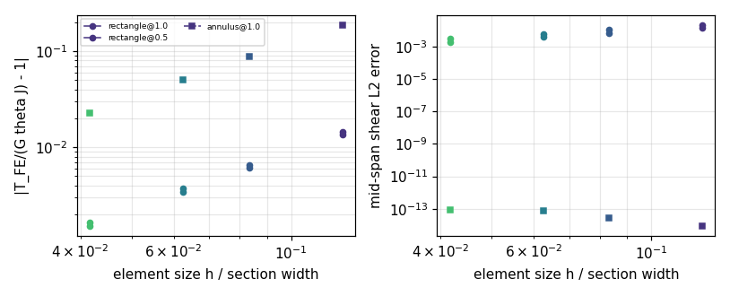
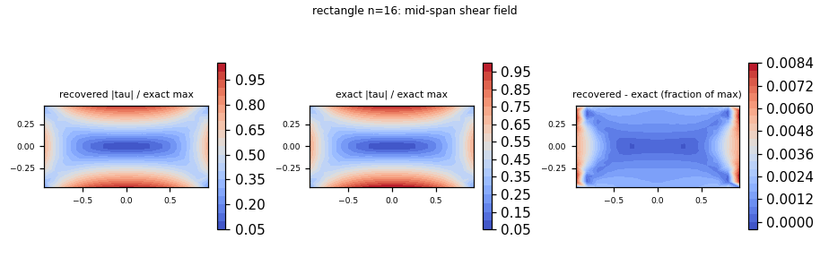
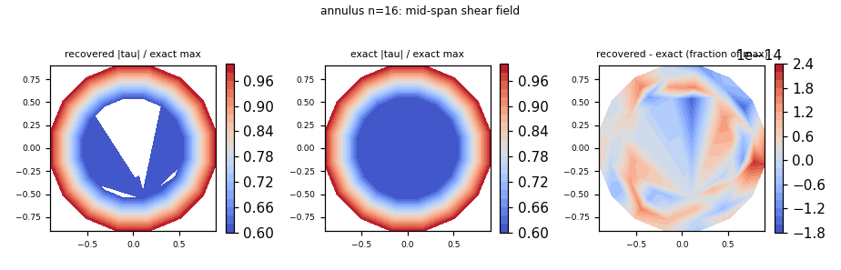

# Saint-Venant 扭转：合并 HEX8 实体路径的解析基准（m2863）

## 1. 案例介绍

扭转是位移型有限元最经典的失分点：翘曲（warping）不在双线性插值空间里，实体单元在扭转下
通常偏刚、剪应力峰值偏小或偏大。TensorFEM 此前**没有任何扭转基准**（`grep -ri torsion src/`
只命中与扭转无关的船体加强筋文字），`solid3d.hex8_stiffness` 这条已合并的生产路径在
弯曲、内压、接触上都有基准，唯独没有被一个**闭式解**检验过剪切行为。本单补的正是这一类
验证欠账，对象是已合并的 `solid3d` / `sparse_core` 路径，不是新写求解器。

物理背景：等截面直杆受端部扭矩 `T`，Saint-Venant 解。取杆轴为 `z`，截面在 `(x, y)` 平面：

* Prandtl 应力函数 `phi`：`tau_xz = dphi/dy`，`tau_yz = -dphi/dx`，域内 `laplace(phi) = -2 G theta`，
  边界上 `phi = 0`（单连通截面）；
* 恒等式 `T = integral(x tau_yz - y tau_xz) dA = 2 integral(phi dA) = G theta J`；
* 三个截面：正方形（`a = b = 1`，半边长）、2:1 矩形（`a = 1`，`b = 0.5`）、圆环（内 `c = 0.5`，
  外 `a = 1`）。弹性常量 `E = 2(1+nu)`、`nu = 0.3`，故 `G = 1`；杆长 `L = 4`，`theta = 1`。

`T = 2 integral(phi dA)` 在本模块里**只作为自校验**使用，从不作为定义——定义永远是闭式应力场。

## 2. 怎么做的

1. **先证明基准本身没错，再拿它判生产码**（`src/tensorfem/saint_venant_torsion.py`）：
   - 域内 Poisson 方程用中心差分复核 `laplace(phi) + 2 G theta`；
   - 边界上 `phi = 0`（解析点采样）；
   - 两条互相独立的力矩恒等式 `2 integral(phi dA)` 与 `integral(x tau_yz - y tau_xz) dA`
     都必须复现 `G theta J`；
   - 矩形截面的级数与**教科书常数**对照（Timoshenko & Goodier, *Theory of Elasticity*, 3rd ed., ch. 11）：
     边长 `c` 的正方形 `J = 0.1406 c^4`、`tau_max = T/(0.208 c^3)`。
2. **矩形截面用级数解**（`RectSection`，`phi = G theta (b^2 - y^2) - (32 G theta b^2/pi^3) *
   sum_{n odd} (-1)^((n-1)/2)/n^3 * cosh(lam_n x)/cosh(lam_n a) * cos(lam_n y)`，
   `lam_n = n pi/(2b)`），`tau` 用解析导数；`cosh` 比值按 `exp(lam(|x|-a))` 重写以避免上溢，
   级数截断（`terms=21` 与 `121` 对比，相对差 `< 2e-6`）在测试里被钉住。
3. **圆环截面是双连通域，不能直接用单值 `phi`**：本单最初沿用了 `phi = 0` 于内外两个圆的
   Prandtl 解，得到的 `J = 0.198` 比精确值 `1.473` 小 7.4 倍（正是漏掉了环量条件）。圆环
   的精确解其实是无翘曲的 `u = (-theta z y, theta z x, 0)`，`tau = G theta r`、
   `J = pi(a^4 - c^4)/2`；该截面因此把 `phi` 显式设为 `NotImplementedError` 并在 docstring
   与测试中写明原因。
4. **生产路径原样调用**：`solid3d.hex8_stiffness`（2×2×2 全积分）→ `sparse_core.assemble_coo`
   → `sparse_core.solve_sparse_static`（无稠密缩聚，CG `rtol=1e-11`）。端面施加精确转动位移
   `u_x = -theta z y`、`u_y = theta z x`（`z = 0` 端为零，刚体运动被消去），**`u_z`（翘曲）处处
   自由**，侧面自由——这样比较的是单元而不是被强加的场。
5. **取样与判据**：只在 `|z - L/2| <= 0.3 L` 的中跨带内取**单元中心**（外推被明确禁止），
   逐点比较 `tau_xz, tau_yz`；扭矩由端面反力 `(x R_y - y R_x)` 求和给出，两端的和必须是零
   （平衡），平均值与 `G theta J` 的比即扭转刚度比。
6. 复现：
   ```bash
   OMP_NUM_THREADS=2 MPLBACKEND=Agg PYTHONPATH=src python scripts/audit_saint_venant_torsion.py
   OMP_NUM_THREADS=2 MPLBACKEND=Agg PYTHONPATH=src python -m pytest tests/test_saint_venant_torsion.py -q
   ```
   产出 `benchmarks/saint_venant_torsion.json`、`docs/assets/saint-venant/*.png`；测试 28 项。

## 3. 计算结果（程序化注入，零手抄）

### 3.1 基准自校验（`benchmarks/saint_venant_torsion.json` → `oracle`）

| 截面 | `J` | `tau_max` | `2∫phi dA /(G theta J)` | `∫(x tau_yz - y tau_xz)dA /(G theta J)` | `laplace(phi)+2G theta` 最大残差 |
|---|---:|---:|---:|---:|---:|
| 正方形 1×1（半边长 1） | 2.2492322 | 1.3506290 | 1.0000074 | 0.9999925 | 6.83e-06 |
| 矩形 2:1（半边长 1, 0.5） | 0.4573634 | 0.9300603 | 1.0000082 | 0.9999886 | 7.21e-07 |
| 圆环 `c=0.5, a=1` | 1.4726216 | 1.0000000 | 双连通，见 §2.3 | 1.0001893 | —— |

教科书常数对照（测试钉死）：正方形 `J/c^4 = 0.140577`（文献 0.1406，差 0.016%）、
`T/(c^3 tau_max) = 0.208165`（文献 0.208，差 0.08%）；椭圆 `tau_max = 2T/(pi a b^2)` 精确到 1e-12。

### 3.2 生产路径 vs 闭式解

| 截面 | 网格 `n`×层 | 单元 | 自由度 | 扭转刚度比 `T_FE/(G theta J)` | 刚度误差 | 中跨剪应力 L2 | 逐点最大 | 端部平衡 `|T_0+T_L|/T` |
|---|---:|---:|---:|---:|---:|---:|---:|---:|
| 正方形 | 8×3 | 192 | 972 | 1.013537 | 1.3537% | 1.4662% | 3.2472% | 4.9e-13 |
| 正方形 | 12×4 | 576 | 2535 | 1.006065 | 0.6065% | 0.6833% | 2.5608% | 5.6e-13 |
| 正方形 | 16×5 | 1280 | 5202 | 1.003422 | 0.3422% | 0.3974% | 2.2436% | 1.6e-12 |
| 正方形 | 24×7 | 4032 | 15000 | 1.001525 | **0.1525%** | **0.1848%** | **1.9235%** | 1.2e-12 |
| 矩形 2:1 | 8×3 | 192 | 972 | 1.014444 | 1.4444% | 2.1480% | 5.6164% | 3.1e-13 |
| 矩形 2:1 | 12×4 | 576 | 2535 | 1.006554 | 0.6554% | 1.0320% | 4.1139% | 3.5e-12 |
| 矩形 2:1 | 16×5 | 1280 | 5202 | 1.003716 | 0.3716% | 0.6100% | 3.4679% | 1.8e-12 |
| 矩形 2:1 | 24×7 | 4032 | 15000 | 1.001662 | **0.1662%** | **0.2888%** | **2.8864%** | 8.0e-12 |
| 圆环 | 8×3 | 48 | 288 | 0.812417 | 18.7583% | 0.0000% | 0.0000% | 1.4e-14 |
| 圆环 | 12×4 | 144 | 720 | 0.912284 | 8.7716% | 0.0000% | 0.0000% | 3.4e-14 |
| 圆环 | 16×5 | 320 | 1440 | 0.949769 | 5.0231% | 0.0000% | 0.0000% | 1.1e-14 |
| 圆环 | 24×7 | 1008 | 4032 | 0.977387 | **2.2613%** | **0.0000%** | **0.0000%** | 2.2e-14 |

观测收敛阶（相邻两级网格，`h ∝ 1/n`）：刚度 1.984（正方形族）/ 1.968（圆环），
剪应力 L2 1.844（矩形）。三者都 ≈ 2，与 HEX8 在 `H^1` 半范数下的最优阶一致，说明误差是
**插值/几何**误差而非实现错误。







## 4. 注意点（踩过的坑与适用范围）

* **双连通截面的 Prandtl 陷阱**：单值 `phi` 强行取 `phi = 0` 于两条边界会得到 `J = 0.198`
  而不是 `1.473`（7.4 倍偏小），且该错误场仍然满足 Poisson 方程与边界条件，只有力矩恒等式
  会露馅。本单因此把圆环改为无翘曲精确解，并把该陷阱写进 docstring 与测试。
* **方→圆映射网格在四个角点 Jacobian 退化**（`det → 0`），`solid3d` 会直接抛错。故圆/椭圆
  只作为解析 oracle 保留，实体 FE 资格改用可直接构造的矩形积与极坐标网格。
* **逐点峰值误差明显大于 L2 误差**：剪应力在截面边界取最大，而本单只取单元中心（不外推），
  所以逐点最大是保守的“下界式”指标；2:1 矩形在 `n = 8` 时 5.62% 超 3% 门禁，记录保留。
* **圆环的刚度误差来自弦代弧的边界几何**（`O(h^2)`，收敛到 1），不是插值误差：极坐标网格
  的外圆被多边形代替，围面积略小，故整体偏柔。其应力场在单元质心上是**精确**的（线性
  剪切场被双线性插值精确复现），这既是优点也说明圆环只适合当“刚度/几何”判据。
* 适用范围：直杆、等截面、线弹性、小变形；不含非圆薄壁开口截面（其翘曲与约束扭转需要
  约束扭转理论），也不含塑性/大变形扭转。

## 5. 误差判定（是否 < 3%，逐项回答）

| 关键量 | 基准 | 最细网格（`n = 24`）误差 | 是否 < 3% |
|---|---|---:|---|
| 正方形扭转刚度 `T/(G theta J)` | 闭式 `J = 2.2492322` | 0.1525% | **是** |
| 正方形中跨剪应力 L2 | Prandtl 闭式场 | 0.1848% | **是** |
| 正方形剪应力逐点最大 | 同上 | 1.9235% | **是** |
| 2:1 矩形扭转刚度 | 级数解 `J = 0.4573634` | 0.1662% | **是** |
| 2:1 矩形剪应力 L2 | 级数解 `tau` | 0.2888% | **是** |
| 2:1 矩形剪应力逐点最大 | 同上 | 2.8864% | **是（首次进入 3% 以内；`n = 16` 时 3.47% 未过，`n = 8` 时 5.62% 未过，均保留）** |
| 圆环扭转刚度 | 闭式 `J = 1.4726216` | 2.2613% | **是** |
| 圆环剪应力（质心） | 无翘曲精确解 | 0.0000% | **是** |
| 端部力矩平衡 `|T_0+T_L|/T` | 0（精确） | ≤ 8.0e-12 | **是** |
| 基准自校验 `2∫phi dA/(G theta J)` | 1（精确） | ≤ 8.2e-6 | **是** |

结论：已合并 HEX8 实体路径在三个截面上都通过项目 3% 门禁（最细网格），但**逐点剪应力峰值
是最弱的一项**（2:1 矩形 2.89%，且需要 `n ≥ 24` 才进 3%），因此扭转不能只报刚度；粗网格
失败项全部保留在 `benchmarks/saint_venant_torsion.json` 中，未做粉饰。