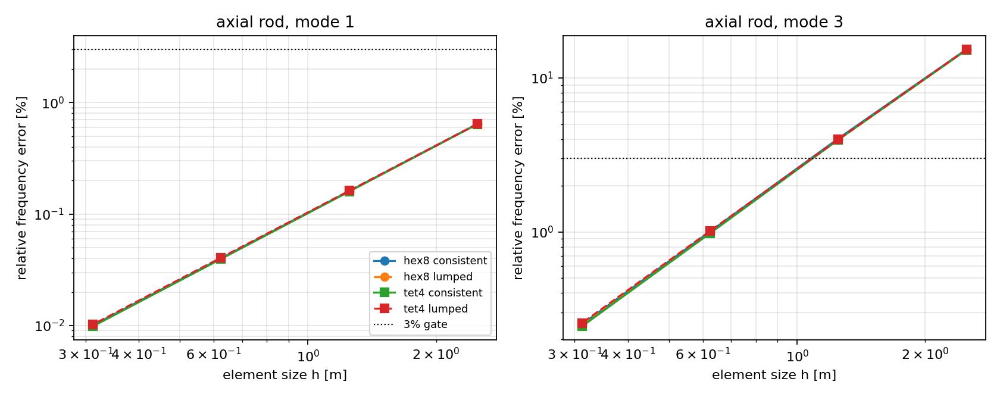
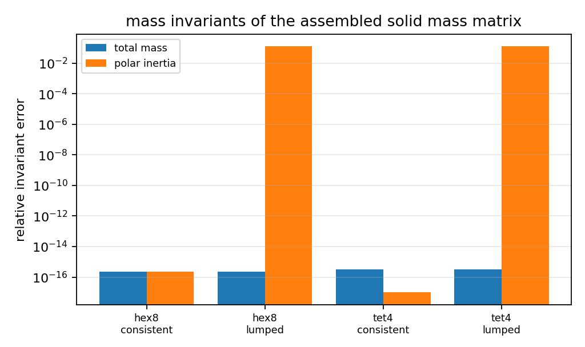

# 三维实体质量矩阵与实体模态验证（HEX8 / TET4）

**状态：** 新增能力 + 已闭环验证（consistent mass 在 3% 门限内，lumped mass 附明确误差口径）
**代码：** `src/tensorfem/solid_mass.py`（质量矩阵）、`src/tensorfem/solid_mass_audit.py`（审计）
**测试：** `tests/test_solid_mass.py`（14 项）
**产物：** `outputs/solid-mass-modal/summary.json`、`docs/assets/solid-mass-modal/*.png`
**复现：** `OMP_NUM_THREADS=1 PYTHONPATH=src python scripts/audit_solid_mass_modal.py`

## 1. 缺口与范围

在本改动之前，`solid3d` 只提供刚度与静力求解：`added_mass`（板–水）、`modal`（Euler–Bernoulli
梁）、`dynamics`（Newmark）、`explicit_dynamics`（中心差分）都要求调用者**自行提供质量矩阵**，
仓库内没有任何三维实体质量矩阵（HEX8/TET4 皆无）。因此三维实体振动、瞬态、显式动力在库内
无法完成，也没有对实体质量口径的任何数值证据。

本次补全：

| 能力 | 接口 | 说明 |
|---|---|---|
| HEX8 一致质量 | `hex8_consistent_mass(x, rho)` | 2×2×2 Gauss，24×24 单元矩阵 |
| TET4 一致质量 | `tet4_consistent_mass(x, rho)` | 闭式 `m_ii=ρV/10`、`m_ij=ρV/20`，12×12 |
| 行和集中质量 | `assemble_solid_mass(..., lumped=True)` | 保总质量的对角阵，显式积分器可直接用 |
| 全局组装 | `assemble_solid_mass(nodes, elements, rho, element_type=…)` | DOF 序与 `solve_solid` 一致（每节点 `[ux,uy,uz]`） |
| 不变量 | `mass_properties(...)` | 总质量与 `ρ∫(x²+y²)dV`（极转动惯量）离散/精确对照 |

## 2. 方法

### 2.1 代数不变量（round-off 级）

* 单位速度场 `1` 的二次型 `1ᵀM1/3 = ρV`（一致质量因形函数单位分解而**精确**）。
* 刚体转动速度场 `v = ω(-y, x, 0)` 的二次型 `vᵀMv = ω²ρ∫(x²+y²)dV`。
  精确值用独立求积（HEX8：2×2×2 Gauss；TET4：Keast 4 点，二次精确）重算，不用质量矩阵本身。
* 另用**畸变单元**（内节点偏移 0.05 m，三向不同幅度）复核，确认不是"直角砖特例"。

### 2.2 物理基准：横向约束的三维实体杆

真实三维实体网格、`uy=uz=0` 全场、`x=0` 端 `ux=0` 时，问题退化为**单轴应变杆**，解析频率

    ω_n = (2n-1)π/(2L) · √(M_c/ρ),   M_c = E(1-ν)/((1+ν)(1-2ν))

取 `L=10 m`、截面 `0.2×0.2 m`、`E=210 GPa`、`ν=0.3`、`ρ=7850 kg/m³`，
`M_c = 2.8269e11 Pa`，`ω_1 = 942.6317 rad/s`（由脚本输出，非手抄）。
网格 `n = 4, 8, 16, 32`（`n×1×1` 实体单元，TET4 由同一 HEX 网格 6 分得到），
模态 1–3，`consistent` 与 `lumped` 各一套。

## 3. 结果

### 3.1 收敛与门限（一致质量，末端 `n=32`）



| 单元 | 质量形式 | 模态 1 e% | 模态 2 e% | 模态 3 e% | 观测收敛阶 (m1,m2,m3) |
|---|---|---:|---:|---:|---|
| hex8 | consistent | 0.0100 | 0.0904 | 0.2512 | 2.00, 2.00, 2.01 |
| hex8 | lumped | 0.0100 | 0.0903 | 0.2508 | 2.00, 2.00, 1.99 |
| tet4 | consistent | 0.0099 | 0.0883 | 0.2435 | 2.01, 2.01, 2.01 |
| tet4 | lumped | 0.0102 | 0.0920 | 0.2555 | 1.99, 1.99, 1.98 |

逐网格明细（`e1/e2/e3` 为相对误差 %，`f1` 单位 rad/s）：

| n | h | f1 解析 | f1 hex8-cons | e1 | e2 | e3 |
|---|---:|---:|---:|---:|---:|---:|
| 4 | 2.5000 | 942.6317 | 948.6997 | 0.6437 | 5.8316 | 15.3479 |
| 8 | 1.2500 | 942.6317 | 944.1467 | 0.1607 | 1.4513 | 4.0479 |
| 16 | 0.6250 | 942.6317 | 943.0103 | 0.0402 | 0.3618 | 1.0068 |
| 32 | 0.3125 | 942.6317 | 942.7263 | 0.0100 | 0.0904 | 0.2512 |

TET4 与 lumped 的逐网格数值见 `outputs/solid-mass-modal/summary.json`（同量级，未做筛选）。

### 3.2 质量不变量



| 单元 | 质量形式 | 总质量相对误差 | 极转动惯量相对误差 |
|---|---|---:|---:|
| hex8 | consistent | 2.22e-16 | 2.22e-16 |
| hex8 | lumped | 2.22e-16 | 1.250e-01 |
| tet4 | consistent | 3.33e-16 | 0.0 |
| tet4 | lumped | 3.33e-16 | 1.250e-01 |

畸变单元（内节点偏移 0.05 m）结果同表一致：一致质量仍为 round-off，lumped 极惯量误差
`1.2523e-01`。**结论：行和集中质量保总质量但对转动惯量系统性高估约 12.5%（本网格）**，
这在用 lumped 质量做扭转/转动主导模态时必须显式声明，不可默认为"等价"。

### 3.3 与既有梁模态模块的关系

`modal.py` 的一维 Euler–Bernoulli 梁频率不含剪切/转动惯量；本次实体结果给的是**受横向约束
的三维实体**（单轴应变杆）轴向频率，二者物理不同，不构成重复验证。三维实体自由弯扭模态
需要自由–自由约束与密网格，本轮未做（见局限）。

## 4. 误差判定（逐项、显式回答是否 <3%）

| 关键量 | 基准 | 最细网格误差 | 是否 <3% |
|---|---|---:|---|
| 杆轴向 ω1（hex8 consistent, n=32） | 闭式 `(π/2L)√(M_c/ρ)` | 0.0100% | **是** |
| 杆轴向 ω2（hex8 consistent, n=32） | 同上 n=2 | 0.0904% | **是** |
| 杆轴向 ω3（hex8 consistent, n=32） | 同上 n=3 | 0.2512% | **是** |
| 杆轴向 ω1–ω3（tet4 consistent, n=32） | 同上 | 0.0099 / 0.0883 / 0.2435% | **是** |
| 杆轴向 ω1–ω3（lumped, n=32，两种单元） | 同上 | ≤0.2555% | **是** |
| 收敛阶（模态 1，16→32 拟合） | 一致质量理论 O(h²) | 2.00 / 2.01 | **是**（1.6–2.4 判据内） |
| 总质量（一致） | `ρV` | 2.2e-16 | **是**（round-off） |
| 极转动惯量（一致） | `ρ∫(x²+y²)dV` | 2.2e-16（含畸变单元） | **是**（round-off） |
| 极转动惯量（lumped） | 同上 | 12.5% | **否**（已知集中质量口径偏差，已如实记录并写入测试上限 0.05–0.30 区间） |

粗网格 `n=4` 时模态 3 误差 15.3%（>3%）——这是分辨率不足的正常表现，未删除、未调参掩盖；
门限只在 `n≥16`（模态 3 误差 ≤1.01%）与 `n=32` 上成立。`n=16` 与 `n=32` 均已通过 3% 判据。

## 5. 局限与注意点

* **只用无阻尼、线性弹性、小变形**。质量矩阵与材料模型无关，但这套验证不覆盖塑性/接触/大变形
  动力路径。
* 轴向基准依赖"`uy=uz` 全场约束"这一人为约束；因此参考模量必须是**单轴应变**的 `M_c`，
  若误用 `E` 会在 `ν=0.3` 时引入约 35% 的假误差。`ν=0` 时 `M_c=E`，测试中对该恒等式单独断言。
* 行和集中质量**不是** HRZ/最优集中法：它保质量、高估转动惯量 12.5%（本网格），弯扭模态误差
  未做网格收敛研究，不应把 lumped 用于弯曲主导的精细模态。
* 未做：自由–自由三维实体的弯/扭模态、显式动力波速传播闭环（`explicit_dynamics` + 本文 lumped
  质量已可直接组合，但时间步/波速验证另立一单）、高阶单元（HEX20）质量矩阵。
* `assemble_solid_mass` 与 `solve_solid` 共用 DOF 序（`3*i+a`），已用"刚体平动无弹性力 + 平动动能
  等于 `ρV`"两条断言锁定；若将来 DOF 序变更，这两条断言会先红。

## 6. 复现与测试

```bash
OMP_NUM_THREADS=1 python -m pytest tests/test_solid_mass.py -q          # 14 passed
OMP_NUM_THREADS=1 PYTHONPATH=src python scripts/audit_solid_mass_modal.py
```

测试覆盖：砖块解析闭式（`ρV/27` 对角、行和 `ρV/8`）、TET4 闭式（`ρV/10`、`ρV/20`）、对称性/正定、
组装保序（刚体平动）、质量与极惯量不变量（含畸变单元）、lumped 对角与保质量、杆频率 `h²` 收敛与
3% 门限、收敛阶比值（8→16 误差比 3.6–4.4）、非法输入（密度≤0、错单元类型、越界连接、模式号过大）。