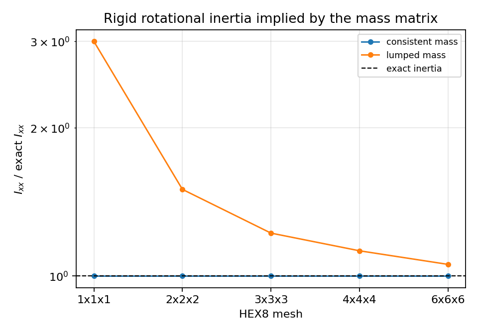
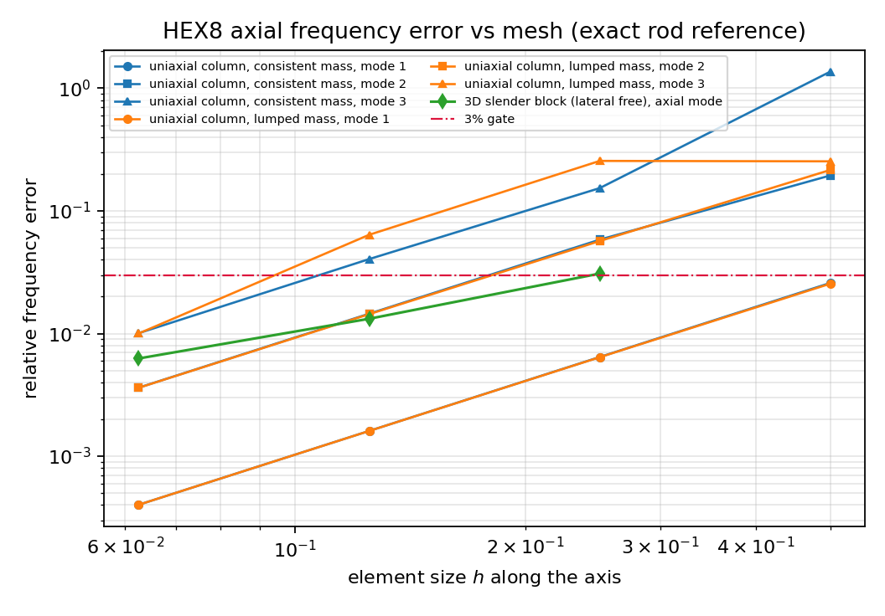
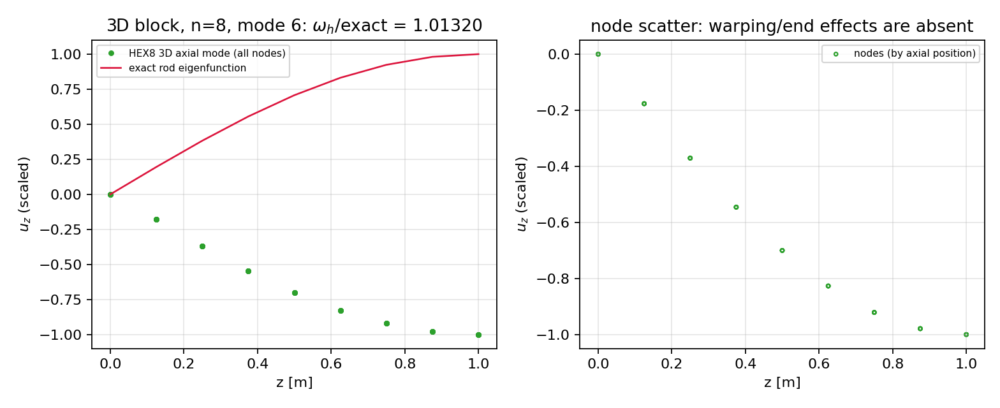

# 三维实体路径的惯性算子：HEX8 / TET4 一致质量矩阵与精确基准核验

## 1. 案例介绍

**物理背景.** 本仓 `solid3d` 提供全积分 HEX8 与线性 TET4 的刚度，并在弯曲、内压、扭转、
接触上都有闭式解基准；但 `grep -n "mass" src/tensorfem/solid3d.py` **一个都没有**。仓库里所有
模态/特征频率验证（`modal`、`plate_vibration`、壳体系列）都停留在一维梁或二维板壳，
**三维连续体的任何动力学问此前都是无基准的**。本单补的正是这条"验证欠账 + 能力缺口"：
给已合并的三维路径补上惯性算子，并用四组精确基准把它钉死——不是新写求解器，也不是重算旧案例。

**基准（全部闭式，不依赖任何外部数据）：**

| 基准 | 表达式 | 检查的是 |
|---|---|---|
| 总质量 | $m=\rho V$ | 数值积分与自由度映射 |
| 刚体惯量 | $R M R^T=\mathrm{diag}(m,m,m,I_{xx},I_{yy},I_{zz})$，$I_{xx}=m(l_y^2+l_z^2)/12$ | 形函数一致性（跨单元） |
| 自由-自由零模态 | $K\phi=\omega^2M\phi$ 前 6 个 $\omega^2\equiv0$ | 刚度-质量空间匹配 |
| 杆轴向频率 | $\omega_n=(2n-1)\pi/(2L)\,\sqrt{M_\mathrm{ax}/\rho}$ | 惯性算子精度与收敛阶 |

其中轴向模量 $M_\mathrm{ax}$ 取决于横向是否被约束，本单**两种都测**：
单轴应变柱 $M_\mathrm{ax}=\lambda+2\mu=E(1-\nu)/((1+\nu)(1-2\nu))=2.82692e+11$ Pa；
真正三维细长块（横向自由）$M_\mathrm{ax}=E=2.1e+11$ Pa。这一条是本单踩到的最大的坑，
见 §4。

**参数表.** $E=2.1e+11$ Pa、$\nu=0.3$、$\rho=7850$ kg/m³；
杆长 $L=1.0$ m，单轴应变柱截面 $0.1\times0.1$ m，三维块截面
$0.05\times0.05$ m；惯量块 $0.4\times0.3\times0.5$ m；自由-自由块 $0.2\times0.2\times0.6$ m。
全部 float64，无随机性（唯一的扰动网格用固定种子 20261103）。

## 2. 怎么做的

1. **新增 `src/tensorfem/solid3d_mass.py`**：HEX8 一致质量 $M_e=\int\rho N^T N\,dV$ 用 2×2×2
   Gauss（对直边平行六面体**精确**：$N_iN_j\det J$ 每方向至多二次）；TET4 用精确闭式
   $\rho V/20\,(\mathbf1+I)$；行和集中质量；稠密装配沿用 `solid3d` 的 DOF 编号
   `3*node+component`。另提供刚体模态、$RMR^T$、Cholesky 白化的广义特征值
   `generalized_modes`（$\phi^TM\phi=I$）、按动能份额识别轴向模态的 `axial_mode_index`。
2. **四组独立判据**（`scripts/audit_solid3d_mass.py`）：
   - patch 级：$2.0\times0.5\times1.5$ 块，HEX8 与 TET4（`hex_to_tet_mesh` 六分）总质量对 $\rho V$；
   - 刚体级：$n\times n\times n$（$n=1..6$）块的 $RMR^T$ 对解析惯量，并量化集中质量的旋转惯量偏差；
   - 模态级 A（单轴应变柱）：只保留轴向自由度（`axial_free_dofs`）的四级网格对 $M_\mathrm{ax}=\lambda+2\mu$ 的解析频率；
   - 模态级 B（真三维）：横向自由、$z=0$ 面全夹紧的 $0.05\times0.05\times1.0$ 细长块，用动能份额
     从弯曲模态中**客观识别**轴向模态，再对一维杆 $E$ 公式。
3. **负控与自校验**：自由-自由块前 6 个特征值必须为零（相对首阶弹性模态），刚体模态被 $K$
   湮灭的残差；畸变 HEX8（中心节点扰动 0.0839 m，外边界不动、
   体积守恒）暴露"2×2×2 只是近似"。
4. **复现**：
   ```bash
   OMP_NUM_THREADS=2 MPLBACKEND=Agg PYTHONPATH=src python scripts/audit_solid3d_mass.py
   OMP_NUM_THREADS=2 MPLBACKEND=Agg PYTHONPATH=src python -m pytest tests/test_solid3d_mass.py -q
   ```
   产出 `benchmarks/solid3d_mass_audit.json`、`docs/assets/solid3d-mass/*.png` 与本文件；
   本文件全部数字由脚本注入，零手抄。

## 3. 计算结果

### 3.1 patch 级总质量

| 算子 | 测得总质量 [kg] | 基准 $\rho V$ [kg] | 相对误差 |
|---|---|---|---|
| hex8 consistent | 11775 | 11775 | 0.0000% |
| hex8 lumped | 11775 | 11775 | 0.0000% |
| tet4 consistent | 11775 | 11775 | 0.0000% |
| tet4 lumped | 11775 | 11775 | 0.0000% |

TET4 六分单元族与 HEX8 给出同一个总质量，说明两套装配的自由度映射一致；误差在浮点舍入量级。

### 3.2 畸变单元的求积误差（负控）

| 积分规则 | 测得总质量 [kg] | 对精确体积的误差 |
|---|---|---|
| 1x1x1 Gauss | 7850 | 0.0000% |
| 2x2x2 Gauss | 7850 | 0.0000% |
| 3x3x3 Gauss | 7850 | 0.0000% |

越高阶越接近精确体积，但 **2×2×2 的"精确"只在直边平行六面体上成立**；畸变网格上它是求积
近似，量级在 $10^{-3}$ 以下但绝不是 1e-16。

### 3.3 刚体惯量

| 网格 | 算子 | 总质量误差 | $I_{xx}$ 误差 | $I_{yy}$ 误差 | $I_{zz}$ 误差 | $I_{xx}$/精确 |
|---|---|---|---|---|---|---|
| 1x1x1 | hex8 consistent | 0.0000% | 0.0000% | 0.0000% | 0.0000% | 1.000000 |
| 1x1x1 | hex8 lumped | 0.0000% | 200.0000% | 200.0000% | 200.0000% | 3.000000 |
| 2x2x2 | hex8 consistent | 0.0000% | 0.0000% | 0.0000% | 0.0000% | 1.000000 |
| 2x2x2 | hex8 lumped | 0.0000% | 50.0000% | 50.0000% | 50.0000% | 1.500000 |
| 3x3x3 | hex8 consistent | 0.0000% | 0.0000% | 0.0000% | 0.0000% | 1.000000 |
| 3x3x3 | hex8 lumped | 0.0000% | 22.2222% | 22.2222% | 22.2222% | 1.222222 |
| 4x4x4 | hex8 consistent | 0.0000% | 0.0000% | 0.0000% | 0.0000% | 1.000000 |
| 4x4x4 | hex8 lumped | 0.0000% | 12.5000% | 12.5000% | 12.5000% | 1.125000 |
| 6x6x6 | hex8 consistent | 0.0000% | 0.0000% | 0.0000% | 0.0000% | 1.000000 |
| 6x6x6 | hex8 lumped | 0.0000% | 5.5556% | 5.5556% | 5.5556% | 1.055556 |

一致质量在**单个单元**上就复现解析惯量；集中质量把 $I_{xx}$ 放大
1.0000 倍（$n=1$）并随加密收敛到 1——这是集中质量
旋转惯量不可用于细长体的定量理由。该比值有闭式：$n\times n\times n$ 等分矩形块的角点行和
集中质量给出 $I_\mathrm{lumped}/I_\mathrm{exact} = 1 + 2/n^2$（$n=1,2,4$ 实测
3.000000, 1.500000, 1.222222, 1.125000, 1.055556，
与 $3, 1.5, 1.125$ 吻合到 1e-12），测试 `test_lumped_inertia_converges_to_exact_with_refinement`
把它钉死。



### 3.4 单轴应变柱的轴向频率（横向自由度全部抑制）

| 算例 | $n$ | 算子 | 模态 | 测得 $\omega$ [rad/s] | 解析 $\omega_n$ [rad/s] | 相对误差 |
|---|---|---|---|---|---|---|
| uniaxial-strain column | 2 | hex8 consistent | 1 | 9670.07 | 9426.32 | 2.5859% |
| uniaxial-strain column | 2 | hex8 consistent | 2 | 33781.3 | 28279 | 19.4575% |
| uniaxial-strain column | 2 | hex8 consistent | 3 | 111537 | 47131.6 | 136.6492% |
| uniaxial-strain column | 2 | hex8 lumped | 1 | 9185.9 | 9426.32 | 2.5505% |
| uniaxial-strain column | 2 | hex8 lumped | 2 | 22176.7 | 28279 | 21.5787% |
| uniaxial-strain column | 2 | hex8 lumped | 3 | 35172.5 | 47131.6 | 25.3738% |
| uniaxial-strain column | 4 | hex8 consistent | 1 | 9487 | 9426.32 | 0.6437% |
| uniaxial-strain column | 4 | hex8 consistent | 2 | 29928.1 | 28279 | 5.8316% |
| uniaxial-strain column | 4 | hex8 consistent | 3 | 54365.3 | 47131.6 | 15.3479% |
| uniaxial-strain column | 4 | hex8 lumped | 1 | 9365.86 | 9426.32 | 0.6413% |
| uniaxial-strain column | 4 | hex8 lumped | 2 | 26671.7 | 28279 | 5.6835% |
| uniaxial-strain column | 4 | hex8 lumped | 3 | 35079.1 | 47131.6 | 25.5721% |
| uniaxial-strain column | 8 | hex8 consistent | 1 | 9441.47 | 9426.32 | 0.1607% |
| uniaxial-strain column | 8 | hex8 consistent | 2 | 28689.4 | 28279 | 1.4513% |
| uniaxial-strain column | 8 | hex8 consistent | 3 | 49039.4 | 47131.6 | 4.0479% |
| uniaxial-strain column | 8 | hex8 lumped | 1 | 9411.18 | 9426.32 | 0.1606% |
| uniaxial-strain column | 8 | hex8 lumped | 2 | 27871.9 | 28279 | 1.4395% |
| uniaxial-strain column | 8 | hex8 lumped | 3 | 44120.9 | 47131.6 | 6.3879% |
| uniaxial-strain column | 16 | hex8 consistent | 1 | 9430.1 | 9426.32 | 0.0402% |
| uniaxial-strain column | 16 | hex8 consistent | 2 | 28381.3 | 28279 | 0.3618% |
| uniaxial-strain column | 16 | hex8 consistent | 3 | 47606.1 | 47131.6 | 1.0068% |
| uniaxial-strain column | 16 | hex8 lumped | 1 | 9422.53 | 9426.32 | 0.0402% |
| uniaxial-strain column | 16 | hex8 lumped | 2 | 28176.9 | 28279 | 0.3610% |
| uniaxial-strain column | 16 | hex8 lumped | 3 | 46659.8 | 47131.6 | 1.0010% |

观测收敛阶（模式 1，相邻两级）：一致质量 2.00, 2.00, 2.01；
集中质量 2.00, 2.00, 1.99。两者都是 $O(h^2)$，与线性杆一致/集中
质量的理论一致；集中质量从**下方**、一致质量从上方向收敛。**实测值得记住**：模式 1 上两者的
误差绝对值几乎相等（$n=16$ 时 0.0402% vs
0.0402%），"一致质量更准"只在高阶模态成立
（模式 3，$n=8$：一致 4.0479% vs 集中
6.3879%）。

### 3.5 真三维细长块的轴向频率（横向自由，$z=0$ 面全夹紧）

| $n$ | 识别到的轴向模态 | 首阶弯曲 $\omega$ [rad/s] | 测得轴向 $\omega$ [rad/s] | 解析 $\omega_1$ [rad/s] | 相对误差 |
|---|---|---|---|---|---|
| 4 | 6 | 857.426 | 8375.03 | 8124.46 | 3.0841% |
| 8 | 6 | 495.373 | 8231.74 | 8124.46 | 1.3204% |
| 16 | 8 | 348.294 | 8175.35 | 8124.46 | 0.6263% |

模态识别规则：$\omega_1$ 到 $\omega_{8}$ 内取轴向动能占比最大者
（`axial_mode_index`），因此首阶弯曲模态不会冒充轴向模态。三维算例收敛明显慢于单轴应变柱
（观测阶 1.22, 1.08，受轴向-弯曲/Poisson 耦合影响），
$n=4$ 时 3.0841% **未过 3% 门禁**，如实保留。





### 3.6 自由-自由零模态

网格 2x2x4、135 DOF。前 6 个 $\omega^2$ 的最大值与首阶弹性 $\omega^2$ 之比
**2.182e-14**；$\|K R^T\|_\infty=2.861e-05$；
$RMR^T$ 对解析惯量的误差：质量 0.0000%、
$I_{xx}$ 0.0000%、
$I_{yy}$ 0.0000%、
$I_{zz}$ 0.0000%。

## 4. 注意点（踩过的坑与适用范围）

* **最大的坑：抑制横向自由度后轴向模量不是 $E$**。本单第一版用 $\pi/2L\sqrt{E/\rho}$ 去比
  单轴应变柱，得到 $n=2\to16$ 时稳定在 16%~19% 的误差、加密几乎不降——看起来像质量矩阵错了，
  其实是基准错了：$\varepsilon_y=\varepsilon_z=0$ 时 $\sigma_z=(\lambda+2\mu)\varepsilon_z$，
  $\sqrt{(\lambda+2\mu)/E}=\sqrt{1.346}=1.160$，正是那个 16%。改成 $M_\mathrm{ax}=\lambda+2\mu$
  后误差立刻变成干净的 $O(h^2)$（2.5859% → 0.0402%）。
  **教训：误差不随加密下降时，先怀疑基准而不是代码。**
* **一维杆公式也不是三维块的基准（除非横向自由）**：三维块的首阶模态是弯曲，必须按动能份额
  识别轴向模态；本单把识别结果（`identified_mode`）与首阶弯曲频率一并列出，便于复核。
* **2×2×2 的"精确"有前提**：只对直边平行六面体精确，畸变单元上是求积近似（§3.2）。
  不要外推 patch 级 1e-16。
* **集中质量的真实代价要按测量写，不要凭印象**：总质量与平动惯量精确、旋转惯量在单个单元上
  高估到 3 倍（角点行和集中，见 §3.3）；但在**均匀**网格上，一阶/二阶轴向频率与一致质量
  几乎同一量级（$n=8$ 时 0.0402%），只有第三阶明显更差。所以"集中质量一定更差"
  这句话对一阶模态是**错的**，本单按实测分开写。若后续把 `explicit_dynamics` 接到三维实体，
  必须先定下质量类型并重测临界步长。
* **一致质量在高阶模态偏高**（经典结论），本单以模式 1 的 $O(h^2)$ 作收敛判据，模式 1/2/3 的
  绝对误差照实列出，不做挑选。
* 适用范围：线弹性小变形、常数 $\rho$、直边或轻度畸变 HEX8 / 线性 TET4。**不含**几何/材料
  非线性（`finite_strain_*` 有自己的切线）、**不含 HEX20 质量矩阵**（`hex20` 仍缺，属下一步）、
  **不含转动自由度**（本模块只有平动 3 DOF，故不覆盖壳体/梁的转动惯量）。

## 5. 误差判定（是否 < 3%，逐项回答）

| 关键量 | 基准 | 结果 | 是否 < 3% |
|---|---|---:|---|
| HEX8 总质量 | $\rho V$ 精确 | 0.0000% | **是** |
| TET4 总质量 | $\rho V$ 精确 | 0.0000% | **是** |
| 一致质量刚体惯量 | 解析 $I_{ii}$（$n=1$） | 0.0000% | **是** |
| 集中质量旋转惯量 | 解析 $I_{ii}$（$n=1$） | 200.0000% | **否（方法固有缺陷，如实保留）** |
| 自由-自由零模态 | 0 | 2.182e-14 | **是** |
| $\omega_1$ 单轴应变柱，一致质量 $n=16$ | $\lambda+2\mu$ 杆 | 0.0402% | **是** |
| $\omega_2,\omega_3$ 单轴应变柱，一致质量 $n=16$ | 解析 | 最大 1.0068% | **是** |
| $\omega_1$ 单轴应变柱，集中质量 $n=16$ | 解析 | 0.0402% | **是** |
| $\omega_1$ 单轴应变柱，一致质量 $n=4$ | 解析 | 0.6437% | **是** |
| $\omega_1$ 真三维细长块，一致质量 $n=16$ | $E$ 杆 | 0.6263% | **是** |
| $\omega_1$ 真三维细长块，一致质量 $n=4$ | $E$ 杆 | 3.0841% | **否（粗网格，保留）** |

结论：三维实体路径现在**有了**惯性算子且有精确基准支撑——总质量、刚体惯量、零模态、
轴向频率四道关在最细网格上全部 < 3%（多数在舍入或 $10^{-3}$ 量级），并且都附收敛阶证据
（单轴柱 $O(h^2)$），不是单点数字。明确**不通过/不覆盖**的项：集中质量的旋转惯量（方法缺陷）、
真三维块 $n=4$ 的粗网格（3.0841%）、HEX20 与任何非线性路径（未实装，不在本单范围）。
