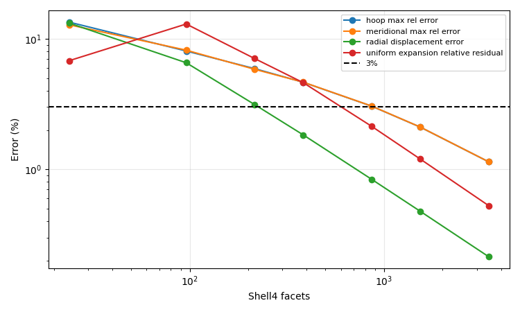
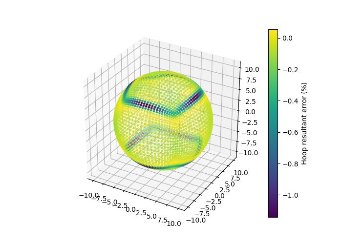

# Shell4 闭合球壳内压验证

沿用原四节点面元和解析解。半径 10 m，厚度 0.04 m，内压 1 Pa。参考膜力为 5 N/m，应力为 125 Pa。表中应力指标按各面元中心取最大相对误差。

| 面元 | 平均膜力误差 | 环向最大误差 | 子午向最大误差 | 径向位移误差 | 非均匀位移残差 | 综合 3% |
|---:|---:|---:|---:|---:|---:|:---:|
| 24 | 12.706% | 13.454% | 12.834% | 13.220% | 6.811% | 未通过 |
| 96 | 4.218% | 8.080% | 8.202% | 6.568% | 13.015% | 未通过 |
| 216 | 2.021% | 5.918% | 5.848% | 3.137% | 7.072% | 未通过 |
| 384 | 1.172% | 4.653% | 4.662% | 1.837% | 4.620% | 未通过 |
| 864 | 0.533% | 3.051% | 3.056% | 0.838% | 2.137% | 未通过 |
| 1536 | 0.302% | 2.108% | 2.110% | 0.477% | 1.199% | 通过 |
| 3456 | 0.135% | 1.142% | 1.142% | 0.214% | 0.527% | 通过 |

修正前 216 面元平均膜力误差为 1005.6%。旧装配打乱节点与分量顺序，旧压力散布在重复索引处丢失贡献，位移拟合矩阵也打乱了坐标分量。现对双线性面元做 2×2 积分，累加共享节点载荷，使用三点平移约束去除刚体自由度。

综合门限同时检查两项主膜力、环向及子午向膜力、径向位移和扣除刚体运动后的位移残差。验证适用于本闭合薄球壳、均匀内压与面元中心恢复量。

复算命令为 `PYTHONPATH=src python scripts/build_sphere_membrane_report.py`。
