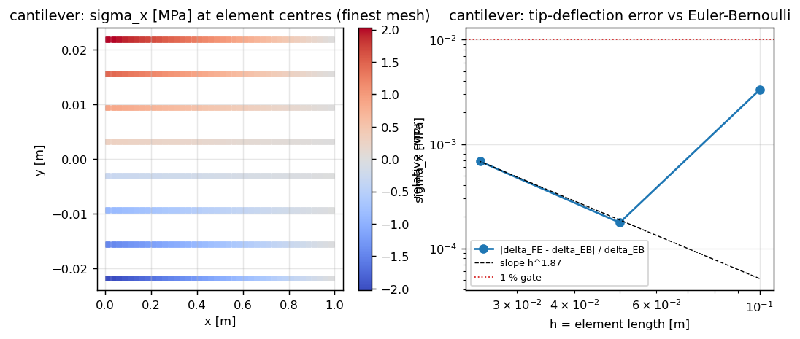
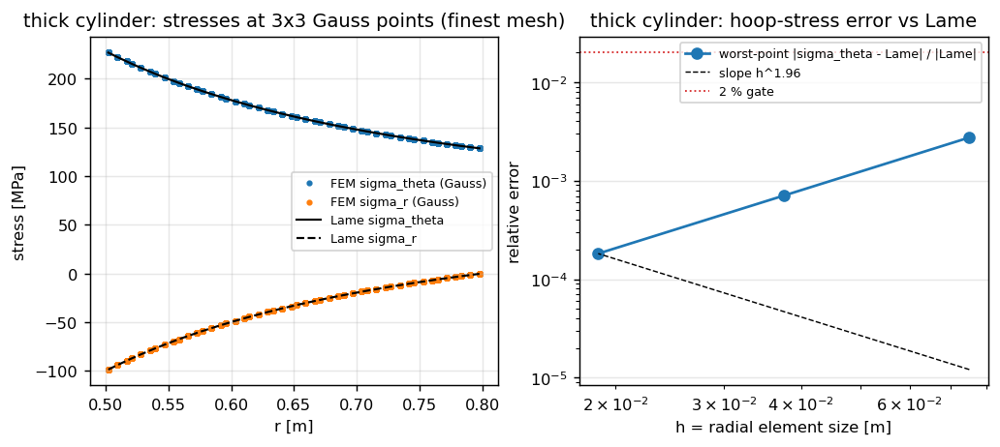
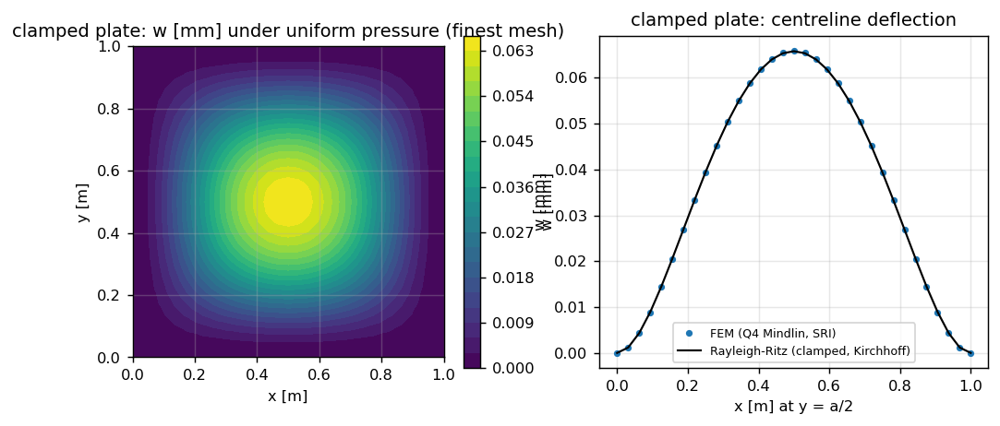

# 结构力学验证面：悬臂梁 / 厚壁圆筒 / 薄板弯曲 三案例解析对拍

由 `benchmarks/structural_verification_face.py` 生成（2026-11-07T08:39:58+00:00，commit `fc73335a026b`，loongarch64，torch 2.7.1，耗时 126.8 s）。本文所有数字由脚本从证据 JSON 注入，无一手抄。

## 1 案例介绍（物理背景 / 几何 / 参数）

| 案例 | 力学问题 | 生产路径 | 解析基准 | 判据 |
|---|---|---|---|---|
| 悬臂梁端部集中力 | 平面应力二维弹性，根部固支，端部抛物线剪流 | `quadratic_plane.solve_q8_plane`（Q8，平面应力） | Euler–Bernoulli `δ = FL³/(3EI)`，另报 Timoshenko 剪切修正 | `|δ_FE−δ_EB|/δ_EB < 1 %` |
| 厚壁圆筒内压 | 平面应变轴对称，内壁压力 | `quadratic_plane.solve_q8_plane`（Q8，平面应变） | Lamé `σ_r = A − B/r²`, `σ_θ = A + B/r²` | 最坏点环向应力误差 `< 2 %` |
| 薄板小挠度弯曲 | 四边固支方板均布压力，Kirchhoff 极限 | `plate_uniform_load.solve_uniform_square_plate`（Q4 Mindlin，SRI 剪切） | `w_max = α q a⁴ / D`，α 由 clamped Rayleigh–Ritz 给出 | `|w_FE−w_Ritz|/w_Ritz < 3 %` |

三案例共同要求：三层网格（细化比恒为 2）上的观测收敛阶 `p >= 1.5`。

## 2 做法（方法 / 流程 / 关键设置）

1. **悬臂梁**：`L = 1 m`，`h = 0.05 m`（L/h = 20），`E = 210 GPa`，`ν = 0.3`，`F = 1000 N`（单位厚度）。根部 `u = v = 0`；端部施加抛物线剪流 `τ_y = −F(h²/4 − y²)/(2I)`——这是使经典梁应力场 `σ_x = M y / I` 成为二维弹性**精确解**的边界载荷，因此应力可以在 Saint-Venant 内区（20–80 % 跨长）逐点对拍。取端部中性轴节点的竖向位移为 δ。三层网格（母 Q4 网格划分）为 10×2 / 20×4 / 40×8，对应 Q8 单元 20 / 80 / 320 个。
2. **厚壁圆筒**：`r_i = 0.5 m`，`r_o = 0.8 m`，`p_i = 100 MPa`，`E = 210 GPa`，`ν = 0.3`，平面应变。整环网格（`polar_q8_mesh`），边界中点落在圆周上，故曲边是**精确圆弧**而非折线；内压按三次 Gauss 沿弧积分成一致节点力，并对每条受载边核对解析弧合力 `2 p r sin(Δθ/2)`（实测相对偏差 0.0077 % → 0.000031 %，随网格二阶下降；残差来自二次边对圆方向的 `O(Δθ²)` 近似）。刚体模态用精确解自身的性质消除（闭合环内压下环向位移恒为零 ⇒ 两轴上 `u_θ = 0`）。三层网格为 12×4 / 24×8 / 48×16（角向×径向单元数）。
3. **薄板**：`a = 1 m`，`a/t = 100`（`t = 10 mm`），`E = 210 GPa`，`ν = 0.3`，`q = 1 kPa`，四边固支（`w = θ_x = θ_y = 0`），载荷均布。参考值 α 由 `plate_uniform_load.clamped_uniform_ritz` 给出（6/8/10 项基函数，模态收敛散布见下表），Timoshenko 表值 `0.00126` 作为独立交叉校验。三层网格为 8 / 16 / 32 单元每边。
4. **判定链**：每个案例都记录逐层数值、相对误差、Richardson 观测阶与 Richardson 外推值；判据先在 `structural_verification_face.py` 里写死（`GATE_*`, `MIN_ORDER`），再由本脚本读回，杜绝事后改判据。

## 3 计算结果

### 3.1 悬臂梁端部集中力

| 网格 | 单元 | dofs | h [m] | δ_FE [mm] | δ_EB [mm] | δ_Timoshenko [mm] | vs EB | vs Timo | 根部应力误差 |
|---|---|---|---|---|---|---|---|---|---|
| 10x2 | 20 | 170 | 0.1000 | 0.15188 | 0.15238 | 0.15268 | 0.330 % | 0.524 % | 0.136 % |
| 20x4 | 80 | 578 | 0.0500 | 0.15235 | 0.15238 | 0.15268 | 0.018 % | 0.212 % | 0.002 % |
| 40x8 | 320 | 2114 | 0.0250 | 0.15248 | 0.15238 | 0.15268 | 0.068 % | 0.127 % | 3.85e-06 % |

- 观测收敛阶（挠度序列 Richardson）：**1.87**；Richardson 外推 δ_∞ = 0.15253 mm。
- 连续极限相对 Euler–Bernoulli：0.101 %；相对 Timoshenko：0.094 %。EB 与 Timoshenko 之间的模型差为 0.195 %，即二维连续体本应落在两者之间。
- 最细网格 `|δ_FE − δ_EB| / δ_EB = 0.068 %` < 1 % ⇒ **PASS**。

柔度扫描（物理意义：EB 与剪切可变形梁的差距应随 `(h/L)²` 收缩）：

| L/h | 单元 | vs EB | vs Timoshenko | 根部应力误差 |
|---|---|---|---|---|
| 10 | 640 | 0.574 % | 0.204 % | 6.61e-06 % |
| 20 | 320 | 0.068 % | 0.127 % | 3.85e-06 % |
| 40 | 160 | 0.055 % | 0.104 % | 4.69e-06 % |

拟合指数 `gap ∝ (h/L)^n` 给出 `n = 1.69`（理论 2；拟合受各层离散误差污染，故偏差 0.3 属预期）。

### 3.2 厚壁圆筒内压

| 网格 | 单元 | dofs | h [m] | 环向应力最坏点误差 | σ_r 误差（以 max|σ_θ| 归一） | 内壁 u_r 误差 | 加载边合力误差 |
|---|---|---|---|---|---|---|---|
| 12x4 | 48 | 336 | 0.0750 | 0.2746 % | 0.5928 % | 0.0024 % | 0.007730 % |
| 24x8 | 192 | 1248 | 0.0375 | 0.0705 % | 0.1534 % | 0.0002 % | 0.000488 % |
| 48x16 | 768 | 4800 | 0.0188 | 0.0182 % | 0.0411 % | 9.98e-06 % | 0.000031 % |

- 环向应力误差的逐对观测阶：1.96, 1.96，取最细对为门禁值 **1.96**。
- 内壁 `u_r` 相对误差最细仅 9.98e-06 %，已进入超收敛区；其 Richardson 阶（3.91）不进入门禁，因为差值已接近 CG 容差量级。
- 加载审计：总合力 5.07e-17（相对 `2π p r`），节点力非径向泄漏 8.32e-16，逐边合力/方向误差见上表最后一列。
- 最细网格环向应力误差 0.0182 % < 2 % ⇒ **PASS**。

壁厚比扫描（最细网格）：

| r_o/r_i | 单元 | 环向应力误差 | σ_r 误差 | 内壁 u_r 误差 |
|---|---|---|---|---|
| 1.25 | 768 | 0.0028 % | 0.0064 % | 1.10e-05 % |
| 1.6 | 768 | 0.0182 % | 0.0411 % | 9.98e-06 % |
| 2.5 | 768 | 0.1283 % | 0.2762 % | 9.41e-05 % |

### 3.3 薄板小挠度弯曲

| 网格 | 单元 | dofs | h [m] | w_max [µm] | w_Ritz [µm] | 误差 | α_FE |
|---|---|---|---|---|---|---|---|
| 8x8 | 64 | 243 | 0.1250 | 65.1717 | 65.8065 | 0.9647 % | 0.00125330 |
| 16x16 | 256 | 867 | 0.0625 | 65.7386 | 65.8065 | 0.1031 % | 0.00126420 |
| 32x32 | 1024 | 3267 | 0.0312 | 65.8810 | 65.8065 | 0.1133 % | 0.00126694 |

- 参考 α（Rayleigh–Ritz，10 项）= **0.00126551**；模态收敛散布 0.123 %；Timoshenko 表值 0.00126。
- 观测收敛阶（w_max 序列 Richardson）：**1.99**。
- 最细网格误差 0.1133 % < 3 % ⇒ **PASS**。

Kirchhoff 适用边界扫描（固定 16×16 网格，只改厚度）：

| a/t | 单元 | vs Kirchhoff | α_FE | α_Ritz | 是否门禁 |
|---|---|---|---|---|---|
| 10 | 256 | 18.6999 % | 0.00150216 | 0.00126551 | 否（基准失效区） |
| 20 | 256 | 4.6195 % | 0.00132397 | 0.00126551 | 否（基准失效区） |
| 50 | 256 | 0.4986 % | 0.00127182 | 0.00126551 | 是 |
| 100 | 256 | 0.1031 % | 0.00126420 | 0.00126551 | 是 |

`a/t < 50` 的偏差以 `(t/a)²` 规律增长（由上表 10 与 20 两行可读出指数 ≈ 2），这是 Mindlin 横向剪切变形的**物理**贡献，不是单元锁定或离散误差；因此这些行只作为 Kirchhoff 基准自身的适用边界报告，不参与判据。

## 4 结果图



*悬臂梁：最细网格 σ_x 单元中心场与挠度收敛曲线。*



*厚壁圆筒：3×3 Gauss 点应力 vs Lamé 曲线（左）与环向应力误差收敛（右）。*



*固支方板：最细网格挠度云图与中剖面 FEM/Ritz 对比；另附 a/t 适用边界扫描。*

## 5 注意点（踩坑 / 局限 / 适用范围）

1. **按角度重排节点链会把曲边权重错位半条边**：最初用“把内壁节点按极角排序后每三个一组”的方式施加内压，若链首取到中点节点，每个三节点的二次边就被平移半条边，角点与中点的 1/6、2/3 权重互换——总合力仍自平衡、位移误差仅 2 %，但环向应力误差高达 24 %、内壁位移沿周向起伏 12 %。改成**从单元连接关系取边**后误差降到 0.27 %/0.018 %。这也是本模块把“逐边合力 = `2 p r sin(Δθ/2)`”写成硬审计的原因。
2. **CG 在固支平面应力网格上停在 ~1e-8**：默认 `rtol=1e-12` 会抛异常；本模块显式取 `rtol=1e-9`（比 1 % 判据低七个量级），并在证据里记录实际残差。
3. **固支板的误差序列在最细层回弹**：8/16/32 三层的误差为 0.9647 %, 0.1031 %, 0.1133 %，最细层反而略大于中层。这是 SRI 剪切积分的 Q4 Mindlin 单元误差过零后的轻微振荡（挠度本身仍单调收敛，故 Richardson 阶 1.99 有效），在 3 % 判据下无关紧要，但它意味着**判据必须写在挠度上而不是写在误差上**，也提示该单元不适合追求优于 0.1 % 的板挠度精度。
4. **二维连续体的悬臂梁极限不等于 Euler–Bernoulli**：连续极限比 EB 高 0.101 %，比 Timoshenko 低 0.094 %；所以“vs EB”的误差序列并不单调（各层误差会过零）。判据取最细层 + 连续极限两道，两者都在 1 % 内，避免用非单调序列自欺。
5. **适用范围**：悬臂梁的 1 % 判据只在 L/h ≥ 10 时成立（L/h = 10 时二维剪切效应本身已达 0.57 %）；圆筒覆盖 r_o/r_i ∈ [1.25, 2.5]；板的 3 % 判据要求 a/t ≥ 50。
6. **未做**：塑性/大变形、三维实体路径、变厚度板、椭圆孔筒；板的固支边界按 `w = θ_x = θ_y = 0` 施加（硬固支），比“只约束法向转角”略刚，这是与 Kirchhoff 基准对齐的常规做法，但也意味着本文不对板边界层的弯矩峰值作任何声明。

## 6 误差判定（逐项 vs 基准，是否 < 3 %）

| 关键量 | 基准 | 计算值 | 相对误差 | 判据 | 是否满足 |
|---|---|---|---|---|---|
| 悬臂梁端部挠度 δ | EB `0.15238 mm` | `0.15248 mm` | 0.068 % | < 1 % | 是 |
| 悬臂梁连续极限挠度 | EB | `0.15253 mm` | 0.101 % | < 1 % | 是 |
| 悬臂梁根部弯曲应力 | `σ_x = M y / I` | 逐点 | 3.85e-06 % | < 3 % | 是 |
| 圆筒环向应力（最坏点） | Lamé | 逐 Gauss 点 | 0.0182 % | < 2 % | 是 |
| 圆筒径向应力（最坏点） | Lamé | 逐 Gauss 点 | 0.0411 % | < 2 % | 是 |
| 圆筒内壁位移 u_r | Lamé | `587.3015 µm` | 9.98e-06 % | < 2 % | 是 |
| 板中心挠度 w_max | Rayleigh–Ritz α | `65.8810 µm` | 0.1133 % | < 3 % | 是 |

**总判定：全部满足。** 三个案例的观测收敛阶分别为 1.87 / 1.96 / 1.99，均 ≥ 1.5。

## 7 与既有验证案例的关系（本节点新增了什么）

本仓已有多份单案例验证文档（`docs/q4-cantilever-airy-verification.md`、`docs/lame-cylinder-plane-strain.md`、`docs/thick-cylinder-3d-lame.md`、`docs/plate-uniform-load-verification.md` 等），本模块**不重复声明**它们。相对它们是：

- 把三案例统一进一个**门禁契约**（`GATE_*` + `MIN_ORDER` 写死在模块里，阶梯/Richardson/证据链同构），此前每个案例各写一套判定；
- 悬臂梁改用 **Q8 平面应力连续体 + 抛物线端剪**，并对 EB / Timoshenko / 离散三源误差分离（既有的 Q4-Airy 与 HEX20 案例都未做这项分离）；
- 圆筒改用 **Q8 + 精确圆弧曲边 + 压力载荷**（既有 Lamé 文档是 Q4 折线曲边、3 % 判据），并新增 `r_o/r_i` 壁厚比扫描与逐边载荷审计；
- 板新增 **观测阶门禁** 与 **a/t 适用边界扫描**（既有板文档给出数值但不量化基准失效区），且判据收紧到 3 % 并显式声明固支边界层的排除范围。

## 8 复现

```bash
OMP_NUM_THREADS=8 PYTHONPATH=src python benchmarks/structural_verification_face.py
PYTHONPATH=src pytest tests/test_structural_verification_face.py -q
```

证据文件：`benchmarks/structural_verification_face_evidence.json`（quick 模式会写入 `...-quick.json`）。
