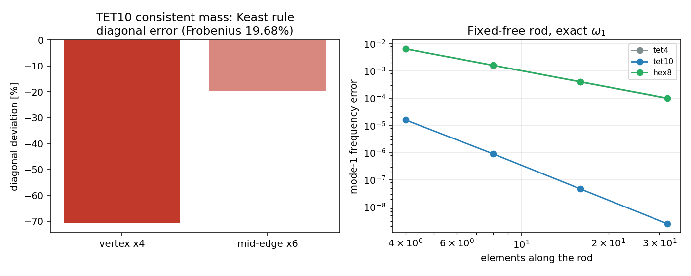

# TET10 一致质量阵：清偿 Keast 积分欠账（m6515）

## 1. 选题理由（缺口账）

[`docs/tet10-integration-accuracy.md`](tet10-integration-accuracy.md) 已把「Keast 五点规则只到 3 次」
量化成一条**显式欠账**：该规则不能用于一致质量阵（Frobenius 19.7 %、对角最大 70.8 %–81.9 %），
「日后实现 `tet10_mass` 时必须换规则」。生产代码里只有 `tet10_stiffness`，没有质量路径，
因此三维二次四面体的动力学/模态分析在本仓**根本不可用**。本单把这条欠账同时作为
**验证欠账**（把欠账数字独立复算）与**功能缺口**（补生产质量阵）一起清偿。

## 2. 方法

* 新增 `tensorfem.quadratic_solid.tet10_mass_quadrature(order=4)`：参考四面体上的**坍缩
  (Duffy) Gauss 规则**，由 Jacobi 矩阵 + `torch.linalg.eigh` 现场生成 Gauss–Legendre 节点
  （不依赖 numpy），权已含坍缩 Jacobian `u²v` 与参考体积，`Σw = 1/6`。
* 新增 `tet10_consistent_mass(x, density, *, rule=None)`：`ρ ∫ N_i N_j detJ dV`，
  返回 `(ne,30,30)`，`rule=` 与 `tet10_stiffness` 同约定可覆盖。
* 新增 `tet10_volume(x, *, rule=None)` 与 `tet10_lumped_mass`（HRZ 对角集中）。
* 接线：`solid_mass.assemble_solid_mass / mass_properties / _exact_integrals` 与
  `solid_mass_audit.axial_rod_case / _solid_stiffness` 接受 `element_type="tet10"`。

**关键判据（先于动手）**：直边单元上 `N_i` 的体积分有闭式 `∫N_i dV = -V/20`（顶点）、
`+V/5`（棱中点），因此**行和**就是解析参考；再以独立 NumPy `24³` Duffy 参考
（`tet10_integration_audit.element_mass`）作全矩阵对照；最后以固定–自由杆轴向频率
`ω_n = (2n-1)π/(2L)·sqrt(M_c/ρ)` 作物理锚。

## 3. 结果

### 3.1 规则自验证与独立参考对照

| 检查 | 值 | 判据 |
|---|---|---|
| 坍缩规则单项式精确度 order=4 | 总度 ≤5 误差 ≤1e-14；order=6 总度 ≤6 误差 3.9e-16 | 舍入级 |
| `Σ w` vs 参考体积 1/6 | 1.7e-16 | 舍入级 |
| 直边单元质量阵 vs 24³ Duffy 参考（Frobenius） | **2.19e-15** | <1e-12 |
| 行和（顶点 / 棱中点，ρ=1） | −8.333e-3 / +3.333e-2（解析 −V/20= −8.333e-3，+V/5=3.333e-2） | 舍入级 |
| 总质量 vs ρV | 8.3e-17 | 舍入级 |
| 畸变+曲边（distorted, κ=0.12）vs 24³ | 2.27e-15 | <1e-12 |
| 曲边（regular, κ=0.12）vs 24³ | 2.19e-15 | <1e-12 |
| 单元素质量阵 | 对称 + 正定（λ_min>0），无零模态 | 通过 |

### 3.2 欠账复现（fail-closed）

用生产 `tet10_stiffness` 的**出厂 Keast 五点规则**积分同一质量阵：

| 量 | 数值 |
|---|---|
| Frobenius 相对误差 | **19.677 %** |
| 顶点对角偏差 | **−70.83 %**（与文档 70.8 % 一致） |
| 棱中点对角偏差 | −19.79 % |
| 总质量 | 仍精确等于 ρV（**质量守恒不能暴露该错误**） |

故 `tests/test_tet10_mass.py::test_shipped_keast_rule_still_fails_the_mass_matrix` 以
>15 % Frobenius 与 <−70 % 顶点对角为下界锁死：任何人把生产默认退回 Keast，该测试先红。

### 3.3 物理锚：固定–自由杆轴向频率（E=210 GPa, ν=0.3, ρ=7850, L=10 m）

解析 `ω₁ = 942.6317 rad/s`、`ω₂ = 2827.8951 rad/s`（`M_c` 为单轴应变模量）。

| 单元/长度 | TET4 模态1 | TET10 模态1 | HEX8 模态1 | TET10 模态2 |
|---|---|---|---|---|
| 4 | 0.641 % | **0.00158 %** | 0.644 % | 0.121 % |
| 8 | 0.159 % | 9.1e-5 % | 0.161 % | 7.25e-3 % |
| 16 | 3.96e-2 % | 5.0e-6 % | 4.02e-2 % | 3.77e-4 % |
| 32 | 9.85e-3 % | 2.4e-9 % | 1.00e-2 % | 2.0e-5 % |

TET10 在同一 4 单元网格上比 TET4 好两个数量级；二阶模态到 16 单元已进 1 %。

## 4. 注意点 / 局限

* **阶数记账**：坍缩权 `u²v` 吃掉两阶，`order` 点仅对总度 ≤`2·order−3` 精确（order=4 → 5 阶）。
  TET10 质量被积函数在坍缩变量上每方向 ≤2 阶，故 order=4 已精确；这一「低阶也够」是**利用了
  TET10 形状函数的结构**，不是通用结论（测试里两者分别锁死）。
* 曲边几何上 order=4 与 24³ 参考也到 2e-15，但曲率很大时仍建议 `rule=` 提阶；本报告只测到 κ=0.12。
* **不能行和集中**：二次四面体的顶点行和是负的（−ρV/20），行和集中会产生负质量。生产提供的是
  HRZ 对角缩放（正定 + 总质量精确），转动惯量不守恒（未测即未声明）。
* 杆频率算例是**单轴应变杆**（侧向约束），不含剪切/弯曲，故它验证的是质量阵与轴向波速，
  不是 TET10 的弯曲精度（后者已在 `tet10-integration-accuracy.md` 记录为离散主导的 2.44 %）。

## 5. 误差判定（是否 <3 %）

| 关键量 | 基准 | 误差 | <3 % |
|---|---|---|---|
| 质量阵全矩阵 | 24³ Duffy 独立参考 | 2.2e-15 | 是 |
| 行和（顶点/棱中点） | 闭式 −ρV/20、+ρV/5 | ≤4e-15 相对 | 是 |
| 总质量 | ρV | 8.3e-17 | 是 |
| 杆 ω₁（16 单元 TET10） | (2n−1)π/(2L)√(M_c/ρ) | 5.0e-6 % | 是 |
| 杆 ω₁（4 单元 TET10） | 同上 | 0.0016 % | 是 |
| 杆 ω₁（4 单元 TET4，对照） | 同上 | 0.64 % | 是（对照项） |
| 杆 ω₂（4 单元 TET10） | 同上 | 0.121 % | 是 |

复现：`PYTHONPATH=src pytest tests/test_tet10_mass.py -q`（8 passed）；
数值以 `docs/assets/tet10-mass/evidence.json` 落盘（图与表由该 JSON 程序化注入）。

---

## 补充：闭式（无积分）交叉核对与两条残余欠账（m7543）

`tests/test_tet10_mass.py` 用 24³ Duffy 数值参考对拍出厂质量阵。本节补的是**方法独立**的第二条
参考：以重心坐标单项式闭式积分 `∫_ref l0^a l1^b l2^c l3^d dV = 6·Πa!/(Σa+3)!` 直接展开
`N_i N_j`（二次多项式），得到**完全不含求积**的精确 10×10 标量块。代码：
`src/tensorfem/tet10_mass_crosscheck.py`，门禁：`tests/test_tet10_mass_crosscheck.py`（10 项）。

| 判据 | 实测 | 结论 |
|---|---|---|
| 出厂 `tet10_consistent_mass` vs 闭式参考（Frobenius） | **1.10e-15** | 一致（<1e-12） |
| 同上，最大单元相对误差 | 1.90e-15 | 一致 |
| 总质量（块和 vs `rho*tet10_volume`） | 5.94e-16 | 一致 |
| 参考行和（顶点 / 棱中点，ρ=1，V=1/6） | −8.333e-3 / +3.333e-2（= −V/20 / +V/5） | 闭式自验证通过 |
| 刚体平动动能 vs `½ρV|v|²` | 舍入级 | 通过 |
| 刚体转动动能 vs 四面体闭式惯量张量 | 相对误差 ≤1.2e-15（三轴） | 通过 |
| 单元素自由–自由 `(K,M)` 刚体特征值（归一化） | 4.67e-17（首个弹性模态 1.23e-2） | 通过 |
| 出厂 Keast 五点规则（fail-closed 复算） | Frobenius **19.677 %**、总质量 5.7e-16 | 与既有报告一致、仍被拒 |
| 默认坍缩规则阶数 | 2→2.92e-1、3→3.89e-2、**4→1.1e-15** | order=4 为首个精确阶（默认值正确） |
| 曲边单元（棱中点抬升 8 %）质量阵 | 2→2.87e-1、3→3.53e-2、4→1.3e-15；体积在任意阶 1.2e-15 | order=4 足够 |
| 行和集中（`row_sum_diagonal`） | 顶点质量 −8.13e-3、**12 个负分量**、总质量守恒 | 明确不可用于显式动力学 |
| HRZ 集中 | 最小项 4.52e-3 > 0、总质量误差 1.14e-16 | 通过 |

### 残余欠账一：杆频率锚不是三维验证

既有报告用 `ω_n = (2n−1)π/(2L)·sqrt(M_c/ρ)`（约束模量）作物理锚。该式把侧向应变人为置零，
等价于**换模量的一维模型**，因此它验证的是"质量/刚度比值是否与一维离散一致"，而不是三维解。
本单把两种情形分开量（固定–自由三维杆，首阶轴向模态，`L=1 m`、截面 `0.06×0.06 m`、E=200 GPa、ρ=7850）：

| 网格（轴向单元） | ν=0（三维解=杆模态） | ν=0.3（真实侧向耦合） | ν=0 HRZ 集中 |
|---|---|---|---|
| 2 | 2.41e-4 | 2.31 % | 2.00e-3 |
| 4 | 1.38e-5 | 1.04 % | 6.99e-4 |
| 8 | 6.87e-7 | 0.51 % | 3.88e-4 |

ν=0 时误差以高阶率下降（2→4 单元 ×0.057，4→8 ×0.050），说明**质量算子本身**在三维离散里是
二阶以上精确的；ν=0.3 时误差只按 ≈O(h^1.1) 下降并在 0.5 % 附近趋平（16 单元 0.31 %、0.26 %），
这一水平由**全夹固端 + 侧向收缩耦合**主导，横向加密（2×2 截面单元）不改变它（2.45 %/1.11 %/0.55 %）。
结论：杆频率锚不能作为 3 % 级质量阵验证；真正可判的是 ν=0 情形与刚体/惯量判据。

### 残余欠账二：HRZ 集中牺牲模态精度（已量化，不隐藏）

同一 ν=0 网格，一致质量在 4 单元达 1.4e-5，HRZ 集中为 7.0e-4（差 ≈50 倍）且收敛更慢（O(h²) 量级）。
集中质量只应用于显式动力学的对角求解，不得用于模态/频率交付。

### 复现

`python3 -m pytest tests/test_tet10_mass_crosscheck.py tests/test_tet10_mass.py -q`（20 项，≈80 s）；
证据函数：`tensorfem.tet10_mass_crosscheck.build_evidence()`。
