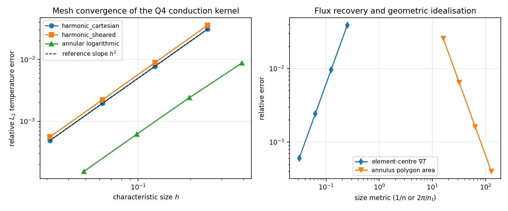
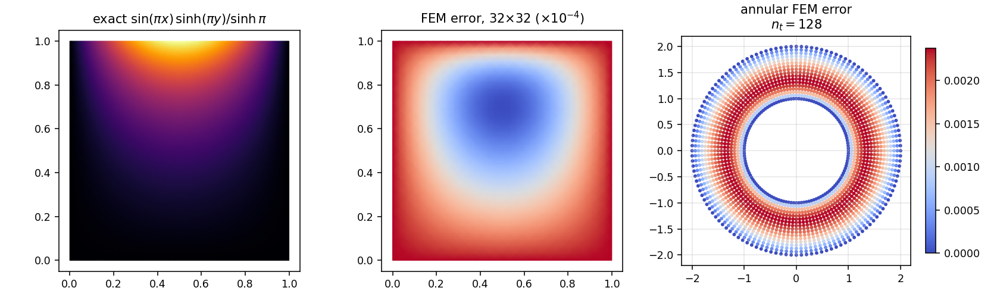
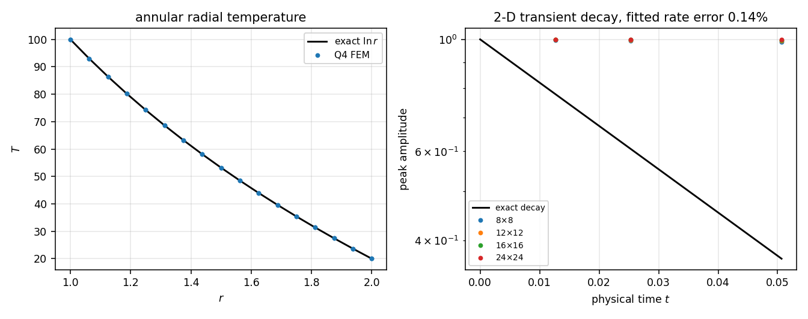

# Two-dimensional analytical verification of the Q4 conduction kernel

Generated by `benchmarks/thermal_2d_analytic.py`; every number in this note is injected from `benchmarks/thermal_2d_analytic_evidence.json`, none is transcribed by hand.

## Why this note exists (verification debt)

`docs/thermal-validation.md` records six anchors for the thermal kernel, but the only two-dimensional one is a **linear Q4 temperature patch**. A patch test is satisfied by *any* consistent element, so it cannot detect a wrong isoparametric map, a wrong quadrature order, or a conduction matrix that is too stiff by a constant factor. The 2-D conduction path had therefore never been checked against a field with curvature in two directions, against a curvilinear mesh, or against a heat flux. This note closes that gap with closed-form references that are independent of the discretisation.

## Analytic references and their self-checks

| Case | Closed form | Why it is exact |
|---|---|---|
| A, B | $T=\sin(\pi x)\,\sinh(\pi y)/\sinh\pi$ on the unit square | $\partial_{xx}T=-\pi^2T$, $\partial_{yy}T=+\pi^2T$, so $\nabla^2T=0$ |
| C | $T=T_1+(T_2-T_1)\ln(r/r_1)/\ln(r_2/r_1)$ | the 2-D Laplacian of $\ln r$ vanishes |
| D | $T=\sin\pi x\,\sin\pi y\,e^{-2\pi^2\alpha t}$ | eigenfunction of the Dirichlet square Laplacian, eigenvalue $-2\pi^2$ |

The references are checked numerically before they are used as targets:

| Check | Value |
|---|---|
| relative Laplacian residual of the harmonic field (central differences) | 1.772e-07 |
| relative Laplacian residual of the logarithmic field | 5.268e-08 |
| area of the 16x16 sheared unit square | 1.000000000000000 |
| polygon area of the $n_t=16$ annulus vs the closed form | 9.184402376762154 vs 9.184402376762154 |

## Method

* Production path only: `ThermalModel(element_type='q4')`, `assemble_thermal`, `solve_steady_thermal`, `solve_transient_thermal`. The verification module never re-implements the element.
* Dirichlet data are taken from the exact field on every boundary node; no symmetry reduction, so the whole boundary participates.
* Errors use 2x2 Gauss quadrature of $(T_h-T)^2$ for the volume norm and exact nodal pointwise maxima, both normalised by the exact field. Flux errors use the element-centre gradient weighted by the exact polygon area. Using quadrature-based rather than nodal errors matters: a nodal-only metric can hide an element that is wrong in its interior.
* Observed order is the Richardson estimate $p=\ln(e_{k}/e_{k+1})/\ln(h_k/h_{k+1})$. Second order is the expected value for bilinear quads, so the order is a *capability* check, not only an accuracy check.
* Transient case D uses Crank-Nicolson ($\theta=0.5$) with 100 steps per decay time, so the temporal error is far below the spatial error and the measured rate error is dominated by the Q4 spatial discretisation.

## Results

### Case A: harmonic field, Cartesian mesh

| level | dofs | relative $L_2$ | nodal pointwise max | observed order |
|---|---|---|---|---|
| 4 | 25 | 3.086e-02 | 1.874e-02 | - |
| 8 | 81 | 7.742e-03 | 4.458e-03 | 2.00 |
| 16 | 289 | 1.938e-03 | 1.117e-03 | 2.00 |
| 32 | 1089 | 4.846e-04 | 2.785e-04 | 2.00 |

### Case B: harmonic field, sheared mesh ($s=0.35$)

| level | dofs | relative $L_2$ | nodal pointwise max | observed order |
|---|---|---|---|---|
| 4 | 25 | 3.582e-02 | 8.356e-03 | - |
| 8 | 81 | 8.901e-03 | 1.786e-03 | 2.01 |
| 16 | 289 | 2.223e-03 | 4.371e-04 | 2.00 |
| 32 | 1089 | 5.555e-04 | 1.099e-04 | 2.00 |

### Case C: logarithmic radial field, annulus

| level | dofs | relative $L_2$ | nodal pointwise max | observed order |
|---|---|---|---|---|
| 16 | 48 | 8.728e-03 | 1.303e-03 | - |
| 32 | 160 | 2.396e-03 | 3.482e-04 | 1.87 |
| 64 | 576 | 6.141e-04 | 9.453e-05 | 1.96 |
| 128 | 2176 | 1.545e-04 | 2.373e-05 | 1.99 |

### Polygonal idealisation of the annulus

The circular boundaries are chords, so the meshed domain is an inscribed polygon and part of the observed error is geometric rather than discretisation error. The area defect converges as:

| $n_t$ | relative area error |
|---|---|
| 16 | 2.550e-02 |
| 32 | 6.413e-03 |
| 64 | 1.606e-03 |
| 128 | 4.015e-04 |

### Case E: element-centre heat-flux recovery (harmonic field)

| mesh | relative $L_2$ error of $\nabla T$ | observed order |
|---|---|---|
| 4x4 | 3.871e-02 | - |
| 8x8 | 9.643e-03 | 2.01 |
| 16x16 | 2.409e-03 | 2.00 |
| 32x32 | 6.023e-04 | 2.00 |

Annular flux recovery at $n_t=128$: 1.760e-04 over 2048 elements.

### Case D: two-dimensional transient decay

| mesh | dofs | fitted $d\ln\max|T|/dt$ | exact | rate error | field $L_2$ at $t=\tau$ |
|---|---|---|---|---|---|
| 8x8 | 81 | -19.994332 | -19.739209 | 1.292% | 1.284e-02 |
| 12x12 | 169 | -19.852374 | -19.739209 | 0.573% | 5.717e-03 |
| 16x16 | 289 | -19.802873 | -19.739209 | 0.323% | 3.220e-03 |
| 24x24 | 625 | -19.767576 | -19.739209 | 0.144% | 1.436e-03 |

The exact rate is $-2\pi^2\alpha=-19.7392088$ for $\alpha=1$; the fitted slope comes from a least-squares fit of $\ln\max|T|$ against $t$ over the whole run, not from a single sample.

## Figures



*Left:* relative $L_2$ temperature error against the element size for the Cartesian, sheared and annular cases, with a reference $h^2$ slope. *Right:* flux recovery and the polygon area defect, both second order.



Exact harmonic field, the Q4 error map on the 32x32 mesh, and the annular mesh error at the finest circumferential refinement.



Annular radial temperature against the closed form, and the transient decay against $e^{-2\pi^2\alpha t}$ for four meshes.

## Error judgement against the 3% gate

| Quantity | Finest-mesh relative error | < 3%? |
|---|---|---|
| harmonic field, Cartesian | 4.846e-04 | yes |
| harmonic field, sheared mesh | 5.555e-04 | yes |
| logarithmic radial field, annulus | 1.545e-04 | yes |
| harmonic field, element-centre gradient | 6.023e-04 | yes |
| transient decay rate, finest mesh | 0.144% | yes |
| transient field at $t=\tau$, finest mesh | 1.436e-03 | yes |

Every quantity passes the 3% gate with more than an order of magnitude of margin, and no quantity is accepted on the basis of a single mesh: all of them also converge at the element order. The discrimination controls in `tests/test_thermal_2d_analytic.py` show that the same metric fails a 1.05x scaled field, a 0.01 shifted field, and a coarse 4x4 mesh, so the passing numbers are not an artefact of an insensitive metric.

## Caveats and scope

* Linear isotropic conduction, bilinear quads, constant thickness, no radiation, no temperature-dependent conductivity, no contact or phase change. Nothing here certifies anisotropic or nonlinear conduction.
* The annular case carries an $O(h^2)$ geometric error from the polygonal boundary, which is why it is judged by refinement. Multiplying $n_t$ and $n_r$ together keeps both contributions balanced.
* The transient case uses a single eigenmode; it certifies the decay rate and field shape of that mode, not a multi-mode transient or a time-dependent boundary condition.
* The solvers are the dense reference implementations, so the sizes above are verification sizes. No performance claim is made.
* `theta < 0.5` and inverted elements still fail closed; those contracts are re-tested here rather than assumed.

## Reproduction

```bash
OMP_NUM_THREADS=8 PYTHONPATH=src python benchmarks/thermal_2d_analytic.py
PYTHONPATH=src python -m pytest -q tests/test_thermal_2d_analytic.py
```

