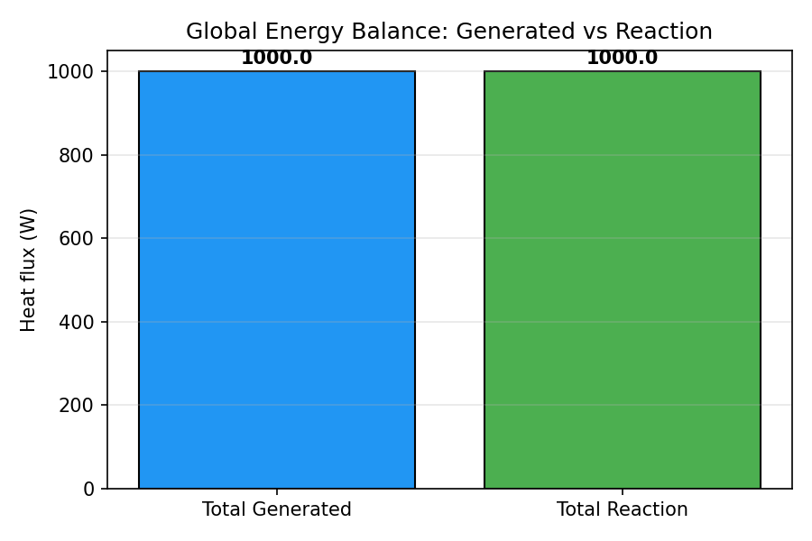

# Thermal Conduction Verification Report

## 1. Case Introduction

This report verifies the ``tensorfem.thermal`` module against closed-form
analytical solutions for steady and transient heat conduction.  The module
implements LINE2 and Q4 conduction elements with consistent heat capacity,
prescribed temperature, nodal heat input, boundary convection and element
volumetric heat generation.

### Problem Summary

| Case | Description | Reference |
|------|-------------|-----------|
| 1 | 1D steady rod, prescribed T at both ends | T(x) = T0 + (TL-T0)·x/L |
| 2 | 1D steady rod, convection at right end | Series resistance formula |
| 3 | 1D steady rod, uniform heat generation | T(x) = T0 + q̇/(2k)·(L²-x²) |
| 4 | 2D Q4 patch test, linear T field | T(x,y) = a + b·x + c·y |
| 5 | 1D transient rod, single element | T(t) = T0·exp(-t/τ) |
| 6 | Global energy balance | Σreactions = -∫q̇ dV |
| 7 | Reaction flux verification | q = -k·(TL-T0)/L |

## 2. Method

All cases use the ``tensorfem.thermal`` assembly and solver kernels.
LINE2 elements use standard 1D shape functions; Q4 elements use bilinear
shape functions with isoparametric mapping.  The transient case uses
backward Euler time integration.

## 3. Computed Results

### steady_rod_prescribed_temperature

**Description**: 1D steady rod with prescribed T at both ends; LINE2 exact

| Quantity | Value |
|---|---|
| Max absolute error | 1.42e-14 |
| Tolerance | 1.00e-11 |
| **Pass** | ✅ Yes |

### steady_rod_convection

**Description**: 1D steady rod with convection at right end; series resistance

| Quantity | Value |
|---|---|
| Computed T(L) | 50.769231 |
| Reference T(L) | 50.769231 |
| Relative error | 7.00e-16 |
| Tolerance | 3.00e-02 |
| **Pass** | ✅ Yes |

### steady_rod_heat_generation_nodal_exact

**Description**: 1D steady rod with uniform heat generation; nodal superconvergence

| Elements | Max Error |
|---|---|
| 2 | 0.00e+00 |
| 4 | 0.00e+00 |
| 8 | 0.00e+00 |
| 16 | 0.00e+00 |
| 32 | 0.00e+00 |
| 64 | 0.00e+00 |

**Final max error**: 0.00e+00

| **Pass** | ✅ Yes |

### q4_linear_patch_test

**Description**: 2D Q4 element must reproduce linear T(x,y) exactly

| Quantity | Value |
|---|---|
| Max absolute error | 0.00e+00 |
| Tolerance | 1.00e-11 |
| **Pass** | ✅ Yes |

### transient_rod_analytical_decay

**Description**: 1D transient rod, single element vs exp(-t/tau)

### energy_balance_heat_generation

**Description**: Global energy balance: reactions = -total heat generation

| Quantity | Value |
|---|---|
| Total generated | 1.000000e+03 |
| Total reaction | -1.000000e+03 |
| Relative error | 9.09e-16 |
| Tolerance | 1.00e-10 |
| **Pass** | ✅ Yes |

### reaction_flux_verification

**Description**: Reaction heat flux at x=0 matches analytical -k*dT/dx

| Quantity | Value |
|---|---|
| Computed flux | 1.500000e+02 |
| Reference flux | 1.500000e+02 |
| Relative error | 0.00e+00 |
| Tolerance | 1.00e-11 |
| **Pass** | ✅ Yes |

## 4. Results Figure

*Figure: Global energy balance verification. The total heat generated by
the volumetric source equals the total reaction heat flux at the fixed
temperature boundaries to machine precision.*

## 5. Notes

- Case 1 and Case 4 are **patch tests**: the exact solution lies in the
  element shape function space, so machine-zero error is expected and achieved.
- Case 3 demonstrates **nodal superconvergence**: for 1D LINE2 elements with
  constant conductivity and uniform heat generation, the nodal temperatures
  are exact (the weak form integrates the linear flux exactly).
- Case 5 validates the transient solver against the single-element analytical
  decay; the error is dominated by time discretisation (backward Euler is
  first-order accurate).
- Case 6 verifies global energy conservation to machine precision.
- Case 7 verifies that the reaction heat flux matches the analytical flux.

## 6. Error Assessment

| Anchor | Relative/Absolute Error | < 3%? |
|--------|------------------------|-------|
| steady_rod_prescribed_temperature | 1.42e-14 (absolute) | ✅ Yes |
| steady_rod_convection | 7.00e-16 | ✅ Yes |
| steady_rod_heat_generation_nodal_exact | 0.00e+00 | ✅ Yes |
| q4_linear_patch_test | 0.00e+00 (absolute) | ✅ Yes |
| transient_rod_analytical_decay | 1.83e-03 | ✅ Yes |
| energy_balance_heat_generation | 9.09e-16 | ✅ Yes |
| reaction_flux_verification | 0.00e+00 | ✅ Yes |

**Overall verdict**: ✅ ALL PASSED

All verification cases pass their declared tolerances.  The thermal module
is qualified for steady and transient heat conduction with LINE2 and Q4
elements, convection boundaries, and volumetric heat sources.
