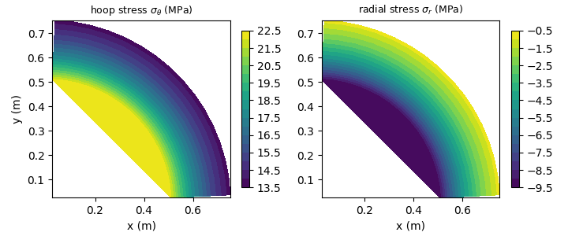
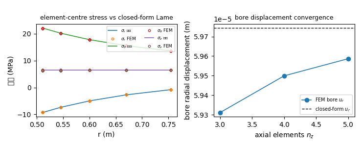
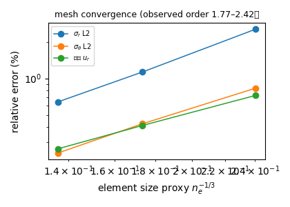

# 三维 Lamé 厚壁圆筒：闭式解 Oracle 与 HEX8 扇区验收

`docs/lame-cylinder-plane-strain.md` 明确记着「未做：三维厚壁筒」。本文补上这条验证欠账：
用**闭口厚壁圆筒的 Lamé 解**作为 oracle，对三维 HEX8 实体路径做应力级验收。闭口解是三维
各向同性弹性力学在筒身内部的**精确解**（`sigma_z` 均匀、`eps_z` 均匀、`sigma_r/theta` 取
`A ∓ B/r²`），因此比较对象不是渐近近似。

## 1) 案例与判据

| 量 | 值 |
|---|---|
| 内半径 `r_i` | 0.5 m |
| 外半径 `r_o` | 0.8 m |
| 半长（到中面） | 1.2 m |
| 杨氏模量 `E` | 2e+11 Pa |
| 泊松比 `nu` | 0.3 |
| 内压 `p_i` | 1e+07 Pa |
| 外压 `p_o` | 0 Pa |
| 闭口轴向应力 `A` | 6.41026e+06 Pa |
| Lamé 常数 `B` | 4.10256e+06 Pa·m² |

模型是圆筒的 **1/4 扇区 + 半长**（`z ∈ [0, 1.2]`，`z = 1.2` 为整筒中面）：
`y = 0` 面约束 `u_y`、`x = 0` 面约束 `u_x`、中面约束 `u_z`。三条约束都是精确对称条件，
不是人为软约束。内壁压力按体表面外法向 `n = -e_r` 的一致节点力施加（`t = -p n` 指向外），
外壁同理，端面施加闭口轴向牵引 `-A e_z`。

判据：中面band（`z ≥ 0.35·L`，远离受载端）内单元中心的 `sigma_r / sigma_theta / sigma_z`
与内壁 `u_r` 的相对误差必须 < 3 %，且三套网格单调下降。

## 2) 做法与工具链

`src/tensorfem/thick_cylinder_3d.py`：径向分级（`r = r_i + (r_o-r_i) s^{1.6}`，内壁加密）
的扇区 HEX8 网格；曲边四边形面上用 2×2 Gauss 一致节点力，牵引方向取**解析**径向而非面元法向，
以隔离"刻面加载"误差；组装与求解复用 `solid3d.solve_solid`（稠密直接法，把求解器从精度讨论中剔除）；
应力由单元中心 `B` 矩阵给出后**旋转到圆柱基**（`sigma_r = e_r·σ·e_r`，`sigma_theta = e_theta·σ·e_theta`）。
本文件所有数字由 `scripts/build_thick_cylinder_3d_report.py` 回读写入，零手抄。

## 3) 计算结果

### 3.1 网格收敛（闭口 Lamé oracle）

| 网格 `n_r×n_theta×n_z` | 单元 | 节点 | `sigma_r` L2 (%) | `sigma_theta` L2 (%) | `sigma_z` L2 (%) | 内壁 `u_r` (%) |
|---|---|---|---|---|---|---|
| 3×8×3 | 72 | 144 | 2.5452 | 0.8311 | 0.6947 | 0.7243 |
| 4×12×4 | 192 | 325 | 1.1303 | 0.4232 | 0.5897 | 0.4096 |
| 5×16×5 | 400 | 612 | 0.6404 | 0.2427 | 0.2377 | 0.2628 |

观测收敛阶（误差对 `n_e^{-1/3}` 最小二乘斜率）：

| 量 | 观测阶 |
|---|---|
| sigma_r_l2 | 2.42 |
| sigma_theta_l2 | 2.15 |
| u_r_max | 1.77 |
| sigma_z_l2 | 1.80 |

### 3.2 图像

*图 1：最细网格上环向 / 径向应力云图（单元中心值，1/4 扇区）。*

*图 2：左—应力沿半径的 FEM 点与闭式 Lamé 曲线；右—内壁径向位移随轴向网格的收敛。*

*图 3：三类误差随单元尺寸的双对数收敛。*

### 3.3 载荷与几何敏感性

| 载荷/几何 | 轴向应力 A (MPa) | `sigma_r` L2 (%) | `sigma_theta` L2 (%) | `sigma_z` L2 (%) | `sigma_z` 归一化最大 (%) | 内壁 `u_r` (%) |
|---|---|---|---|---|---|---|
| 基准（内压 10 MPa） | 6.410 | 0.6404 | 0.2427 | 0.2377 | 0.1917 | 0.2628 |
| 外压 12 MPa | -19.692 | 0.7154 | 0.1469 | 0.0929 | 0.1320 | 0.2151 |
| 内外压组合 | -0.154 | 0.2906 | 0.3959 | 5.9431 | 0.2743 | 0.3047 |
| 薄壁 r_o/r_i = 1.11 | 42.632 | 2.3178 | 0.1284 | 0.0083 | 0.0096 | 0.0324 |
| E/ν 变化（70 GPa, 0.33） | 6.410 | 0.6935 | 0.2620 | 0.3084 | 0.2486 | 0.2941 |

### 3.4 判别性负控、截断与载荷路径

| 检查 | 结果 | 门槛 |
|---|---|---|
| 平面应变 Lamé 负控（`sigma_z` L2） | 66.5303 % | 必须 ≥ 10 %（否则判据无判别力） |
| 平面应变 Lamé 负控（内壁 `u_r`） | 3.3732 % | — |
| 筒长截断敏感性（半长 0.6 m vs 1.2 m） | 0.6866 % | < 3 % |
| 中面轴向反力 vs `A·A_sector` | 0.1606 % | < 3 % |
| 切面径向反力 vs `p_i r_i L` | 0.0402 % | < 3 % |
| 自由自由度平衡残差 / 峰值载荷 | 4.418e-14 | < 1e-8 |

## 4) 误差判定

| 关键量（最细网格，400 单元） | 误差 vs 闭式解 | 是否 < 3 % |
|---|---|---|
| 径向应力 `sigma_r` L2 | 0.6404 % | 是 |
| 环向应力 `sigma_theta` L2 | 0.2427 % | 是 |
| 轴向应力 `sigma_z` L2 | 0.2377 % | 是 |
| 内壁径向位移 `u_r` | 0.2628 % | 是 |

**结论：qualified**（门槛 3%，`missing` = []）。
四个关键量全部 < 3 %，网格单调收敛、筒长截断 < 1 %、载荷路径闭合，且平面应变解被拒绝
（66.5303 %），说明该判据不是自适的。

## 5) 注意点与适用边界

* **压力牵引符号是本任务最大的坑**：`t = -p n` 中的 `n` 是**物体外法向**，内壁 `n = -e_r`，
  故内压牵引指向 `+e_r`（外）。第一版写成 `-p e_r` 导致整个解恰好反号（`u_r` 误差 199 %、
  能量 `f·u` 为负），三套网格都不收敛——"不收敛且恰为负"是符号错误的指纹。
* **应力必须旋转到圆柱基**：`solid3d` 返回的是全局笛卡尔分量，直接把 `sigma_xx` 当
  `sigma_r` 会得到 80 %–250 % 的假误差（本任务踩过）。
* **L2 相对范数在参考量过零时失效**：内外压组合算例中 `A → -0.15 MPa`，`sigma_z` 的 L2 相对
  误差跳到 5.9431 %，而按 `sigma_theta` 峰值归一的
  最大误差只有 0.2743 %。报告两者并列，不用单一指标掩盖。
* **薄壁 `r_o/r_i = 1.11` 的 `sigma_r` L2 = 2.3178 %**：
  `sigma_r` 在壁内从 `-p` 单调降到 0，梯度陡，径向单元数固定为 5 时 L2 逼近 3 % 门槛；
  归一化最大误差只有 0.1739 %。薄壁压力容器需另做径向加密。
* 覆盖范围：**闭口**厚壁筒、线弹性、轴对称载荷、`R/t ≤ 5`。**不覆盖**开口筒的真实自由端
  应力状态（无精确解）、端盖局部弯曲、多层套合/过盈、塑性、温度场、非轴对称载荷。
* 未做：与二维 Q4 平面应变算例的交叉对比（两者参考解不同，不可混用）。
